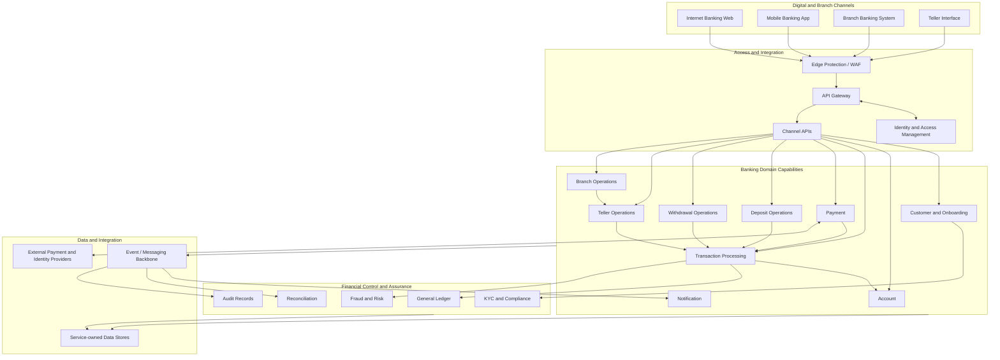

# Baraza Banking Platform
### Enterprise Banking Modernization | Cloud-Native Microservices | Platform Engineering

Baraza is an enterprise banking modernization programme focused on evolving an established production banking system from a legacy monolithic architecture into a secure, resilient, cloud-native microservices platform.

The modernization builds on an existing Baraza banking system that has operated in production at microfinance institutions. The new platform is designed to preserve the banking domain's operational purpose while introducing clearer service boundaries, modern digital channels, independently deployable capabilities, and an automated cloud platform.

This repository contains the application and platform engineering implementation for the modernized Baraza platform. The documentation describes the complete target banking ecosystem and serves as the technical blueprint for its progressive implementation.

---

## Contents

- [Platform Overview](#platform-overview)
- [Modernization Vision](#modernization-vision)
- [Enterprise Target Architecture](#enterprise-target-architecture)
- [Banking Channels](#banking-channels)
- [Banking Domain Capabilities](#banking-domain-capabilities)
- [Financial Integrity and Control](#financial-integrity-and-control)
- [Technology Stack](#technology-stack)
- [Platform Engineering Architecture](#platform-engineering-architecture)
- [Repository Structure](#repository-structure)
- [Application Development](#application-development)
- [Local Development and Verification](#local-development-and-verification)
- [Production Deployment Direction](#production-deployment-direction)
- [Security, Reliability, and Operations](#security-reliability-and-operations)
- [Documentation](#documentation)
- [Implementation Roadmap](#implementation-roadmap)
- [Engineering Principles](#engineering-principles)

---

## Platform Overview

Baraza is designed as a complete banking ecosystem for microfinance institutions and other financial-service providers. It brings together:

- Customer onboarding, identity, and lifecycle management.
- Account management and transaction processing.
- Payment initiation and external payment-provider integration.
- Deposit and withdrawal operations.
- Internet and mobile banking channels.
- Branch banking and teller operations.
- Financial accounting, reconciliation, risk, compliance, and audit capabilities.
- Cloud infrastructure, container orchestration, CI/CD, GitOps, and observability.

The architecture is domain-oriented. Each service owns a defined business capability and its authoritative data. Banking channels consume governed APIs; they do not implement core financial rules or directly manipulate account balances.

The target platform is broader than the services currently represented in the repository. Capabilities are delivered incrementally against the architecture documented here.

## Modernization Vision

The modernization addresses the limitations of a legacy monolithic banking system by moving toward:

1. **Domain separation:** isolate customer, account, transaction, payment, and operational responsibilities behind explicit service contracts.
2. **Channel expansion:** provide consistent banking services through web, mobile, branch, and teller channels.
3. **Financial integrity:** introduce controlled ledger postings, idempotent transaction processing, reconciliation, and auditable financial events.
4. **Operational resilience:** design for failure isolation, controlled retries, recovery, observability, and tested operational procedures.
5. **Secure access:** apply customer and workforce identity, authorization, least privilege, and audit controls throughout the platform.
6. **Independent delivery:** automate application builds, container publishing, infrastructure provisioning, and Kubernetes deployments.
7. **Cloud readiness:** define a production-oriented Kubernetes architecture with Amazon EKS as the intended AWS deployment environment.

## Enterprise Target Architecture

The following diagram presents the intended platform ecosystem and its principal relationships.



This is the target logical architecture. It does not imply that every capability must become an independently deployed microservice. Service boundaries are determined by domain ownership, consistency requirements, operational scale, and the need for independent evolution.

## Banking Channels

| Channel | Purpose |
|---|---|
| Internet Banking Web | Customer web access to accounts, balances, transaction history, transfers, and payments |
| Mobile Banking | Customer banking experience on mobile devices using governed platform APIs |
| Branch Banking | Staff workflows for customer servicing and branch operations |
| Teller Interface | Controlled counter operations, cash transactions, teller sessions, and approvals |

Channel applications are presentation and interaction layers. Authorization and financial rules are enforced by backend services.

Branch deployments may require secure edge capabilities for connectivity-constrained environments. Any offline operation that can affect financial state must use explicit synchronization, conflict handling, and duplicate-prevention controls.

## Banking Domain Capabilities

The target banking domain includes:

| Capability | Primary responsibility |
|---|---|
| Customer and Onboarding | Registration, application review, approval, activation, customer profile and lifecycle |
| Account | Account creation, ownership, status, product association, and account inquiry |
| Transaction Processing | Validation, authorization coordination, transaction state, idempotency, and posting orchestration |
| Payment | Payment initiation, provider adapters, callbacks, status management, and payment references |
| Deposit Operations | Deposit workflows across digital, branch, teller, and supported external channels |
| Withdrawal Operations | Withdrawal validation, limits, authorization, posting, and confirmation |
| Teller Operations | Teller sessions, tills, cash drawers, limits, supervisor approval, and balancing |
| Branch Operations | Branch configuration, staff context, operating controls, and branch reporting |
| Notification | Event-driven email, SMS, and push delivery |

### Financial control and assurance

The broader platform includes the following capabilities:

- **General Ledger:** balanced debit and credit journals, controlled financial postings, immutable posting history, and traceability to originating transactions.
- **Reconciliation:** comparison of internal transactions and ledger records against provider, settlement, and operational records.
- **Fraud and Risk:** transaction risk evaluation, velocity controls, unusual activity detection, and review workflows.
- **KYC and Compliance:** customer due diligence, identity verification, documentation, screening, and risk classification.
- **Audit:** traceable records of financial and security-sensitive actions.
- **Standing Orders and Scheduled Payments:** recurring and future-dated payment instructions.
- **Cash and Vault Management:** branch cash positions, teller cash movements, vault balances, and replenishment controls.
- **Fees, Charges, and Interest:** configurable charges, waivers, interest calculations, and accounting treatment.
- **Customer Service and Disputes:** service requests, complaints, disputes, and investigation workflows.

Deposits and withdrawals are documented as distinct banking operations. Their final implementation boundaries may be workflows within transaction processing or separately deployed services where justified. All financial effects must pass through controlled posting and ledger rules.

## Financial Integrity and Control

Financial integrity is a core platform requirement:

- Financial postings are controlled by the ledger; channel applications never update balances directly.
- Double-entry journal postings must balance.
- Idempotency prevents retries from creating duplicate financial effects.
- Transaction states and permitted transitions are explicit.
- Posted financial records are corrected through traceable reversals or adjustments, not destructive edits.
- Customer, staff, teller, branch, and transaction limits are enforced server-side.
- Correlation and transaction references connect channel requests, service processing, provider responses, and ledger postings.
- Internal records are reconciled with external providers and settlement records.

## Technology Stack

The platform uses the following technology foundation. Exact versions and component status should be maintained in the relevant implementation documentation and repository manifests.

| Area | Technology / Direction |
|---|---|
| Application language | Java 21 |
| Application framework | Spring Boot |
| Build | Maven |
| Frontend | React, TypeScript, Vite |
| Relational data | PostgreSQL |
| Database migrations | Flyway where configured |
| Containerization | Docker |
| Orchestration | Kubernetes |
| Production Kubernetes target | Amazon EKS |
| Application packaging | Helm |
| Infrastructure as Code | Terraform |
| CI/CD | GitHub Actions |
| Container registry | GitHub Container Registry (GHCR) |
| GitOps | Argo CD |
| Observability direction | Prometheus, Grafana, OpenTelemetry, centralized logs and traces |
| Source control | Git and GitHub |

## Platform Engineering Architecture

The application delivery model is designed around automated, traceable changes.

```mermaid
flowchart LR
    SOURCE["Source Changes"] --> GIT["GitHub"]
    GIT --> ACTIONS["GitHub Actions"]
    ACTIONS --> BUILD["Build and Test"]
    BUILD --> QUALITY["Quality and Security Validation"]
    QUALITY --> IMAGE["Versioned Container Image"]
    IMAGE --> GHCR["GHCR"]
    GHCR --> CONFIG["GitOps Configuration"]
    CONFIG --> ARGO["Argo CD"]
    ARGO --> K8S["Kubernetes / Amazon EKS"]
    K8S --> VERIFY["Deployment Verification"]
    VERIFY --> OBS["Metrics, Logs, Traces and Alerts"]
```



### Infrastructure

The intended AWS foundation includes network segmentation, public entry points, private application workloads, protected data services, IAM, load balancing, managed database services, secrets management, and Kubernetes through Amazon EKS.

Terraform defines infrastructure declaratively. Changes are reviewed through plans before they are applied.

### Kubernetes and Helm

Kubernetes manages workload scheduling, service discovery, health checks, configuration, resource controls, scaling, and rolling updates. Helm packages reusable application deployment templates and environment-specific values.

### CI/CD and GitOps

GitHub Actions provides the source-driven build and validation workflow. Versioned images are published to the container registry. Argo CD reconciles the desired Kubernetes state declared in Git.

### Observability

The target observability model combines infrastructure and application metrics, structured logs, distributed traces, Kubernetes events, and business-level operational signals. Dashboards and alerts should support both technical diagnosis and banking operations.

## Repository Structure

The repository is organized around independently maintained application and platform components. The exact tree evolves as capabilities are added.

```text
baraza-banking-platform/
├── applications/
│   ├── customer-service/
│   ├── account-service/
│   ├── transaction-service/
│   ├── notification-service/
│   ├── baraza-payment/
│   └── internet-banking-web/
├── infrastructure/
│   └── terraform-aws/
├── docs/
│   ├── architecture.md
│   ├── platform-overview.md
│   ├── database.md
│   ├── docker.md
│   ├── kubernetes.md
│   ├── helm.md
│   ├── terraform.md
│   ├── ci-cd.md
│   ├── gitops-argocd.md
│   ├── security.md
│   ├── monitoring.md
│   ├── operations.md
│   ├── troubleshooting.md
│   └── runbooks/
├── .github/
│   └── workflows/
└── README.md
```

The tree is a guide to the repository's organization, not a guarantee that every future service or documentation file already exists.

## Application Development

Backend services are built with Java, Spring Boot, and Maven. The Internet Banking Web application is built with React, TypeScript, and Vite.

Typical backend validation from a service directory:

```powershell
mvn clean test
mvn clean package
```

Build the frontend from its application directory using the repository's package scripts:

```powershell
npm install
npm run build
```

Application-specific setup, configuration, and test instructions belong in the relevant service documentation.

## Local Development and Verification

Local environments are used for development, integration, and verification. They are not the production architecture.

Typical workstation tools include Java 21, Maven, Node.js/npm, Docker, kubectl, Helm, and a local Kubernetes environment where required.

Verify installed tools:

```powershell
java -version
mvn -version
node --version
npm --version
docker version
kubectl version --client
helm version
```

For local Kubernetes work, verify the active context and cluster before applying changes:

```powershell
kubectl config current-context
kubectl get nodes
kubectl get namespaces
```

Build a backend service image from its application directory:

```powershell
docker build -t baraza-service:dev .
docker images
```

Inspect Kubernetes workloads in the namespace used by the deployment:

```powershell
kubectl get deployments,pods,services -n baraza-banking
kubectl get events -n baraza-banking --sort-by=.metadata.creationTimestamp
```

The exact namespace, chart path, image name, and environment values must be taken from the relevant deployment configuration. Do not assume that one command or chart path applies to every service.

Detailed workstation and service procedures are maintained under [docs](docs/).

## Production Deployment Direction

Amazon EKS is the intended AWS production Kubernetes environment. The target production topology separates public ingress, private application workloads, and protected data services across appropriate network boundaries.

A conceptual deployment path is:

```text
Customers and Staff
        |
        v
DNS / Edge Protection / Load Balancing
        |
        v
API Gateway and Ingress
        |
        v
Amazon EKS Private Workloads
        |
        +---- Banking Domain Services
        |
        +---- Integration and Event Processing
        |
        v
Protected Data Services
        |
        +---- PostgreSQL
        +---- Ledger and Audit Data
```

Production readiness also requires tested database recovery, secrets management, access controls, availability design, capacity planning, monitoring, incident response, and disaster recovery procedures. Cloud deployment and production operation must be supported by deployed infrastructure and verification evidence; architecture documentation alone does not imply that an environment is already running.

## Security, Reliability, and Operations

The platform is designed to apply security and reliability controls across the full request and delivery lifecycle.

**Security**
- Customer and workforce authentication and authorization.
- Role-based and contextual access controls.
- Least-privilege service identities and cloud IAM.
- Encryption in transit and at rest.
- Secrets management and credential rotation.
- Network segmentation and restricted service communication.
- Container, dependency, and software supply-chain security.
- Protected audit trails and controlled administrative access.

**Reliability**
- Health checks and readiness-based traffic routing.
- Resource requests, limits, and workload scaling policies.
- Timeouts, bounded retries, circuit breakers, and idempotency.
- Graceful startup and shutdown.
- Database backup and tested restoration.
- Deployment rollback and configuration recovery.
- Defined recovery time and recovery point objectives.

**Operations**
- Metrics, structured logs, distributed traces, and correlation identifiers.
- Business signals such as payment outcomes, transaction failures, reconciliation exceptions, and teller balancing differences.
- Actionable alerts linked to operational runbooks.
- Controlled release, incident, change, and recovery processes.

Regulatory obligations depend on the institution, jurisdiction, payment methods, and deployment context. Applicable requirements must be assessed and validated rather than assumed.

## Documentation

The README is the entry point to the platform. Detailed technical and operational material is maintained in the `docs/` directory.

| Document | Coverage |
|---|---|
| [Platform Overview](docs/platform-overview.md) | Platform purpose, target capabilities, engineering principles |
| [Architecture](docs/architecture.md) | Service boundaries, interactions, workflows, and deployment architecture |
| [Database](docs/database.md) | Data ownership, schemas, migrations, and financial data integrity |
| [Workstation Setup](docs/workstation-setup.md) | Development environment prerequisites and setup |
| [Docker](docs/docker.md) | Container builds, runtime, and image conventions |
| [Kubernetes](docs/kubernetes.md) | Cluster resources, workload management, and networking |
| [Helm](docs/helm.md) | Charts, templates, and environment values |
| [Terraform](docs/terraform.md) | AWS infrastructure as code |
| [CI/CD](docs/ci-cd.md) | Build, test, validation, and image publishing |
| [GitOps and Argo CD](docs/gitops-argocd.md) | Desired state, synchronization, and drift management |
| [Security](docs/security.md) | Application, container, Kubernetes, and cloud security |
| [Monitoring](docs/monitoring.md) | Metrics, logs, traces, dashboards, and alerts |
| [Operations](docs/operations.md) | Operational standards and service management |
| [Troubleshooting](docs/troubleshooting.md) | Diagnostic procedures |
| [Deployment Runbook](docs/runbooks/deployment.md) | Deployment procedure |
| [Rollback Runbook](docs/runbooks/rollback.md) | Release rollback and recovery |
| [Image Management Runbook](docs/runbooks/image-management.md) | Image lifecycle and registry operations |
| [Kubernetes Debugging Runbook](docs/runbooks/kubernetes-debugging.md) | Workload and cluster diagnostics |

Some linked documents are being developed as part of the documentation programme.

## Implementation Roadmap

The target architecture is delivered incrementally. The roadmap groups work by business capability and engineering foundation; it is not a claim that every target capability is already deployed.

### Banking capabilities
- Customer onboarding, authentication, approval, and lifecycle.
- Account management and account access controls.
- Transaction processing and financial state management.
- Payment integration and provider callback handling.
- Internet Banking Web.
- Notification delivery.
- Mobile Banking channel.
- Branch Banking and teller workflows.
- Deposit and withdrawal operations.
- General Ledger and controlled financial posting.
- Reconciliation, fraud and risk, KYC/compliance, and audit.
- Additional banking operations such as scheduled payments, fees, interest, and cash management.

### Platform engineering
- Standardized container builds and image lifecycle.
- Kubernetes workload hardening and reusable Helm charts.
- CI quality gates, automated tests, and security validation.
- GitOps application definitions and environment promotion.
- AWS network and EKS infrastructure through Terraform.
- Managed database strategy, backup, and recovery.
- Metrics, dashboards, centralized logging, tracing, and alerting.
- Performance, resilience, security, and disaster recovery validation.

Implementation status and supporting evidence should be maintained in service-specific documentation and release records as work is completed.

## Engineering Principles

1. **Banking domain integrity:** business rules belong to their domain services and financial postings are controlled and auditable.
2. **Clear ownership:** services own their data and expose explicit contracts.
3. **Secure by design:** identity, authorization, encryption, and least privilege are built into each layer.
4. **Resilience:** failures are expected and handled through bounded retries, isolation, and recovery.
5. **Automation:** repeatable build, test, infrastructure, and deployment activities are automated.
6. **Declarative operations:** infrastructure and deployment intent are version-controlled.
7. **Observability:** technical and business behavior can be measured and investigated.
8. **Controlled change:** changes are reviewed, traceable, verifiable, and recoverable.
9. **Evolvability:** capabilities can be extended without recreating a tightly coupled monolith.

---

**Baraza Banking Platform**  
*Modernizing established banking operations through domain-driven services, secure digital channels, and cloud-native platform engineering.*
