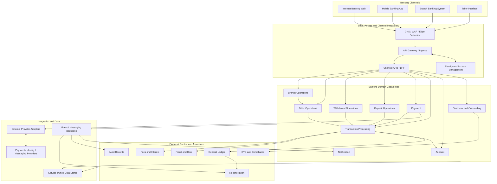
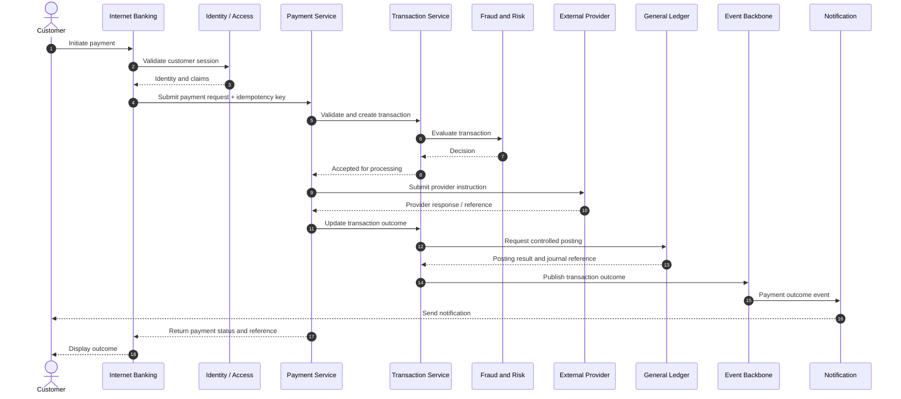
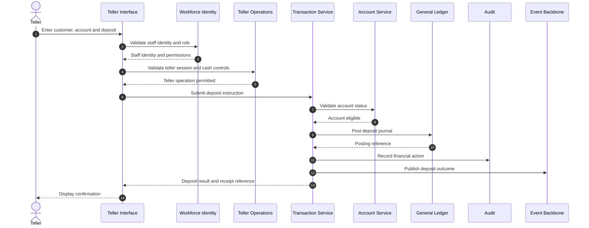
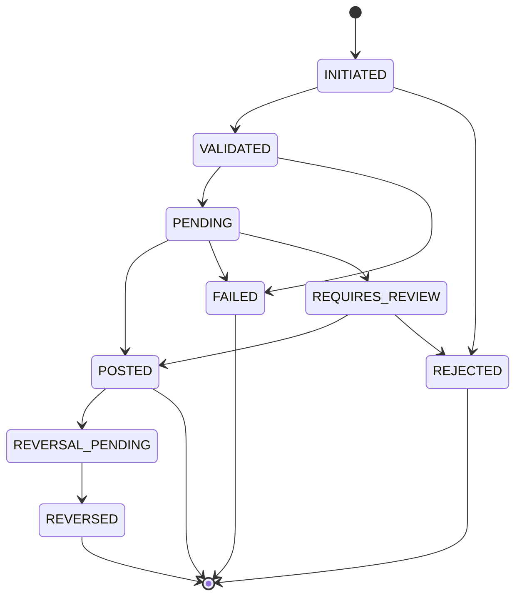
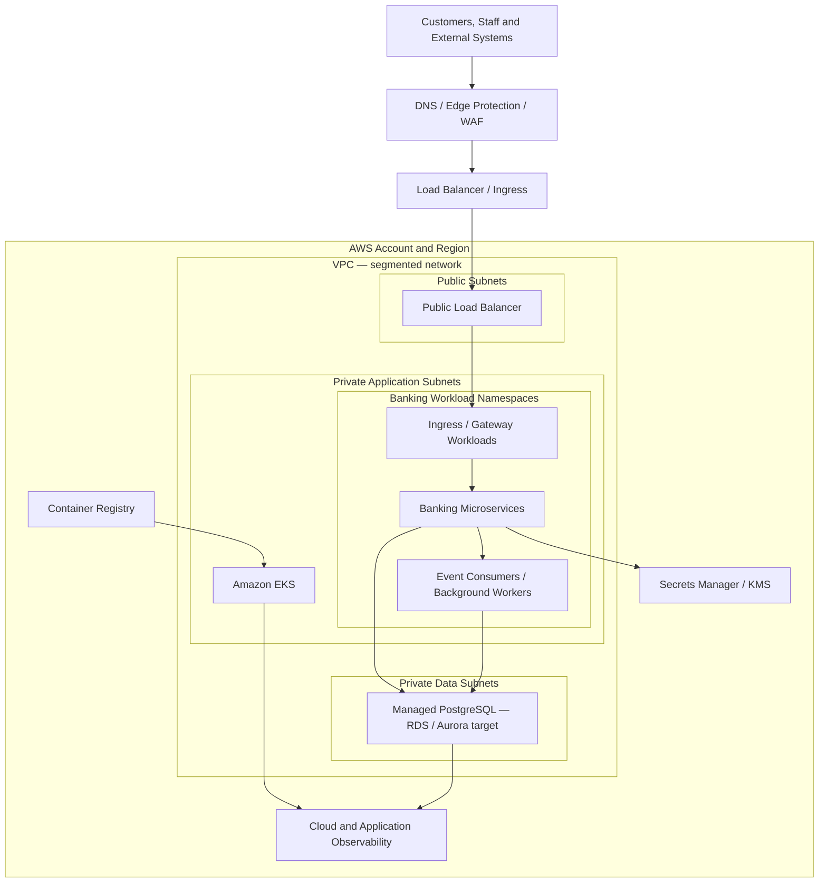
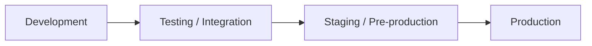

# Baraza Banking Platform — System Architecture

## 1. Purpose and Scope

This document defines the logical, application, integration, data, security, deployment, and operational architecture of the Baraza Banking Platform.

Baraza is a banking modernization programme evolving an established production monolithic banking system into a cloud-native platform built around well-defined banking domains, secure digital channels, and independently deployable application capabilities.

The architecture covers the complete target banking ecosystem:

- Customer onboarding and lifecycle management.
- Account management and financial transaction processing.
- Payment integration and payment lifecycle management.
- Deposit and withdrawal operations.
- Internet and mobile banking.
- Branch banking and teller operations.
- General ledger, reconciliation, fraud and risk, KYC and compliance, audit, and operational controls.
- Cloud infrastructure, Kubernetes orchestration, automated delivery, GitOps, and observability.

This is the target system architecture and engineering blueprint. Capabilities are implemented progressively. The architecture describes the intended system behavior and boundaries; implementation evidence and environment-specific details belong in service documentation, deployment manifests, and operational records.

## 2. Modernization Context

The existing Baraza banking system has operated in production at microfinance institutions using a legacy monolithic architecture. The modernization programme retains the banking domain purpose while redesigning the application and platform architecture.

The modernization is intended to address the constraints associated with a tightly coupled monolith:

- Changes to one capability can affect unrelated banking functions.
- Scaling is tied to the application as a whole rather than individual workloads.
- Release coordination can become complex as the system grows.
- Integration boundaries and ownership can be difficult to evolve independently.
- Modern digital channels and external integrations require clearer, governed interfaces.
- Operational visibility, automation, and recovery need to be designed across the platform.

The target architecture introduces domain-oriented services, explicit APIs and events, controlled financial posting, independently deployable workloads, and an automated cloud platform.

The modernization is not a one-to-one conversion of every legacy module into a microservice. Service boundaries are selected according to business ownership, consistency, security, deployment, and operational requirements.

## 3. Architectural Drivers

| Driver | Architectural response |
|---|---|
| Banking integrity | Ledger-controlled posting, idempotency, traceable transaction state, and reconciliation |
| Multiple banking channels | Shared domain APIs with channel-specific presentation and experience |
| Customer lifecycle | Controlled onboarding, identity verification, approval, activation, and access management |
| External payment integration | Provider adapters, authenticated callbacks, durable references, and idempotent processing |
| Operational independence | Domain ownership and independently deployable services where justified |
| Resilience | Health-based traffic management, bounded retries, failure isolation, recovery, and observability |
| Security | Strong identity, authorization, encryption, least privilege, and audit |
| Delivery speed | Automated builds, tests, image publishing, infrastructure as code, and GitOps |
| Cloud operation | Kubernetes orchestration with Amazon EKS as the intended AWS production environment |
| Evolvability | Versioned contracts, controlled data ownership, and extensible domain capabilities |

## 4. Architecture at a Glance

Baraza is organized into six logical layers:

1. **Channels:** Internet Banking Web, Mobile Banking, Branch Banking, and Teller Interface.
2. **Edge and access:** DNS, edge protection, API gateway/ingress, identity, authorization, and channel APIs.
3. **Banking domain:** Customer, Account, Transaction, Payment, Deposit, Withdrawal, Teller, Branch, and Notification capabilities.
4. **Financial control:** General Ledger, Reconciliation, Fraud and Risk, KYC and Compliance, Audit, Fees, and other financial controls.
5. **Integration and data:** service-owned data stores, event/messaging backbone, and external provider adapters.
6. **Platform engineering:** cloud networking, Kubernetes/EKS, containers, Helm, Terraform, CI/CD, GitOps, secrets, and observability.

## 5. Enterprise Logical Architecture

The diagram below represents the complete target platform. It is a logical view: a capability may be implemented within an existing service or as a separately deployed service depending on domain and operational requirements.

### 5.1 Architectural interpretation

- Channels present workflows and collect user input; they do not own core banking rules.
- The gateway and identity layer provide controlled access to backend capabilities.
- Domain services own business rules and authoritative data for their domains.
- Transaction processing coordinates financial workflows.
- The ledger controls accounting postings and financial journal integrity.
- Provider adapters isolate external protocols and credentials.
- Events decouple non-blocking work such as notifications, audit processing, and reconciliation.
- The platform layer supplies the runtime, delivery automation, security controls, and operational visibility.

## 6. Banking Channels

### 6.1 Internet Banking Web

Internet Banking Web is the browser-based customer channel. It provides customer access to banking services through authenticated backend APIs.

Target capabilities include:

- Customer registration and application submission.
- Secure customer sign-in and session/token handling.
- Customer dashboard and account overview.
- Account details and available balance inquiry.
- Transaction history and transaction status.
- Transfer and payment initiation.
- Customer profile and service requests.
- Clear transaction references and outcome information.

The web application is not an authority for account balances, customer eligibility, transaction authorization, or payment status. Those decisions are enforced by backend services.

### 6.2 Mobile Banking

Mobile Banking provides customer access through mobile devices. It shares the platform's customer, identity, account, transaction, and payment capabilities.

Mobile-specific concerns include device registration, secure token storage, device/session management, application attestation where appropriate, push notifications, and mobile-specific API composition.

The mobile application is a channel, not necessarily a separate core banking microservice. A mobile backend-for-frontend may be introduced where it provides a justified boundary for channel-specific aggregation or security.

### 6.3 Branch Banking System

Branch Banking supports staff workflows within physical branches. It provides controlled access to customer servicing, account operations, transaction initiation, branch controls, and operational reporting.

The target architecture supports centrally governed APIs and branch-aware authorization. Where branch connectivity is constrained, a branch edge component may support explicitly approved local functions and secure synchronization.

Offline financial posting requires particular care. The system must define which actions may be queued, how authorization is retained, how conflicts are resolved, and how duplicate financial effects are prevented when connectivity returns. Offline capability must never silently bypass central ledger controls.

### 6.4 Teller Interface

The Teller Interface is the staff-facing channel for counter operations. It supports customer identification, account lookup, deposit and withdrawal initiation, receipt/reference presentation, cash operations, and supervisor approval workflows.

The interface communicates with Teller Operations and the core transaction workflow. It does not independently update customer balances or post accounting entries.

## 7. Identity, Access and API Entry

### 7.1 Identity domains

The platform distinguishes customer identities from workforce identities. Customer access and staff access have different lifecycle, assurance, role, and approval requirements.

The identity architecture covers:

- Customer registration and activation.
- Staff provisioning and deactivation.
- Authentication and token/session lifecycle.
- Role-based authorization and contextual access checks.
- Customer-to-account ownership validation.
- Staff role, branch, and teller context.
- Privileged and administrative access controls.

A valid token alone does not grant access to every resource. Services must validate the caller's permissions and the caller's relationship to the requested customer, account, branch, or transaction.

### 7.2 API gateway and ingress

The gateway/ingress layer provides controlled HTTP entry into the platform. Responsibilities may include TLS termination, routing, request size limits, rate limiting, authentication integration, and edge-level protection.

The gateway does not replace authorization inside domain services. Sensitive banking operations must enforce authorization and business rules at the service that owns the capability.

### 7.3 Channel APIs

Channel APIs or backend-for-frontend components compose responses for web, mobile, and staff channels where needed. They should avoid duplicating core domain logic or becoming an uncontrolled orchestration layer.

## 8. Banking Domain Services

### 8.1 Customer and Onboarding

Owns customer records and the customer lifecycle, including registration, application submission, review, approval, rejection, activation, profile maintenance, and status management.

Customer onboarding integrates with KYC and compliance controls. The platform applies eligibility and approval rules before granting access to banking capabilities.

### 8.2 Account

Owns account records and account lifecycle operations, including account creation, ownership, account status, product association, and account inquiries.

Account rules govern whether an account is open, restricted, dormant, frozen, or otherwise eligible for a requested operation. Account data is accessed through service contracts rather than direct writes by other services.

### 8.3 Transaction Processing

Coordinates the lifecycle of financial transactions. Responsibilities include request validation, authorization coordination, transaction references, state transitions, idempotency, posting coordination, and transaction status.

The transaction domain coordinates with account, payment, risk, and ledger capabilities. It must handle retries, timeouts, duplicate submissions, asynchronous provider responses, and reversal workflows safely.

### 8.4 Payment

Owns payment initiation and the payment lifecycle across supported internal and external payment methods.

Responsibilities include payment validation, provider selection, provider request/response mapping, callback handling, status transitions, reference management, timeout handling, and idempotency.

Provider-specific protocols are isolated behind adapters. A provider callback must be authenticated, correlated to the original request, validated, and processed safely even if it is delivered more than once.

### 8.5 Deposit Operations

Coordinates deposit use cases across applicable channels. A deposit request is validated, authorized, assigned a unique reference, processed through the transaction workflow, and recorded through the ledger.

Deposit channels may include teller cash deposits, branch-assisted deposits, digital deposits where supported, and deposits originating from integrated payment providers.

### 8.6 Withdrawal Operations

Coordinates withdrawal use cases, including account eligibility, available-funds checks, transaction limits, authorization, posting, and confirmation.

Cash withdrawals require teller and branch context, cash availability controls, and supervisor approval where policy requires it. Digital withdrawals and transfers follow the relevant channel, payment, and risk controls.

### 8.7 Teller Operations

Owns teller-specific controls such as teller identity and sessions, assigned tills or cash drawers, opening float, cash movements, transaction limits, supervisor overrides, cash position, and end-of-day balancing.

Teller Operations coordinates with Branch, Account, Transaction, and Ledger capabilities. It does not bypass the financial posting workflow.

### 8.8 Branch Operations

Owns branch identity, branch configuration, staff assignments, operating controls, branch-level limits, and branch reporting context.

Branch context is used in authorization, audit, cash management, and operational reporting where relevant.

### 8.9 Notification

Delivers customer and staff notifications triggered by platform events. Delivery channels may include SMS, email, and mobile push.

Notification delivery is decoupled from the critical financial posting path. Provider failures or delayed delivery must not reverse or invalidate a committed banking transaction. Delivery attempts and outcomes are traceable.

## 9. Financial Control and Assurance Services

### 9.1 General Ledger

The General Ledger is the authoritative accounting record for financial postings. It maintains balanced debit and credit journals and supports customer balances, internal accounts, fees, settlement, and financial reporting.

Ledger controls include:

- Balanced journal entries.
- Immutable posted journal history.
- Unique posting references and idempotent posting requests.
- Explicit accounting periods and posting rules.
- Traceability to the originating business transaction.
- Controlled reversals and adjustment entries.
- Segregation of duties for sensitive accounting operations.

A transaction is not considered financially posted merely because a channel request was accepted. Its financial outcome must be represented by the appropriate ledger posting state.

### 9.2 Reconciliation

Reconciliation compares internal transaction and ledger records with external provider, settlement, bank, and operational records. It identifies missing, duplicated, delayed, or mismatched entries and supports controlled investigation and resolution.

### 9.3 Fraud and Risk

Fraud and Risk evaluates customer and transaction activity against configurable controls. These may include transaction velocity, thresholds, unusual activity indicators, risk scoring, watchlists, and review or hold workflows.

Risk decisions must be explainable, attributable, and auditable. High-risk decisions may require synchronous checks; broader behavioral analysis may run asynchronously.

### 9.4 KYC and Compliance

KYC and Compliance manages due diligence, identity verification, customer documentation, screening outcomes, risk classification, periodic review, and evidence retention.

Policy requirements vary by institution and jurisdiction and must be configured and validated against applicable obligations.

### 9.5 Audit

Audit captures security-sensitive and financially significant actions, including the actor, action, affected resource, timestamp, channel, correlation or transaction reference, and outcome.

Audit history must be protected against unauthorized alteration and retained under approved institutional and regulatory policies.

### 9.6 Additional financial capabilities

The target domain may also include Fees and Charges, Interest and Accruals, Standing Orders and Scheduled Payments, Cash and Vault Management, Customer Service and Disputes, and Regulatory Reporting.

These capabilities should become separate services only where independent domain ownership, scaling, security, or release requirements justify that separation.

## 10. Core Financial Processing

### 10.1 Principles

All financial workflows follow these principles:

1. Financial effects are posted through controlled ledger operations.
2. Journal entries balance debits and credits.
3. Idempotency prevents duplicate effects from retries or repeated callbacks.
4. Transaction states and permitted transitions are explicit.
5. Posted records are corrected through reversals or adjustments, not destructive edits.
6. Limits and authorization are enforced server-side.
7. Correlation identifiers connect requests, service calls, events, provider messages, and postings.
8. Reconciliation detects differences between internal and external records.

### 10.2 Example: customer payment flow

This sequence is a target workflow. Exact synchronous/asynchronous boundaries, pending states, settlement behavior, and posting timing depend on the payment rail and provider contract. A provider acceptance response must not be confused with final settlement unless the provider's contract defines it that way.

### 10.3 Example: teller cash deposit

The final accounting entries depend on the institution's chart of accounts and cash-handling policy. The ledger posting model must define the appropriate debit and credit accounts.

### 10.4 Transaction state and idempotency

The transaction lifecycle must distinguish request acceptance from financial completion. A conceptual lifecycle is:

The exact state machine is defined by transaction type. Not every transaction uses every state. State changes must be validated and persisted with timestamps, actor/system identity, reason, and correlation references.

Idempotency keys are scoped to the initiating client or operation and retained for a defined period. Reusing a key with a materially different request must be rejected. Provider callbacks and event consumers must also be idempotent.

## 11. Service Integration Architecture

### 11.1 Synchronous integration

REST APIs are appropriate when a caller requires an immediate validation or response. Examples include account inquiry, customer authorization checks, transaction initiation, and provider request submission.

Synchronous calls must use explicit timeouts, bounded retries where safe, and clear error contracts. A retry must not repeat a non-idempotent financial effect.

### 11.2 Asynchronous integration

Events are appropriate for decoupled work such as notification delivery, audit processing, reconciliation feeds, reporting, and selected long-running workflows.

Events should include:

- Unique event identifier.
- Event type and schema version.
- Occurrence timestamp.
- Aggregate or business reference.
- Correlation and causation identifiers where applicable.
- Payload appropriate to the consumer's need, without unnecessary sensitive data.

Consumers must tolerate duplicate delivery and out-of-order arrival where the event contract permits it. Durable publication patterns, such as an outbox, should be considered for events that must not be lost after a database commit.

### 11.3 External provider integration

External providers are integrated through adapters that isolate provider-specific authentication, protocols, payload formats, error codes, callback semantics, and rate limits.

The integration layer must support credential protection, callback authentication, signature validation where available, idempotency, timeout handling, reconciliation, and provider-specific operational monitoring.

## 12. Data Architecture and Ownership

### 12.1 Service ownership

Each domain service is authoritative for its own business data. Other services consume that data through APIs or events rather than directly updating another service's tables.

The target model favors database-per-service ownership. Physical deployment may use separate database instances or isolated databases/schemas according to operational scale and environment, but logical ownership remains explicit.

### 12.2 Data domains

| Domain | Authoritative data examples |
|---|---|
| Customer | Customer profile, onboarding application, lifecycle status |
| Account | Account identity, ownership, product, status and account controls |
| Transaction | Transaction request, state, references, processing history |
| Payment | Payment instruction, provider reference, callback and payment status |
| Teller / Branch | Teller sessions, till assignments, branch configuration and cash controls |
| Ledger | Journal, journal lines, posting references, accounting periods |
| Reconciliation | Reconciliation batches, matched items, exceptions and resolutions |
| Risk / KYC | Risk assessments, due diligence records, screening and review evidence |
| Audit | Actor, action, resource, timestamp, outcome and trace references |
| Notification | Delivery request, channel, provider response, retry and delivery status |

The detailed database document defines the implemented schemas, migrations, constraints, and relationships. This architecture table describes ownership domains, not a claim that every listed schema has already been created.

### 12.3 Consistency

Within a service boundary, database transactions enforce local consistency. Cross-service business workflows use explicit orchestration, events, and compensating actions where a distributed transaction is not appropriate.

Financial posting requires particularly strict controls. The platform must define when a transaction becomes final, how ledger posting is retried safely, and how failures between services are recovered.

## 13. Deployment Architecture

### 13.1 Production target on AWS

Amazon EKS is the intended AWS production Kubernetes environment. The production topology separates public ingress, private application workloads, and protected data services.

The production design must define availability zones, routing, NAT/egress, private endpoint access, security groups, network policies, database connectivity, secrets access, encryption, backups, and disaster recovery. These details are specified in the infrastructure and security documentation.

This is the intended production topology. It should not be interpreted as evidence that an AWS EKS environment has already been provisioned.

### 13.2 Kubernetes workload model

Kubernetes provides workload scheduling, service discovery, replica management, health-based traffic routing, rolling updates, resource controls, and autoscaling.

Application workloads are packaged as containers and deployed through Helm charts. Kubernetes resources may include:

- Namespaces and service accounts.
- Deployments and Pods.
- Services and Ingress/Gateway resources.
- ConfigMaps and Secrets references.
- Resource requests and limits.
- Startup, readiness, and liveness probes.
- Horizontal Pod Autoscalers.
- Network Policies and RBAC.
- Persistent volumes only where stateful workloads require them.

Stateful financial data should use an appropriate database platform and backup/recovery strategy rather than relying on application Pod storage.

### 13.3 Environment model

The intended promotion path separates development, testing, staging, and production configuration.

The same immutable image should be promoted across environments where practical. Environment-specific configuration, secrets, scaling, and infrastructure settings are supplied separately.

### 13.4 Local development

Local Docker and Kubernetes environments are used for development and verification. Minikube is a local Kubernetes option; it is not the production architecture or the defining architecture of Baraza.

Local environment instructions belong in the workstation setup and Kubernetes documentation.

## 14. Container and Application Packaging

Backend services are packaged as container images. The frontend is built as a web application artifact and delivered through the selected hosting or edge platform.

Container build principles include:

- Reproducible builds and pinned dependencies where practical.
- Minimal runtime images.
- Non-root execution.
- Health endpoints and graceful shutdown.
- Explicit ports and environment configuration.
- No embedded credentials or environment-specific secrets.
- Versioned tags and immutable digests.
- Vulnerability and provenance checks in the delivery pipeline.

Helm charts provide reusable Kubernetes manifests and environment-specific values. Charts should define probes, resource controls, security context, service configuration, and deployment strategy consistently.

## 15. CI/CD and GitOps Architecture

The target delivery pipeline separates source validation, artifact creation, and environment reconciliation.

### 15.1 Continuous integration

CI validates source changes through compilation, automated tests, code quality checks, dependency checks, and container build validation. Image publication occurs only after the required checks pass.

### 15.2 Artifact management

Images are tagged with traceable version information and referenced by immutable digest for controlled deployment. Credentials for registry access are managed securely.

### 15.3 GitOps delivery

GitOps configuration declares the desired deployment state. Argo CD continuously compares the declared state with the cluster and reconciles permitted differences.

Application source and deployment configuration may be maintained in separate repositories. The relationship between image versions and GitOps revisions must remain traceable.

### 15.4 Release safety

Release controls include health verification, progressive rollout where appropriate, rollback procedures, and clear ownership of production approvals. Database changes require backward-compatible migration planning because application rollback does not automatically reverse schema changes.

## 16. Security Architecture

Security is applied across identity, application APIs, service communication, containers, Kubernetes, cloud infrastructure, and operations.

### 16.1 Identity and authorization

- Separate customer and workforce identity lifecycles.
- Strong authentication and secure token/session handling.
- Role-based and contextual authorization.
- Customer-to-account ownership checks.
- Staff, teller, branch, and supervisor permissions.
- Least-privilege service identities.
- Privileged access controls and audit.

### 16.2 Application and API security

- Server-side authorization for every protected operation.
- Input validation and safe error handling.
- TLS for external and internal connections as required by the threat model.
- Rate limiting and abuse protection.
- Secure callback authentication and signature validation where supported.
- Sensitive-data minimization and masking in logs.
- Dependency and software supply-chain controls.

### 16.3 Container and Kubernetes security

- Non-root containers and restricted capabilities.
- Image scanning and trusted image sources.
- Kubernetes RBAC and service accounts with least privilege.
- Network policies and workload isolation.
- Secrets references rather than plaintext credentials in Git.
- Resource quotas, limits, and admission controls where appropriate.
- Controlled cluster administration and audit logging.

### 16.4 Cloud security

- Segmented VPC networking.
- Private application and data services.
- IAM roles and short-lived credentials.
- Encryption at rest and in transit.
- Managed secrets and key management.
- Centralized security logging and alerting.
- Backup protection and recovery access controls.

## 17. Reliability and Resilience

Reliability is an end-to-end property, not simply the presence of multiple Pods.

The architecture considers:

- Multiple replicas for stateless services where availability requires them.
- Health checks and readiness-based traffic management.
- Resource requests, limits, and autoscaling policies.
- Graceful shutdown and startup behavior.
- Timeouts, bounded retries, circuit breakers, and bulkheads.
- Durable event publication and idempotent consumers.
- Database availability, connection management, backups, and restore testing.
- Safe deployment and rollback procedures.
- Defined recovery time objective (RTO) and recovery point objective (RPO).
- Disaster recovery across appropriate failure domains.

A service must not retry a financial operation blindly. Retry behavior must account for idempotency, transaction state, and the possibility that a downstream system completed an operation but its response was lost.

## 18. Observability Architecture

Observability combines infrastructure telemetry, application telemetry, and business-level signals.

### 18.1 Metrics

Examples include request rate, latency, error rate, JVM/process health, database connection usage, queue depth, consumer lag, pod restarts, and resource utilization.

### 18.2 Logs

Services emit structured logs with timestamps, severity, service identity, correlation identifiers, and relevant outcome fields. Sensitive customer, credential, and payment data must not be logged in plaintext.

### 18.3 Distributed tracing

Trace context follows requests across gateways, services, provider adapters, and asynchronous consumers. This allows operators to investigate latency and failures across service boundaries.

### 18.4 Banking operational signals

Business dashboards should include payment outcomes, transaction failures, pending transactions, ledger posting exceptions, reconciliation differences, teller cash differences, and notification delivery failures.

Alerts must be actionable, routed to an accountable team, and linked to runbooks.

## 19. Failure Handling and Recovery

### 19.1 Workload failure

Kubernetes replaces failed Pods according to the declared workload state. Readiness probes prevent unready workloads from receiving traffic; liveness probes detect processes that require restart. Startup probes protect slow-starting applications from premature liveness failures.

Pod replacement does not recover lost in-memory work or guarantee business transaction completion. Durable state, idempotency, and recovery workflows are required.

### 19.2 Dependency failure

Service-to-service calls use explicit timeouts and bounded retry policies. Circuit breakers and bulkheads may isolate unstable dependencies. Failures are surfaced with correlation identifiers and actionable metrics.

### 19.3 Payment provider timeout

A provider timeout is an uncertain outcome, not proof that the provider rejected the payment. The payment remains in a defined pending or investigation state until the result is confirmed through callback, status inquiry, or reconciliation. Re-submission must use provider-supported idempotency or reference controls.

### 19.4 Database failure

Database recovery depends on the selected database service, backup configuration, replication, and recovery objectives. Restore procedures must be tested. Application retries must be bounded to avoid amplifying database outages.

### 19.5 Release failure

A failed release is handled through rollout health checks and a documented rollback or forward-fix decision. Database migrations must be designed for safe coexistence of application versions where rollback may be required.

## 20. Scalability and Performance

The platform supports horizontal scaling for stateless application workloads. Scaling decisions consider more than CPU and memory: request latency, concurrency, queue depth, provider rate limits, database connection capacity, and transaction throughput may also be relevant.

Performance engineering includes:

- Capacity and load testing for critical banking workflows.
- Database query and index analysis.
- Connection pool sizing and backpressure.
- Queue partitioning and consumer concurrency where applicable.
- Caching only where consistency and invalidation behavior are understood.
- Rate limits and provider-specific throttling.
- Load shedding and graceful degradation for non-critical functions.

Scaling an application tier without scaling or protecting its dependencies can move the bottleneck to the database or an external provider. Capacity planning therefore considers the full request path.

## 21. Branch and Edge Architecture Considerations

Branch banking introduces connectivity, device, physical cash, and operational concerns not present in a purely digital channel.

The target branch model must address:

- Secure branch identity and device trust.
- Staff authentication and branch-scoped authorization.
- Network segmentation and secure connectivity to central services.
- Teller session and cash drawer controls.
- Local service continuity requirements.
- Queueing and synchronization rules for approved offline workflows.
- Conflict detection and duplicate prevention.
- Reconciliation of branch activity after connectivity recovery.
- Central audit visibility and controlled administrative support.

Offline behavior must be specified per operation. Read-only customer/account information, queued service requests, and cash transactions have different risk profiles. No offline workflow should create an untraceable or duplicate financial posting.

## 22. Architecture Decisions and Trade-offs

| Decision area | Architectural position | Reasoning |
|---|---|---|
| Monolith modernization | Decompose by banking domain, not by technical layer | Preserves business ownership and reduces accidental coupling |
| Service boundaries | Create services where independent ownership and lifecycle justify them | Avoids unnecessary microservice proliferation |
| Deposit and withdrawal | Model as explicit banking operations; deploy separately only if justified | They share transaction and ledger controls |
| Mobile banking | Treat as a channel using shared APIs | Avoids duplicating core banking logic |
| Teller | Separate staff channel and teller operational domain | Teller sessions, cash controls, and approvals have distinct rules |
| Financial accounting | Centralize authoritative journal posting in the ledger domain | Protects double-entry integrity and auditability |
| Integration | Combine synchronous APIs with asynchronous events | Supports immediate validation and decoupled processing |
| Data ownership | Service-owned data and contracts | Reduces cross-service database coupling |
| Orchestration | Kubernetes with EKS as AWS production target | Supports managed container orchestration |
| Infrastructure | Terraform | Makes infrastructure declarative and reviewable |
| Delivery | GitHub Actions plus GitOps/Argo CD | Separates build validation from deployment reconciliation |
| Local Kubernetes | Development and verification only | Keeps local tooling distinct from production topology |

## 23. Architecture Governance

Architecture changes should be reviewed for:

- Banking domain ownership and service boundaries.
- Data authority and consistency implications.
- Financial posting, reversal, and reconciliation behavior.
- Authentication, authorization, and audit impact.
- API and event contract compatibility.
- Failure modes, retry safety, and recovery behavior.
- Performance, scaling, and provider limits.
- Operational ownership, monitoring, and runbook coverage.
- Infrastructure cost, security, and deployment impact.

Significant decisions should be captured as Architecture Decision Records (ADRs), including context, options considered, decision, consequences, and date.

## 24. Related Documentation

- [Platform Overview](platform-overview.md)
- [Database Architecture](database.md)
- [Workstation Setup](workstation-setup.md)
- [Docker](docker.md)
- [Kubernetes](kubernetes.md)
- [Helm](helm.md)
- [Terraform](terraform.md)
- [CI/CD](ci-cd.md)
- [GitOps and Argo CD](gitops-argocd.md)
- [Security](security.md)
- [Monitoring](monitoring.md)
- [Operations](operations.md)
- [Troubleshooting](troubleshooting.md)
- [Deployment Runbook](runbooks/deployment.md)
- [Rollback Runbook](runbooks/rollback.md)
- [Kubernetes Debugging Runbook](runbooks/kubernetes-debugging.md)

## 25. Architecture Summary

Baraza is designed as a complete banking platform in which multiple customer and staff channels use governed domain services. Transaction processing coordinates business workflows, while the General Ledger controls financial postings. Provider adapters isolate external integrations, and events support decoupled notification, audit, and reconciliation processes.

The platform engineering foundation uses containerized workloads, Kubernetes, Helm, Terraform, automated CI/CD, GitOps, and observability. Amazon EKS is the intended AWS production Kubernetes environment. Local Kubernetes tooling supports development and verification but does not define the production architecture.

The central separation of responsibilities is:

- **Banking services** own domain behavior and data.
- **Transaction processing** coordinates financial workflows.
- **The General Ledger** controls accounting postings.
- **Channels** provide customer and staff experiences.
- **The integration layer** connects internal services and external providers.
- **Terraform** provisions infrastructure.
- **Helm** packages application deployment configuration.
- **Kubernetes / Amazon EKS** orchestrates workloads.
- **GitHub Actions** validates and builds software artifacts.
- **Argo CD** reconciles declared deployment state.
- **Observability and operations** provide the controls required to run the platform reliably.
