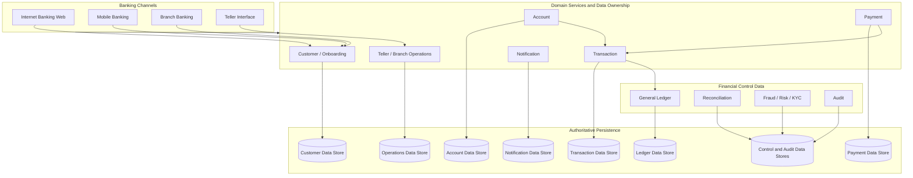
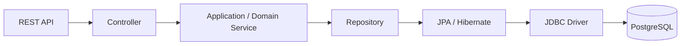
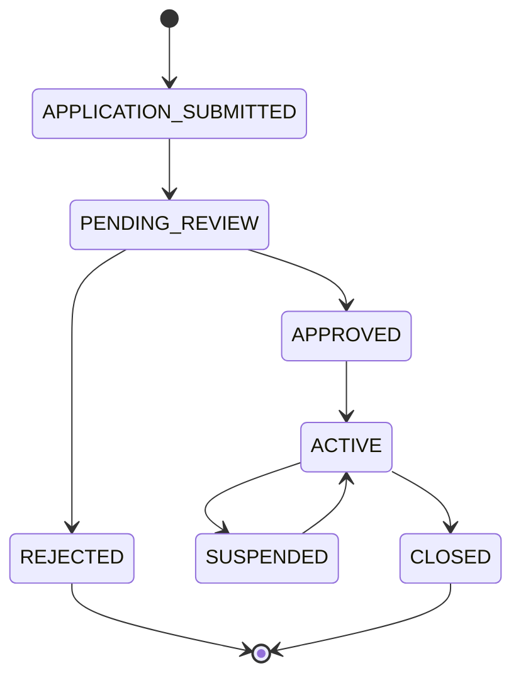
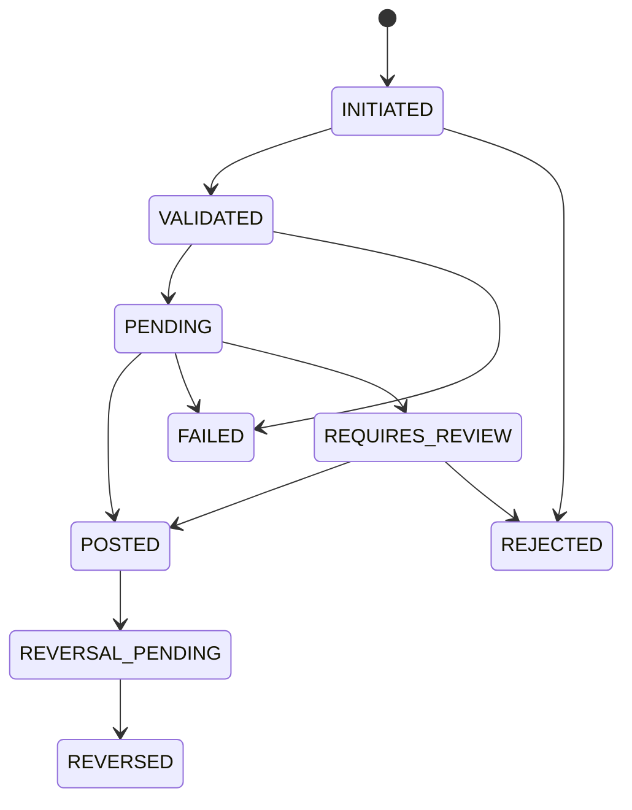
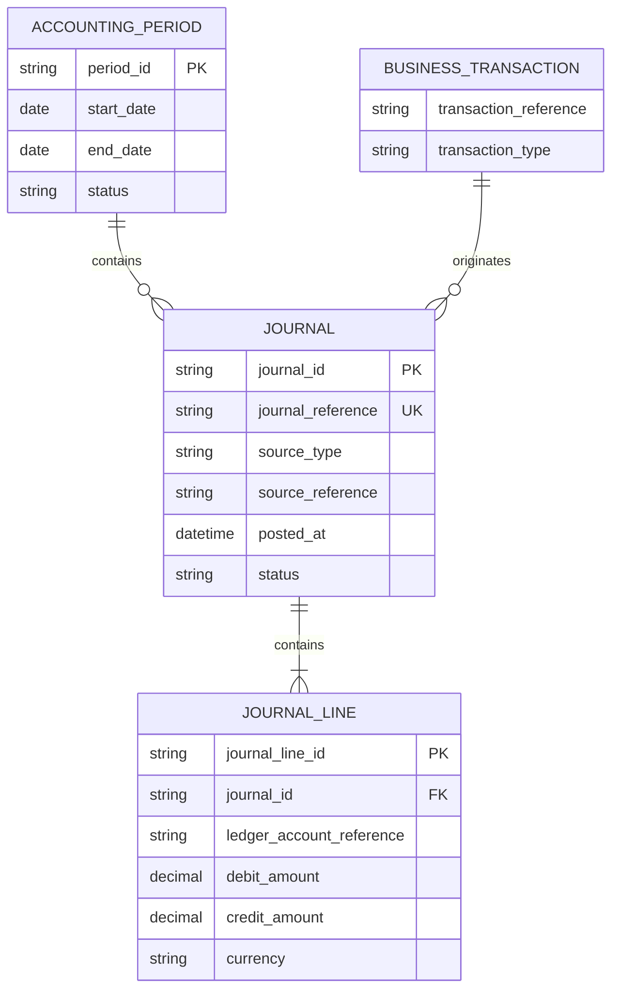
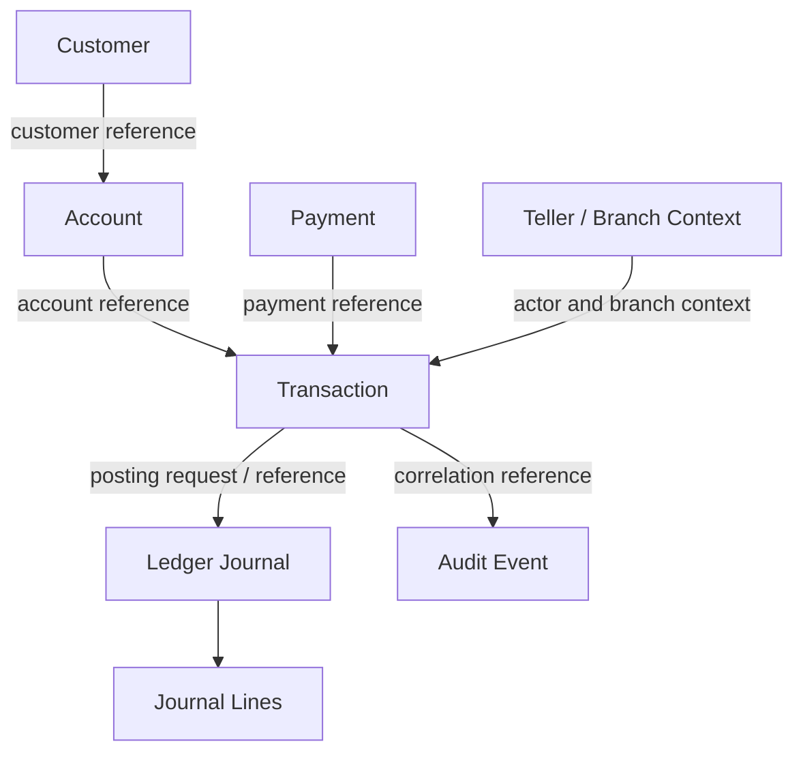
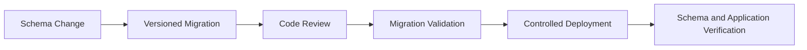
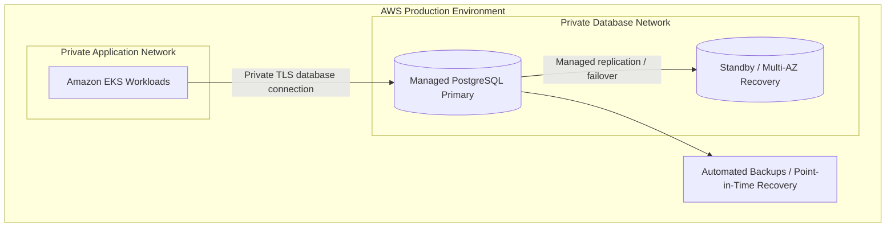

# Baraza Banking Platform — Data Architecture

## 1. Purpose and Scope

This document defines the data architecture for the Baraza Banking Platform modernization programme. It describes the target data ownership model, relational persistence, financial records, consistency controls, security, migrations, availability, and operational practices.

Baraza is evolving an established production banking system from a legacy monolithic architecture into a domain-oriented platform. The data architecture must preserve the integrity and traceability expected of banking operations while allowing services and channels to evolve independently.

The document covers both:

- **The target enterprise data model:** the data domains required by the complete banking platform.
- **The implementation model:** PostgreSQL-backed Spring Boot services, service-specific persistence, and schema migrations.

The target model is not a statement that every listed table, database, or service has already been implemented. Physical schemas, columns, constraints, and migration versions must be verified against the source code and database migrations for each service.

## 2. Data Architecture Principles

1. **Domain ownership:** each banking domain has an authoritative service and data owner.
2. **No uncontrolled cross-service writes:** a service must not directly update another service's tables.
3. **Financial integrity:** financial postings are controlled, balanced, traceable, and corrected through reversals or adjustments.
4. **Consistency by design:** local ACID transactions protect service-owned data; cross-service workflows use explicit coordination and recovery.
5. **Data minimization:** services store and expose only the information required for their responsibilities.
6. **Security and privacy:** sensitive information is protected in transit, at rest, in logs, backups, and operational tooling.
7. **Schema evolution:** database changes are versioned, reviewed, tested, and deployed through migrations.
8. **Recoverability:** backups, point-in-time recovery, and restoration are tested against defined recovery objectives.
9. **Auditability:** important customer, staff, transaction, payment, and administrative actions remain attributable and traceable.
10. **Evidence-based implementation:** actual schemas are documented from entity definitions and migration scripts, not inferred from conceptual diagrams.

## 3. Data Architecture Overview

The target data architecture is organized around business ownership rather than a single shared application schema.



The diagram expresses logical ownership. It does not prescribe a separate PostgreSQL server for every service. Separate databases, schemas, or database instances may be selected according to isolation, scale, security, and operational requirements. The critical requirement is that ownership and write authority remain explicit.

## 4. PostgreSQL and Persistence Technology

PostgreSQL is the relational persistence technology used by the platform's Spring Boot services. The development environment has used PostgreSQL 16.

The application persistence path is:



Responsibilities are separated:

| Layer | Responsibility |
|---|---|
| Controller | Request parsing, API validation, response mapping |
| Application/domain service | Business rules, authorization context, workflow coordination |
| Repository | Persistence queries and updates |
| JPA / Hibernate | Object-relational mapping where used |
| JDBC | Database connectivity |
| PostgreSQL | Durable storage, constraints, indexes, concurrency and transactions |
| Flyway | Versioned schema migration where configured |

The exact persistence implementation may differ between services. Service-specific documentation should identify the actual entities, repositories, database name, migration locations, and configuration.

## 5. Data Ownership and Service Boundaries

The target platform uses domain ownership. Each service is authoritative for the records within its boundary.

| Data domain | Authoritative owner | Example data responsibilities |
|---|---|---|
| Customer and onboarding | Customer Service | Customer profile, application, approval and lifecycle state |
| Identity and access | Identity capability / Customer Service where currently hosted | Login identity, credential hash, roles, enabled state, token-related identity references |
| Account | Account Service | Account identity, ownership, product, status and account controls |
| Transaction | Transaction Service | Transaction request, state, reference, processing history and idempotency |
| Payment | Payment Service | Payment instruction, provider reference, callback and payment status |
| Notification | Notification Service | Notification request, delivery attempt, provider response and delivery status |
| Teller and branch operations | Teller / Branch domain | Teller sessions, till assignment, cash controls, branch configuration and balancing |
| General Ledger | Ledger domain | Journal headers, debit/credit lines, posting references and accounting periods |
| Reconciliation | Reconciliation domain | Reconciliation batches, matched records, exceptions and resolution |
| Risk and KYC | Risk / Compliance domain | Risk assessment, due diligence, screening and review evidence |
| Audit | Audit capability | Actor, action, affected resource, timestamp, outcome and trace references |

### 5.1 Database-per-service principle

A service owns its persistence contract. Other services should use the owning service's API or consume published events.

Avoid:
- Direct SQL writes from one service into another service's tables.
- Shared ORM entities across service boundaries.
- Cross-service foreign keys that require a single shared database transaction.
- Using another service's database as an undocumented integration API.

A service may retain an external business identifier, such as `customerId`, `accountId`, or `transactionReference`, without owning the referenced record. The identifier is validated through the relevant service contract.

### 5.2 Physical database deployment

Logical ownership does not require one database server per microservice. Options include:
- Separate PostgreSQL instances for stronger isolation.
- Separate databases on a managed PostgreSQL instance.
- Separate schemas and database roles where operationally appropriate.

The chosen physical layout must preserve least-privilege access and prevent one service from modifying another service's data.

## 6. Customer and Onboarding Data

Customer data supports registration, application review, approval, activation, and ongoing customer lifecycle management.

The target customer domain includes:

- Customer identity and profile information.
- Contact details and communication preferences.
- Onboarding application and its reference.
- Application status and review history.
- Customer activation, suspension, or closure state.
- Links to KYC and compliance evidence.
- Customer identity and access relationships.

A conceptual lifecycle is:



The actual application status values and transitions must match the implemented customer-service code and database migrations.

### 6.1 Customer identity and credentials

Authentication data must be protected separately from ordinary profile data where practical. Passwords must be stored as strong one-way password hashes, never plaintext. Tokens and session secrets must not be stored in logs.

Customer and staff identity contexts must be distinguishable. Authorization must also validate that a customer can access the requested account or transaction; authentication alone is insufficient.

### 6.2 Data minimization

KYC documents, identity numbers, contact details, and other sensitive attributes should be collected only when required. Access must be restricted and audited. Logs and analytics should use masked or non-sensitive identifiers wherever possible.

## 7. Account Data

The Account domain owns account records and account lifecycle state.

Conceptual account attributes may include:

- Account identifier and account number.
- Customer or ownership reference.
- Account product and currency.
- Account status and restrictions.
- Opening and closure timestamps.
- Branch or servicing context where applicable.

A customer may own multiple accounts subject to product and institutional rules.

### 7.1 Balance representation

A balance shown to a customer is a financial value derived from authoritative account and ledger rules. The architecture must define whether the account service maintains a balance projection, whether balances are calculated from ledger postings, or whether a combination is used.

Any balance projection must be reconcilable to the authoritative financial records. A cached or replicated balance must not be treated as an unrestricted authority for posting decisions.

### 7.2 Account controls

Account status, holds, restrictions, available funds, currency, and transaction limits must be validated by the owning domain before a financial operation proceeds.

## 8. Transaction Data

The Transaction domain records the lifecycle of financial operations.

Conceptual attributes include:

- Transaction identifier.
- Business transaction reference.
- Transaction type and channel.
- Source and destination account references where applicable.
- Amount and currency.
- Initiating customer, staff, teller, or system actor reference.
- Transaction status and timestamps.
- Idempotency key or request identity.
- Correlation and provider references.
- Failure, review, reversal, or adjustment reason.

The exact schema depends on the implemented transaction model and must be documented from the actual entity and migration definitions.

### 8.1 Transaction history

Financial history must remain traceable. A completed or posted transaction should not be silently overwritten or deleted. Corrections are represented through explicit reversals, adjustments, or compensating entries with references to the original operation.

### 8.2 Transaction states

A conceptual state model is:



This is a target conceptual lifecycle, not a declaration of the current enum values. Each transaction type must define its valid transitions and terminal outcomes.

## 9. Payment Data

The Payment domain owns the payment instruction and its external processing lifecycle.

Target data responsibilities include:

- Internal payment identifier and customer-facing reference.
- Payment method and provider.
- Source account or funding reference.
- Beneficiary or destination reference, subject to data minimization.
- Amount and currency.
- Provider request and response references.
- Callback identity and processing state.
- Payment status and timestamps.
- Idempotency key.
- Settlement and reconciliation references.

Provider payloads should be retained only where necessary and should be protected against exposure of credentials, personal data, and payment secrets.

### 9.1 Provider callback records

Callbacks must be authenticated and correlated with the original payment. Duplicate callbacks must not create duplicate financial postings. Callback processing should record enough metadata to investigate provider behavior while minimizing sensitive payload retention.

### 9.2 Payment versus settlement

A provider's acknowledgement, payment authorization, customer debit, and final settlement may be distinct events. The data model must represent the provider-specific lifecycle rather than assuming that an accepted request is always settled.

## 10. Deposit and Withdrawal Data

Deposit and withdrawal are distinct banking operations, even if they share transaction processing and ledger infrastructure.

### Deposit data

A deposit workflow may need to record:
- Deposit reference and transaction reference.
- Customer and target account references.
- Amount and currency.
- Deposit channel and originating branch.
- Teller or staff actor where applicable.
- Cash, provider, or other source classification.
- Authorization and processing state.
- Ledger posting reference and receipt reference.

### Withdrawal data

A withdrawal workflow may need to record:
- Withdrawal reference and transaction reference.
- Customer and source account references.
- Amount and currency.
- Channel, branch, teller, or device context.
- Limit and authorization decisions.
- Cash disbursement or provider reference.
- Processing state and ledger posting reference.

These are target data requirements. The implementation may store operation-specific attributes in transaction records or in dedicated domain tables. The decision should follow the actual workflow and ownership boundaries.

## 11. Teller and Branch Operations Data

Branch and teller workflows introduce operational records beyond the customer account and transaction.

Target data may include:

| Record group | Example information |
|---|---|
| Branch | Branch identifier, name, location, status and operating configuration |
| Staff assignment | Staff identity reference, branch assignment, role and effective dates |
| Teller session | Teller, branch, opening time, closing time and session state |
| Till / cash drawer | Till identifier, assigned teller, opening float and current control balance |
| Cash movement | Cash-in, cash-out, transfer, vault movement and approval references |
| Supervisor approval | Approver identity, decision, reason and timestamp |
| Teller balancing | Expected cash, counted cash, difference, investigation and resolution |

Cash positions must be traceable to transactions and ledger entries. A teller session closing balance is an operational control; it is not a substitute for the authoritative accounting ledger.

## 12. General Ledger Data Architecture

The General Ledger is the authoritative accounting record for financial postings in the target platform.

A double-entry ledger normally separates a journal header from its journal lines.

Conceptual structure:



This diagram is conceptual and does not prescribe the final physical schema.

### 12.1 Double-entry controls

For each journal and currency, total debits must equal total credits. Posting controls should also enforce:
- Unique posting references.
- Valid ledger accounts and open accounting periods.
- Valid currency and precision.
- No unauthorized modification of posted journals.
- Reversal or adjustment entries linked to the original posting.
- Idempotent posting requests.
- Traceability to the originating transaction or business event.

### 12.2 Balance calculation

Customer-facing balances must be derived from a defined accounting model. The platform must distinguish ledger balance, available balance, holds, pending items, and uncleared funds where applicable.

The exact treatment depends on product rules and institutional accounting policy. A transaction service should not independently invent or update the authoritative financial balance.

## 13. Reconciliation Data

Reconciliation compares internal financial records with external provider, settlement, bank, and branch records.

Target data structures may include:
- Reconciliation batch and source.
- Statement or provider file metadata.
- Imported source records.
- Internal transaction and journal references.
- Matching rules and match outcomes.
- Unmatched or mismatched exceptions.
- Investigation notes and resolution status.
- Operator and approval history.

Reconciliation must preserve the original imported evidence and the history of matching decisions. Correcting an exception should not erase the original discrepancy.

## 14. Fraud, Risk, KYC and Compliance Data

### 14.1 Fraud and risk

Risk data may include risk assessments, rule outcomes, velocity counters, risk scores, alerts, review cases, and decisions. Sensitive risk indicators should be access-controlled and protected from inappropriate disclosure.

Risk decisions associated with a transaction should be attributable and linked to the relevant transaction reference.

### 14.2 KYC and compliance

KYC data may include due diligence status, identity verification references, document metadata, screening outcomes, customer risk classification, review dates, and evidence retention details.

Documents and identity evidence should use protected storage with controlled access. The relational database may store metadata and secure object references rather than unrestricted document content.

Applicable retention and compliance requirements must be confirmed for the institution and jurisdiction.

## 15. Audit and Event Data

Audit records capture financially significant and security-sensitive actions.

A conceptual audit event includes:
- Event identifier.
- Actor type and actor reference.
- Action and affected resource.
- Event timestamp.
- Channel, branch, or service context where relevant.
- Outcome and reason.
- Correlation, causation, transaction, or posting reference.
- Source service.

Audit records should be append-oriented and protected against unauthorized modification. Access to audit data must itself be controlled and monitored.

Operational logs are not a replacement for a durable business audit record. Logs support diagnosis; audit records support traceability and institutional control.

## 16. Notification Data

The Notification domain may retain:
- Notification request and business event reference.
- Recipient reference and delivery channel.
- Template and message classification.
- Provider request and response references.
- Attempt count and next retry time.
- Delivery status and timestamps.
- Failure classification.

Sensitive message content should be minimized. Notification delivery is asynchronous and must not determine whether a committed financial transaction is valid.

## 17. Entity Relationships and Cross-Service References

Within a service-owned database, normal relational constraints such as primary keys, foreign keys, unique constraints, and check constraints should enforce local integrity.

Across service boundaries, use stable business identifiers and API/event contracts rather than cross-database foreign keys.

A simplified domain relationship is:



The arrows represent business references and interactions, not necessarily physical foreign keys. Each service validates external references through its owning service or a trusted contract.

## 18. Relational Integrity and Constraints

PostgreSQL constraints provide essential protection against invalid data.

### Primary keys

Every persisted entity requires a stable primary key appropriate to its lifecycle and access patterns.

### Foreign keys

Use foreign keys within a service-owned relational boundary where referential integrity is required.

### Unique constraints

Examples include customer-facing references, account numbers, payment references, and idempotency keys, subject to the uniqueness scope and business rules.

### Check constraints

Use database checks for invariants that can be safely expressed at row level, such as positive amounts or mutually exclusive debit/credit values.

### Not-null constraints

Required business attributes should be non-null unless the lifecycle explicitly permits an incomplete state.

Application validation and database constraints complement one another. Neither replaces the other.

## 19. Financial Transactions and ACID

PostgreSQL provides ACID transaction semantics within a database transaction.

- **Atomicity:** all statements in a local database transaction commit together or roll back.
- **Consistency:** constraints and application rules preserve valid states.
- **Isolation:** concurrent operations are controlled according to the selected isolation level and locking strategy.
- **Durability:** committed data is persisted according to PostgreSQL and storage configuration.

### 19.1 Important distributed-systems distinction

A PostgreSQL transaction is atomic only within its database transaction boundary. It does not automatically make calls to multiple microservices, payment providers, or separate databases atomic.

Cross-service financial workflows require explicit state management, idempotency, durable messaging, and compensating or reversal procedures. Do not describe a multi-service transfer as one ordinary SQL transaction unless all affected data genuinely resides in the same transactional database boundary.

### 19.2 Transfer example

A target transfer workflow may:
1. Validate the customer, source account, destination account, currency, limits, and available funds.
2. Create a uniquely referenced transaction.
3. Obtain the required risk and authorization decisions.
4. Request the appropriate ledger posting.
5. Persist the final or pending outcome.
6. Publish the result for notification and downstream processing.
7. Reconcile the posting and external effects where applicable.

The ledger posting must balance. If processing fails after a partial distributed workflow, the transaction remains in a recoverable state and is resolved through retry, compensation, or reversal—not by assuming a database rollback has undone every external action.

## 20. Concurrency and Isolation

Banking workloads can contain concurrent requests against the same account or financial resource.

Controls may include:
- Appropriate transaction isolation.
- Row-level locking for critical balance or posting decisions.
- Optimistic locking/version columns for concurrent updates.
- Unique constraints to prevent duplicate references.
- Atomic conditional updates.
- Idempotency keys.
- Explicit handling of deadlocks and serialization failures.

The selected strategy must be tested under concurrent load. Lock scope and transaction duration should be kept as small as practical.

## 21. Idempotency and Duplicate Prevention

Idempotency protects financial operations against retries, network timeouts, repeated user submissions, and duplicate provider callbacks.

A robust idempotency record or constraint should define:
- Key and uniqueness scope.
- Request fingerprint or equivalent payload identity.
- Processing state.
- Original transaction or payment reference.
- Stored outcome or a means to retrieve it.
- Retention period and expiry policy.

A repeated key with the same logical request should return or resolve to the original operation. Reusing the key with a materially different request should be rejected.

Idempotency is required at relevant boundaries: client request, payment provider callback, event consumer, and ledger posting. A single API-level check does not protect every downstream operation.

## 22. Indexing and Query Design

Indexes should be based on actual query patterns and measured execution plans.

Potential access paths include:
- Customer reference and normalized search fields.
- Account identifier and account number.
- Transaction reference, account reference, status, and creation time.
- Payment provider reference and payment status.
- Ledger posting reference, journal date, and ledger account.
- Reconciliation batch and exception status.
- Teller session, branch, and business date.

Index design should consider selectivity, ordering, composite index column order, write overhead, storage, and maintenance.

Use PostgreSQL query plans and representative data volumes to validate performance. Avoid indexing every column without evidence.

## 23. Database Migrations and Schema Evolution

Schema changes must be version-controlled and repeatable. Flyway is used in services where configured.

A migration lifecycle is:



### 23.1 Migration practices

- Keep migrations immutable after they have been applied in shared environments.
- Use ordered, versioned migration files.
- Test migrations against representative database states.
- Avoid destructive changes in the same release that first stops using a column.
- Back up or otherwise protect data before high-risk changes.
- Ensure migration execution is controlled when multiple application replicas start.
- Keep Hibernate schema behavior aligned with the migration strategy; validation is preferable to uncontrolled automatic schema mutation in production.

### 23.2 Expand-and-contract

For changes that need rolling deployment compatibility:
1. Expand the schema with backward-compatible structures.
2. Deploy code that can work with both old and new structures.
3. Backfill or migrate data safely.
4. Switch reads and writes to the new structure.
5. Remove obsolete structures in a later controlled release.

Application rollback does not automatically reverse a database migration. Migration compatibility must be part of release planning.

## 24. Connection Management and Pooling

Spring Boot services commonly use HikariCP for JDBC connection pooling.

Pool sizing must account for:
- Number of application replicas.
- Maximum pool size per replica.
- Database connection limits.
- Background workers and migration connections.
- Expected concurrency and query duration.
- Reserved capacity for administration and recovery.

The aggregate connection demand across all Pods matters. Increasing replicas while leaving each pool unchanged can exhaust database connections.

Use timeouts and monitor active, idle, pending, and timed-out connections. Do not treat a larger pool as an automatic performance improvement.

## 25. Database Availability and Production Topology

The target AWS architecture uses managed PostgreSQL, such as Amazon RDS for PostgreSQL or Aurora PostgreSQL where justified by workload and requirements.



The exact managed database option, availability configuration, instance sizing, and regional recovery design must be selected from availability, performance, cost, and compliance requirements.

Amazon EKS is the intended application runtime. The database is managed separately and is not assumed to run as an ordinary application Pod in production.

## 26. Backup, Restore and Disaster Recovery

Production database operations should define:
- Automated backup schedule and retention.
- Point-in-time recovery capability where supported.
- Backup encryption and access controls.
- Recovery point objective (RPO).
- Recovery time objective (RTO).
- Restore procedures and responsible operators.
- Periodic restore tests.
- Cross-region or off-site recovery where required.
- Verification of application consistency after recovery.

A backup is not a proven recovery capability until restoration has been tested and the recovered application data has been validated.

## 27. Database Security and Privacy

### Network security
Only authorized application workloads and approved operational paths should reach database endpoints. Production database access should use private networking and restricted security groups or equivalent controls.

### Authentication and authorization
Use dedicated database roles for applications and operational tasks. Avoid shared superuser credentials. Separate migration privileges from normal runtime privileges where practical.

### Encryption
Use TLS for database connections according to the deployment threat model and encryption at rest for database storage and backups.

### Secrets
Credentials must not be committed to source control, container images, Helm values, CI logs, or application logs. Use the platform's secret-management solution and rotate credentials under a controlled process.

### Sensitive data
Apply data minimization, masking, access logging, retention controls, and secure disposal. Restrict production data copied into development and testing environments; use synthetic or appropriately anonymized data where possible.

### Audit
Database administration, privileged access, schema changes, and sensitive data access should be traceable.

## 28. Database Observability

Database observability should cover technical health and banking workload behavior.

| Area | Signals |
|---|---|
| Capacity | CPU, memory, storage, IOPS and connection utilization |
| Query performance | Query latency, slow queries, execution plans and throughput |
| Concurrency | Lock waits, deadlocks, long-running transactions and contention |
| Reliability | Connection failures, transaction errors, replication and failover health |
| Recovery | Backup completion, retention, restore-test results and recovery readiness |
| Application interaction | Pool saturation, query timeouts, persistence exceptions |
| Banking controls | Ledger posting failures, duplicate attempts, reconciliation exceptions and delayed processing |

Monitoring should use actionable thresholds and link alerts to operational runbooks. Sensitive SQL parameters and customer data must be masked where appropriate.

## 29. Data Retention and Lifecycle

Retention requirements depend on the data category, institution policy, and applicable jurisdictional obligations.

The data lifecycle should define:
- Purpose and lawful basis for collection.
- Data classification and access restrictions.
- Retention period and archival requirements.
- Legal hold and investigation requirements.
- Secure deletion or anonymization where permitted.
- Backup expiry and deletion behavior.
- Evidence of disposal where required.

Financial and audit records may have different retention requirements from transient session, cache, or notification-delivery data. Do not apply one blanket retention period to every table.

## 30. Local Development and Connectivity

Local development uses PostgreSQL containers and/or the configured local Kubernetes environment. The exact database name, port mapping, service name, and credentials must be read from the relevant Compose, Helm, and application configuration.

For a PostgreSQL service exposed through a Kubernetes Service, applications should connect through the stable Service DNS name rather than a Pod IP.

Example diagnostic commands:

```powershell
kubectl get pods -A
kubectl get services -A
kubectl get events -A --sort-by=.metadata.creationTimestamp
```

If a database Service is deployed in a known namespace:

```powershell
kubectl get svc -n <namespace>
kubectl describe svc <service-name> -n <namespace>
```

A temporary port-forward may be used for local inspection when the service and namespace are known:

```powershell
kubectl port-forward svc/<service-name> 5432:5432 -n <namespace>
```

Port forwarding is a development and troubleshooting technique, not the normal production connectivity model. Never assume a generic service name or namespace; use the deployed manifests.

## 31. Database Troubleshooting

Investigate from the application toward the database:

1. Confirm the application is using the expected database URL, database name, username, and secret reference.
2. Check application logs for authentication, DNS, connection, timeout, migration, or SQL errors.
3. Verify the database endpoint resolves from the application environment.
4. Verify network policy, security group, routing, and port access.
5. Check database readiness and service endpoint health.
6. Inspect database logs and resource utilization.
7. Check connection pool saturation, locks, long-running transactions, and query plans.
8. Confirm migration history and schema compatibility.
9. Preserve transaction references and logs for any affected financial operation; do not blindly resubmit it.

Common failure categories include:
- Invalid credentials or expired secrets.
- Incorrect hostname, port, or database name.
- Database unavailable or not accepting connections.
- Network policy or security group blocking traffic.
- Connection pool exhaustion.
- Migration failure or schema drift.
- Constraint violation or duplicate key.
- Lock contention, deadlock, or slow query.
- Insufficient storage or resource exhaustion.

A database connection error does not prove that a financial operation failed. For uncertain outcomes, inspect transaction and provider references before retrying.

## 32. Local Development versus Production

| Concern | Local development | Production target |
|---|---|---|
| Database engine | PostgreSQL | Managed PostgreSQL |
| Application runtime | Local containers / local Kubernetes | Amazon EKS |
| Network | Workstation and local cluster networking | Private VPC networking |
| Credentials | Local environment secrets | Managed secrets and IAM integration |
| Storage | Development persistence | Managed durable storage |
| Availability | Development-level | Defined HA and recovery objectives |
| Backups | Development/test configuration | Automated backups and tested restore |
| Observability | Local logs and available metrics | Centralized metrics, logs, traces and alerts |
| Access | Restricted developer access | Least-privilege operational access |
| Recovery | Development procedures | Formal recovery and disaster recovery |

Minikube is a local development option, not the production database or application architecture.

## 33. Implementation Evidence and Schema Documentation

The target data domains in this document are architectural requirements. Before documenting physical tables, columns, constraints, or indexes as implemented, verify them against:

- JPA entity classes and mappings.
- Flyway migration scripts.
- Repository queries.
- Service configuration and database connection settings.
- Actual database metadata where available.
- Integration tests that exercise persistence behavior.

For each implemented service, its detailed data reference should identify:
1. Database and schema ownership.
2. Entity and table names.
3. Primary and foreign keys.
4. Unique and check constraints.
5. Indexes and query access patterns.
6. Migration directory and current migration version.
7. Data classification and sensitive attributes.
8. Backup, retention, and recovery expectations.

This avoids treating conceptual banking entities as physical tables before they exist.

## 34. Related Documentation

- [README](../README.md)
- [Platform Overview](platform-overview.md)
- [System Architecture](architecture.md)
- [Workstation Setup](workstation-setup.md)
- [Docker](docker.md)
- [Kubernetes](kubernetes.md)
- [Helm](helm.md)
- [Terraform](terraform.md)
- [Security](security.md)
- [Monitoring](monitoring.md)
- [Operations](operations.md)
- [Troubleshooting](troubleshooting.md)

## 35. Data Architecture Summary

The Baraza data architecture uses PostgreSQL as the relational persistence foundation for domain services. Each service owns its data and exposes contracts for other services. The target enterprise model covers customer onboarding, identity, accounts, transactions, payments, deposits, withdrawals, teller and branch operations, general ledger, reconciliation, risk, KYC, audit, and notifications.

The most important banking distinction is between an operational transaction record and an authoritative accounting posting. Transaction processing coordinates the business workflow; the General Ledger controls balanced financial entries. Idempotency, explicit transaction states, controlled reversals, reconciliation, and auditability protect financial integrity across service and provider boundaries.

Local database environments support development and verification. The production direction is managed PostgreSQL accessed privately by application workloads running on Amazon EKS. Physical schemas and implementation status must always be verified from service code and migrations.

> **Core principle:** each domain owns its data, each financial posting is controlled and traceable, and every production data store has a defined security, availability, and recovery strategy.
