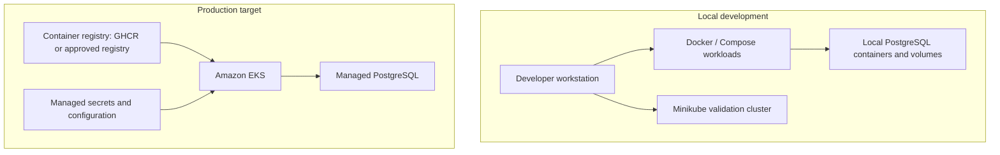
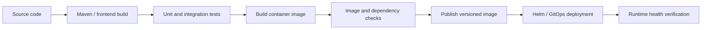

# Docker and Containerization

## 1. Purpose

This document defines how Baraza services are packaged, configured, executed, and promoted as containers. It covers the local developer workflow and the container standards expected of the production platform.

Baraza is a modernization programme for an established banking system. The target platform separates banking capabilities into independently deployable services and supports internet banking, mobile banking, branch operations, and teller workflows. Containers provide a consistent runtime for those services across developer machines, test environments, and the Kubernetes production platform.

The repository currently uses Docker for local service execution and Kubernetes-based deployment workflows. The production target is Amazon EKS. Minikube is a local development and validation environment; it is not the production hosting architecture.

This guide describes both current container workflows and the standards to apply as the platform matures. A control described as a standard or target practice should not be interpreted as proof that it is already enforced in every image pipeline.

## 2. Containerization objectives

Baraza container images should:

- Package one deployable application or supporting component with its runtime dependencies.
- Behave consistently across local, test, staging, and production environments.
- Be immutable after publication; configuration belongs outside the image.
- Start predictably, expose health information, handle termination signals, and shut down gracefully.
- Run with the least privileges required by the application.
- Avoid storing customer data, credentials, or durable banking state inside the container filesystem.
- Be traceable to source code, build inputs, and a specific release.
- Be small enough to reduce transfer time and the vulnerability surface.

A container is a packaging and runtime boundary. It is not, by itself, a security boundary between mutually untrusted workloads, a substitute for application authorization, or a durable data store.

## 3. Container architecture

The principal containerized workloads are the Java/Spring Boot banking services and the React-based internet banking web application. Supporting infrastructure may also run in containers during local development.

| Workload | Runtime / packaging | Responsibility |
|---|---|---|
| Customer service | Java 21, Spring Boot | Customer onboarding, identity-related workflows, and customer-facing APIs |
| Account service | Java 21, Spring Boot | Account lifecycle and account queries |
| Transaction service | Java 21, Spring Boot | Transaction processing and coordination with account capabilities |
| Payment service | Java 21, Spring Boot | Payment initiation, provider integration, and callback handling |
| Notification service | Java 21, Spring Boot target | Delivery of customer and operational notifications |
| Internet banking web | React, TypeScript, Vite; static web build | Browser-based customer channel |
| PostgreSQL | PostgreSQL container for local development | Local development databases only |

The service list describes the platform scope. Not every listed capability or service should be assumed to have a production-ready image or deployment today. Confirm the repository's current Dockerfiles, Compose definitions, and image references before treating a specific image tag or port as an implemented interface.

### 3.1 Container boundary

Each independently deployable backend service should have its own image and runtime configuration. Avoid combining multiple banking services into one application container. This preserves independent deployment, scaling, health management, and failure isolation.

The internet banking web application is a separate delivery artifact. It may be served by a static web host or a dedicated web-server container depending on the deployment environment. The current web delivery choice and the backend container strategy are separate concerns.

### 3.2 Local and production topology



Local Compose is useful for starting a group of dependencies and services on one workstation. Kubernetes is used to validate the deployment model and GitOps workflow. In the production target, EKS runs the application workloads while durable database services are provided separately.

## 4. Image build and release lifecycle

The intended image lifecycle is:



A release should be traceable from the deployed image back to its source revision. The image pipeline should:

1. Check out a specific source revision.
2. Resolve dependencies using controlled build inputs.
3. Compile and run the relevant test suites.
4. Build the runtime image from the tested artifact.
5. Run image and dependency security checks where configured.
6. Attach useful OCI metadata, including source repository and revision.
7. Publish the image to the configured registry.
8. Update the deployment configuration through the GitOps repository.
9. Verify rollout status and application health after deployment.

The current repository uses GitHub Actions and GHCR in its delivery workflow. The exact workflow files, image names, and tags are defined by the repository configuration and should be treated as authoritative.

### 4.1 Image tags and promotion

Use tags that communicate the build identity and intended use. A commit-SHA tag provides an unambiguous link to source; a human-readable release tag can be used for a versioned release.

Recommended conventions:

- Development builds: a development tag plus the source commit identifier.
- Test builds: a test or release-candidate tag plus the source commit identifier.
- Production releases: a versioned release tag and preferably an immutable digest reference.
- Avoid relying on mutable tags such as `latest` for production deployment.

Build once and promote the same image digest between environments. Do not rebuild an image separately for production merely to change environment settings. Environment-specific configuration must be injected at runtime.

## 5. Building Java service images

Backend services use Java 21 and Spring Boot. A multi-stage Docker build separates compilation from the runtime image. This keeps Maven and build tooling out of the final runtime layer.

The following is a reference pattern, not a claim that every service currently uses this exact Dockerfile. Adapt the artifact name, build context, and entry point to the service being built.

```dockerfile
# Build stage
FROM maven:3.9-eclipse-temurin-21 AS build
WORKDIR /workspace

COPY pom.xml .
COPY src ./src
RUN mvn -B -DskipTests dependency:go-offline
RUN mvn -B clean package -DskipTests

# Runtime stage
FROM eclipse-temurin:21-jre
WORKDIR /app

RUN groupadd --system app && useradd --system --gid app app
COPY --from=build /workspace/target/*.jar /app/application.jar

USER app
EXPOSE 8080
ENTRYPOINT ["java", "-XX:MaxRAMPercentage=75.0", "-jar", "/app/application.jar"]
```

Important considerations:

- Pin base images to maintained versions; use digest pinning where reproducibility requirements call for it.
- Use a JRE runtime image rather than a full JDK when the application does not need a compiler at runtime.
- Run as a non-root user. Confirm that copied files and required directories are readable or writable by that user.
- Keep build tools, source files, test data, and package caches out of the final image.
- Do not copy local configuration files containing secrets into the image.
- Ensure the application listens on the container interface, not only on loopback.
- Configure JVM memory in a way that respects container memory limits. Validate actual heap and native-memory behaviour under the workload.
- Prefer exec-form `ENTRYPOINT` so the Java process receives termination signals directly.
- Do not use `-DskipTests` as a substitute for running tests in CI. The example separates image packaging from the test stage for clarity.

### 5.1 Spring Boot runtime behaviour

The application should expose health endpoints suitable for container and Kubernetes health checks. Liveness should indicate whether the process can continue; readiness should indicate whether it can safely receive traffic. Do not make liveness depend on every downstream system, since a temporary database or provider outage should not cause an unnecessary restart loop.

Configure graceful shutdown so in-flight requests have an opportunity to complete. The termination grace period in Kubernetes must be consistent with the application's shutdown behaviour and the maximum expected request duration.

## 6. Building the internet banking web image

The internet banking web application is built with React, TypeScript, and Vite. A production build produces static assets. If the web application is containerized, use a build stage with the Node toolchain and a small static web-server runtime stage.

The following illustrates the pattern only; the actual build command, output directory, and web-server configuration must match the frontend project.

```dockerfile
FROM node:22-alpine AS build
WORKDIR /app
COPY package*.json ./
RUN npm ci
COPY . .
RUN npm run build

FROM nginx:stable-alpine
COPY --from=build /app/dist /usr/share/nginx/html
EXPOSE 80
```

Do not embed environment-specific API endpoints or secrets in a frontend image without understanding the build-time versus runtime configuration model. Browser-delivered configuration is public to the user. Never put private API credentials, signing keys, database credentials, or privileged tokens in frontend assets.

## 7. Build context and caching

A Docker build context should contain only files needed to build the image. A carefully maintained `.dockerignore` reduces accidental inclusion of local files, speeds up builds, and helps prevent secrets or generated artifacts from entering an image.

Typical exclusions include:

- Git metadata and local IDE settings.
- Build output that is regenerated inside the build.
- Local logs, temporary files, and test reports not needed by the image.
- Local environment files and secret files.
- Node modules when dependencies are installed inside the build stage.
- Local database data and developer-specific configuration.

Review exclusions against each service's build process. Do not blindly exclude a file required by the build.

For efficient builds, copy dependency manifests before frequently changing source files, use BuildKit caching where available, and avoid invalidating dependency layers unnecessarily. Reproducibility also depends on controlled dependency versions and base-image updates.

## 8. Runtime configuration and secrets

The same image should be usable in different environments. Inject environment-specific values at runtime through the deployment platform.

Examples of configuration categories include:

| Category | Examples |
|---|---|
| Application | active profile, server port, log level |
| Database | JDBC URL, database name, connection pool limits |
| Service discovery | internal service URLs and API endpoints |
| Authentication | issuer and audience configuration, public key references |
| External integrations | provider endpoint, timeout, callback configuration |
| Observability | metrics/exporter endpoint, trace sampling configuration |

These are categories, not literal values for every service. Use the service's Spring configuration and deployment manifests to determine the actual variable names.

Never bake passwords, database URLs containing credentials, JWT signing secrets, API tokens, private keys, or payment-provider credentials into a Dockerfile, image layer, source repository, or frontend bundle. For local development, use an ignored environment file or an approved local secret mechanism. For production, use an appropriate managed secret store and tightly scoped workload access.

Configuration changes should not require rebuilding the image unless the application artifact itself changes.

## 9. Container networking

Containers communicate over the networks configured by Docker Compose or the Kubernetes cluster. Within a Compose network, services should normally address one another by service DNS name and container port rather than by a developer workstation's `localhost`.

Inside a container, `localhost` refers to that same container. It does not refer to another service or to the developer's host machine. This distinction is a common source of connection failures.

In Kubernetes, use the relevant Service DNS name and service port. Keep internal service traffic on cluster networking and expose only the required entry points through an ingress or gateway layer.

Published host ports are for local access and testing. They are not a production security control. Avoid publishing database ports broadly on a workstation or exposing internal banking services directly to the public internet.

## 10. Persistent data and storage

Application containers are replaceable and their writable layers are ephemeral. Do not store durable customer, account, transaction, payment, audit, or ledger data only inside a container filesystem.

For local development, PostgreSQL containers may use named Docker volumes so database state survives container recreation. Protect local volumes from accidental deletion and never treat them as a backup.

For production, use managed, durable PostgreSQL infrastructure with defined backup, point-in-time recovery, access control, encryption, monitoring, and disaster-recovery procedures. Kubernetes persistent volumes may be appropriate for selected stateful workloads, but they do not remove the need for a deliberate database availability and recovery design.

Financial records require stronger controls than ordinary application cache data. Database backups, restore tests, retention, and reconciliation procedures must be designed and operated as part of the banking platform.

## 11. Health, logs, and observability

Containers should follow platform-friendly operational conventions:

- Write application logs to standard output and standard error.
- Use structured logs with timestamps, severity, service identity, and correlation identifiers where practical.
- Do not log passwords, access tokens, payment credentials, or unnecessary personal or financial data.
- Expose health and metrics endpoints only through controlled interfaces.
- Propagate trace and correlation context across service calls.
- Set resource requests and limits in Kubernetes based on observed workload behaviour.
- Use readiness and liveness probes for distinct purposes.
- Ensure shutdown and restart behaviour does not create duplicate financial processing.

Docker health checks can be useful for local container supervision. Kubernetes deployments should use Kubernetes probes configured against the application's supported health endpoints. A Docker health check does not replace Kubernetes readiness and liveness probes.

## 12. Container security standards

Container security is part of the banking platform's defence-in-depth model. Apply the following controls as the image pipeline and deployment environment support them:

1. Use maintained, minimal base images and rebuild regularly for security updates.
2. Run application processes as non-root.
3. Remove unnecessary packages, shells, tools, and capabilities from runtime images where feasible.
4. Scan application dependencies and container images for known vulnerabilities.
5. Generate a software bill of materials (SBOM) for release artifacts.
6. Sign images and verify signatures at deployment where supported.
7. Use immutable image digests for production releases.
8. Apply read-only root filesystems and drop Linux capabilities where compatible with the application.
9. Set CPU and memory requests and limits to reduce noisy-neighbour and resource-exhaustion risks.
10. Restrict registry publishing and deployment permissions to the identities and workflows that require them.
11. Keep secrets outside images and restrict access to runtime secret values.
12. Rebuild and redeploy images when critical base-image or dependency vulnerabilities require remediation.

Scanning, SBOM generation, signing, and admission enforcement are target controls unless the relevant pipeline and cluster policies demonstrate that they are enabled. Do not describe them as implemented solely because they are documented here.

## 13. Local Docker workflow

Run commands from the repository root unless the command explicitly changes directory. Confirm the service's actual Dockerfile and build context before running a build.

### 13.1 Check Docker

PowerShell:

```powershell
docker version
docker info
docker compose version
```

If the Docker daemon is unavailable, start Docker Desktop and retry. A working Docker CLI alone does not prove that the daemon is running.

### 13.2 Inspect running containers and images

```powershell
docker ps
docker ps -a
docker image ls
docker network ls
docker volume ls
```

### 13.3 Build an image

Reference command; replace the context and Dockerfile path with the verified service paths:

```powershell
docker build -t baraza-customer-service:local -f applications/customer-service/Dockerfile applications/customer-service
```

The example assumes a Dockerfile at that location. If the service uses a different build context or Dockerfile location, adjust the command rather than creating a duplicate Dockerfile.

### 13.4 Run and inspect a container

```powershell
docker run --rm --name baraza-service-local -p 8080:8080 baraza-customer-service:local
docker logs baraza-service-local
docker inspect baraza-service-local
```

The port mapping is illustrative. Confirm the application's configured container port and required environment variables first. The example's `--rm` option removes the container after it exits; it does not remove a separately managed named volume.

### 13.5 Stop and clean up

```powershell
docker stop baraza-service-local
docker container prune
docker image prune
```

Prune commands remove unused resources. Inspect what will be affected before using broader cleanup commands, particularly when local database volumes or images are needed for ongoing work. Do not use volume-prune commands casually.

## 14. Troubleshooting

| Symptom | Likely cause | Checks and response |
|---|---|---|
| Docker daemon connection error | Docker Desktop is stopped or unhealthy | Start Docker Desktop; check `docker info` |
| Container exits immediately | Startup exception, invalid config, or failed dependency connection | Inspect `docker logs` and container exit status |
| Host cannot reach application | Wrong host-port mapping or application bound to loopback | Check `docker ps`, application port, and server bind address |
| One container cannot reach another | Incorrect hostname, network, or port | Check network membership and use service DNS plus container port |
| Database connection refused | Database not ready, wrong URL, or wrong network target | Check database logs, readiness, credentials, and connection URL |
| Image build is unexpectedly slow | Large build context or cache invalidation | Review `.dockerignore` and Dockerfile layer ordering |
| Container is killed under load | Memory limit or JVM sizing mismatch | Inspect container resource usage and JVM memory settings |
| Permission denied at startup | Runtime user lacks access to required files or directories | Inspect ownership and permissions; avoid reverting to root as the default fix |
| New deployment runs old code | Mutable tag, stale image, or failed rollout | Compare image digest and source revision; inspect deployment rollout |

Useful diagnostic commands:

```powershell
docker logs --tail 200 <container-name>
docker inspect <container-name>
docker stats
docker network inspect <network-name>
docker exec -it <container-name> sh
```

Use an interactive shell only when the image contains one and access is permitted. Production runtime images should not retain debugging tools unnecessarily.

## 15. Local development versus production

| Concern | Local development | Production target |
|---|---|---|
| Container runtime | Docker Desktop / local Kubernetes | Amazon EKS |
| Database | PostgreSQL containers and local volumes where needed | Managed PostgreSQL service |
| Image registry | Local images and GHCR | Controlled registry with immutable release references |
| Configuration | Local environment configuration | Managed configuration and secret services |
| Deployment | Docker Compose and Minikube validation | Helm releases reconciled through GitOps |
| Availability | Developer workstation availability | Multi-node cluster and managed-service availability design |
| Observability | Local logs and selected metrics | Centralized logs, metrics, traces, alerting |
| Security controls | Developer-safe defaults | Enforced workload, registry, network, and identity controls |

Local development is intended to validate application behaviour and deployment configuration without incurring cloud costs. It does not establish production availability, resilience, security, or performance characteristics.

## 16. Relationship to Kubernetes, Helm, and GitOps

Docker produces the application image. Kubernetes schedules and supervises containers. Helm packages Kubernetes resources and environment-specific values. Argo CD reconciles the desired state from the GitOps repository.

The responsibilities are distinct:

- Dockerfile: how the application image is built.
- Container registry: where versioned image artifacts are stored.
- Kubernetes manifests: how workloads and services run in the cluster.
- Helm: how deployment resources are parameterized and packaged.
- GitOps: how the desired deployment state is reviewed, versioned, and reconciled.

A successful image build does not prove that a Kubernetes deployment is healthy. A successful Argo CD synchronization does not by itself prove that banking workflows are correct. Validate image identity, rollout status, application health, dependencies, and relevant business transactions.

## 17. Operational checklist

Before promoting a container image:

- [ ] The source revision is known and reviewed.
- [ ] Build and relevant tests have passed.
- [ ] The runtime image contains only required application artifacts and dependencies.
- [ ] The image runs as a non-root user where supported.
- [ ] Runtime configuration and secrets are external to the image.
- [ ] Health endpoints and graceful shutdown behaviour are validated.
- [ ] Logs avoid credentials and sensitive banking data.
- [ ] Image identity and source revision are traceable.
- [ ] Required vulnerability and supply-chain checks have passed.
- [ ] The deployment references the intended image tag or digest.
- [ ] Rollout and application-level verification have completed.
- [ ] Database persistence, backup, and recovery do not depend on container lifecycle.

## 18. Related documentation

- [Platform overview](platform-overview.md)
- [Architecture](architecture.md)
- [Database](database.md)
- [Kubernetes](kubernetes.md)
- [Helm](helm.md)
- [CI/CD](ci-cd.md)
- [GitOps and Argo CD](gitops-argocd.md)
- [Security](security.md)
- [Deployment runbook](runbooks/deployment.md)
- [Rollback runbook](runbooks/rollback.md)
