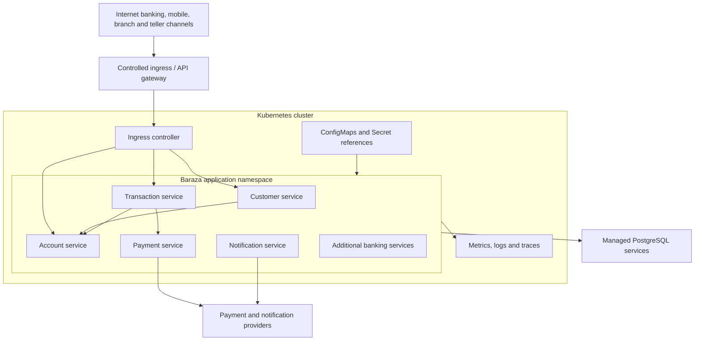
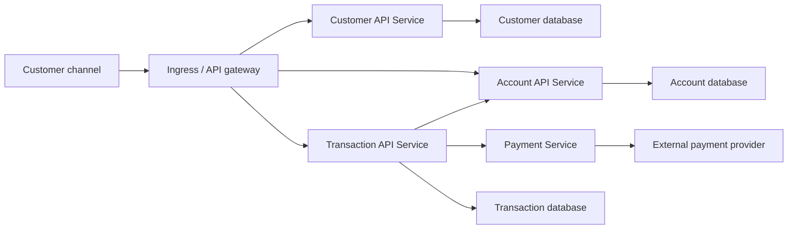
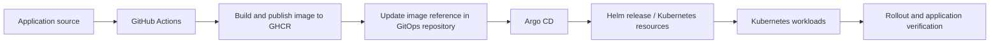

# Kubernetes Platform and Operations

## 1. Purpose

This document describes how Baraza banking workloads are deployed and operated on Kubernetes. It establishes the target deployment model, explains the resources that make up an application deployment, and provides operational guidance for local validation and production operations.

Baraza is a modernization programme that replaces an established monolithic banking platform with a cloud-native, service-oriented platform. The target system supports internet and mobile banking, branch operations, teller workflows, and the banking capabilities behind those channels.

The production Kubernetes target is Amazon Elastic Kubernetes Service (Amazon EKS). Minikube is used for local development and deployment validation. A workload running successfully on Minikube is useful evidence of deployment behaviour, but it does not mean that the production EKS environment has been provisioned or validated.

This guide describes current platform conventions and the intended production operating model. A capability described as a target standard is not necessarily implemented or enabled in every current manifest.

## 2. Kubernetes objectives

Kubernetes provides the orchestration layer for Baraza's independently deployable application workloads. The platform is intended to provide:

- Declarative deployment of application versions and runtime configuration.
- Service discovery and stable internal networking.
- Self-healing through workload controllers and health probes.
- Controlled rollout and rollback of application releases.
- Resource isolation and capacity management.
- Horizontal scaling for stateless workloads.
- Configuration and secret integration.
- A consistent deployment model across development, test, staging, and production.
- Integration with Helm and GitOps-based delivery.

Kubernetes does not replace application-level correctness, database transaction guarantees, banking authorization, financial controls, or disaster-recovery planning. Those remain explicit responsibilities of the application and platform architecture.

## 3. Cluster environments

### 3.1 Local development

Minikube provides a local Kubernetes cluster for testing container images, Deployments, Services, ConfigMaps, Secrets, probes, Helm releases, and GitOps workflows. It is constrained by the developer workstation's available CPU, memory, and storage.

Local cluster configuration should be kept lightweight. Do not infer production capacity or availability from the local cluster.

### 3.2 Production target: Amazon EKS

Amazon EKS is the intended production Kubernetes platform. The production design should use private application networking, controlled ingress, workload identity, managed secrets, centralized observability, and managed database services.

The infrastructure target documented for Baraza uses AWS region `af-south-1` and a VPC address space of `10.20.0.0/16`, with separate public, private application, and database subnets. The intended EKS API endpoint is private. These are design parameters; they do not establish that an EKS cluster or its supporting AWS resources are currently deployed.

### 3.3 Environment separation

Use separate namespaces and environment-specific configuration to distinguish development, test, staging, and production workloads. For stronger isolation, production may require a separate cluster or account boundary according to operational risk and organizational policy.

Do not rely on namespace separation alone as the only security boundary for highly sensitive workloads.

## 4. Kubernetes architecture

A typical Baraza deployment separates the application workloads from the cluster's supporting services and from persistent data services.



The diagram represents the target logical architecture. It does not imply that all target services or integrations are already deployed.

### 4.1 Workload boundaries

Each independently deployable service should normally run as a separate Kubernetes workload. A Deployment manages stateless service replicas. A Service provides stable network identity for the selected Pods. Stateful data belongs in an appropriate database or storage service, not in a replaceable application Pod.

The platform's target service domains include customer, account, transaction, payment, notification, branch and teller operations, deposits and withdrawals, general ledger, reconciliation, fraud and risk, KYC/compliance, and audit. Deploy only the services that have a corresponding implemented artifact and deployment configuration; add further workloads as those capabilities are delivered.

## 5. Core Kubernetes resources

| Resource | Baraza purpose |
|---|---|
| Namespace | Logical grouping and environment separation |
| Deployment | Desired replica count and rollout strategy for stateless services |
| ReplicaSet | Maintains the Pod count for a Deployment revision |
| Pod | Runs one or more tightly coupled containers |
| Service | Stable DNS name and virtual IP for a set of Pods |
| Ingress / Gateway | Controlled HTTP(S) entry into cluster services |
| ConfigMap | Non-sensitive runtime configuration |
| Secret | Sensitive configuration, subject to secure storage and access controls |
| ServiceAccount | Workload identity within Kubernetes |
| Role / RoleBinding | Namespace-scoped Kubernetes API permissions |
| ClusterRole / ClusterRoleBinding | Cluster-scoped permissions where required |
| NetworkPolicy | Restricts permitted Pod network traffic when supported by the cluster networking implementation |
| HorizontalPodAutoscaler | Adjusts replicas based on configured metrics |
| PersistentVolumeClaim | Requests persistent storage for workloads that require it |
| Job / CronJob | Runs finite or scheduled operational tasks |

Use the narrowest resource type and permission scope that satisfies the workload. Avoid granting application service accounts broad Kubernetes API permissions when the application does not need to call the Kubernetes API.

## 6. Namespaces and naming

Namespaces should reflect environment boundaries and operational ownership. Example names might include `baraza-dev`, `baraza-test`, and `baraza-prod`; actual names must match the repository's Helm values and GitOps configuration.

Use consistent labels and annotations for application name, component, environment, owner, and release revision. Labels should support selectors, policy targeting, inventory, and observability. Avoid using mutable or high-cardinality values as labels.

A namespace is not a substitute for separate cloud accounts, clusters, network controls, or data access policies where those stronger boundaries are required.

## 7. Deployments and Pods

A Deployment declares the desired state of a stateless application. It should specify:

- A versioned container image, preferably pinned by digest for production.
- A suitable replica count for the environment.
- Container ports and resource requests/limits.
- Readiness, liveness, and startup probes as appropriate.
- Environment variables and references to ConfigMaps or Secrets.
- A non-root security context where compatible.
- A rolling update strategy and revision history.
- Pod labels and annotations required by services and operations.

Illustrative Deployment fragment:

```yaml
apiVersion: apps/v1
kind: Deployment
metadata:
  name: account-service
  namespace: baraza-dev
spec:
  replicas: 1
  selector:
    matchLabels:
      app: account-service
  template:
    metadata:
      labels:
        app: account-service
    spec:
      containers:
        - name: account-service
          image: ghcr.io/owner/account-service:COMMIT_SHA
          ports:
            - name: http
              containerPort: 8080
          resources:
            requests:
              cpu: 100m
              memory: 256Mi
            limits:
              cpu: 500m
              memory: 512Mi
          readinessProbe:
            httpGet:
              path: /actuator/health/readiness
              port: http
          livenessProbe:
            httpGet:
              path: /actuator/health/liveness
              port: http
```

This is a teaching example, not a copy of a verified current Baraza manifest. Replace the illustrative image, namespace, ports, resource values, and probe paths with the values supported by the service and its actual deployment chart. Probe endpoints must be enabled and configured in the application before the probes are applied.

### 7.1 Pod lifecycle

A Pod may be scheduled, initialized, started, become ready, become unready, terminate, or fail. Controllers create replacement Pods when necessary to restore the declared state.

Pods are disposable. Do not depend on a Pod's IP address or local filesystem surviving a restart or rescheduling event. Persist required state externally.

### 7.2 Graceful termination

When Kubernetes terminates a Pod, it sends a termination signal and observes the configured grace period. Applications should stop accepting new work, complete or safely abandon in-flight work, close resources, and exit within the grace period.

For financial operations, retries and termination must be safe. Use application-level idempotency and durable transaction state so a restarted Pod cannot accidentally apply the same financial instruction twice.

## 8. Services and internal networking

A Kubernetes Service provides a stable endpoint for a changing set of Pods. Internal service-to-service communication should use Kubernetes DNS and declared service ports rather than Pod IP addresses.

Common Service types:

- ClusterIP: internal cluster communication; the default for most banking APIs.
- NodePort: exposes a port on cluster nodes and is generally not the preferred public entry point for production.
- LoadBalancer: requests an external or internal cloud load balancer, depending on provider configuration.
- Headless Service: provides direct DNS discovery for selected stateful or peer-discovery use cases.

Expose only the endpoints that require access from outside the cluster. Customer-facing APIs should pass through the approved ingress or API gateway layer, where TLS, authentication integration, routing, rate limiting, and request controls can be applied.

### 8.1 Network flow



This is a logical communication view. Actual service dependencies, database endpoints, and ingress routes must be verified against the current application and deployment configuration.

### 8.2 Network policies

Apply default-deny network policies where the cluster networking implementation supports them, then allow only required ingress and egress paths. Define policies based on service dependencies, DNS requirements, database access, and approved external provider endpoints. Test policy changes carefully; an overly restrictive policy can prevent health checks, DNS resolution, or required banking workflows.

## 9. Configuration and secrets

Keep environment-specific configuration outside container images.

- ConfigMaps hold non-sensitive settings such as feature configuration and service URLs.
- Kubernetes Secrets provide a resource interface for sensitive values, but base64 encoding is not encryption.
- Production secrets should be integrated with an approved secret manager and encrypted at rest.
- Restrict Secret access through RBAC and workload identity.
- Avoid printing secret values in Pod descriptions, logs, shell history, CI output, or diagnostic bundles.
- Rotate credentials and tokens according to the security policy.

Use separate configuration for each environment. Do not copy production credentials into local Minikube or development namespaces.

## 10. Storage and database connectivity

Application Pods should normally be stateless. Baraza's banking records—including customer, account, transaction, payment, audit, and ledger data—must reside in durable database systems with defined ownership and recovery controls.

The local development environment may run PostgreSQL in Docker containers with named volumes. Production is designed around managed PostgreSQL services outside the application Pod lifecycle. Kubernetes persistent volumes may be used for workloads that genuinely require persistent files, but they are not a reason to place core banking data in arbitrary application Pods.

Database connection settings should be injected through environment-specific configuration and secret references. Connection pools must be sized with awareness of replica counts and database connection limits. A scale-out event can multiply the number of database connections, so pool sizing must be planned at the platform level.

## 11. Health probes and application readiness

Kubernetes supports different probes for different lifecycle questions:

- Startup probe: has the application completed its startup sequence?
- Liveness probe: is the process healthy enough to continue, or should Kubernetes restart it?
- Readiness probe: can this Pod safely receive new traffic?

For Spring Boot services, Actuator health groups can provide separate readiness and liveness endpoints when configured. Validate their paths and semantics before using them in manifests.

A readiness check may include dependencies that are essential for serving requests, but liveness should generally not fail solely because a downstream database or external payment provider is temporarily unavailable. Poorly designed probes can cause cascading restarts during an outage.

## 12. Resource requests, limits, and scaling

Requests inform scheduling and capacity planning. Limits constrain resource consumption. Set values using measurements from representative workloads rather than copying example values between services.

Consider:

- CPU and memory use during startup and steady state.
- JVM heap, metaspace, thread stacks, and native memory.
- Peak request volume and transaction processing patterns.
- Database connection pool size.
- Pod density and node capacity.
- Operational headroom for rolling deployments and node failure.

Horizontal Pod Autoscaling can adjust replica counts using CPU, memory, or custom metrics when the relevant metrics pipeline is configured. Scaling should account for downstream capacity: adding transaction-service replicas without sufficient database connections or account-service capacity can make overall latency worse.

Do not assume that increasing replicas increases throughput linearly. Validate bottlenecks and preserve financial consistency under concurrent load.

## 13. Availability and rollout strategy

Use multiple replicas for production services where availability requirements justify them. Spread replicas across failure domains using topology spread constraints or pod anti-affinity. Configure PodDisruptionBudgets to protect minimum availability during voluntary disruptions, while ensuring they do not block necessary maintenance indefinitely.

A rolling update should use readiness checks to avoid sending traffic to a Pod before it can serve requests. Configure maximum unavailable and maximum surge values to balance availability with cluster capacity.

For stateful schema changes, use backward-compatible migration patterns where possible:

1. Introduce schema changes that are compatible with both old and new application versions.
2. Deploy application code that supports the new schema.
3. Migrate or backfill data in a controlled manner.
4. Remove obsolete schema elements only after old versions are no longer running.

Database migrations and application rollouts must be coordinated. A Kubernetes rollback cannot automatically reverse a committed financial transaction or safely undo every database migration.

## 14. Security and workload isolation

Kubernetes security for Baraza should include:

- Least-privilege RBAC for users, automation, and service accounts.
- Dedicated service accounts for workloads that need Kubernetes API access.
- Non-root containers and restrictive Pod security contexts.
- Read-only root filesystems where application behaviour permits.
- Dropped Linux capabilities and seccomp restrictions where compatible.
- Network policies restricting service communication.
- Secret encryption, restricted access, and rotation.
- Image provenance, vulnerability scanning, and controlled registry access.
- Admission policies to enforce approved workload standards.
- Audit logging for cluster administration and sensitive operations.
- Separate production access paths and approval controls.

The Kubernetes control plane should not be treated as the only security layer. Application authentication and authorization, API security, database access control, encryption, audit, and financial controls remain necessary.

Controls listed here are target standards unless verified in the active cluster configuration and policy definitions.

## 15. Observability and operations

Operate Kubernetes using a combination of application-level and infrastructure-level signals:

- Metrics: Pod restarts, CPU, memory, saturation, request rate, error rate, latency, and database pool usage.
- Logs: structured application logs and Kubernetes workload events.
- Traces: request correlation across API gateway and service boundaries.
- Alerts: actionable symptoms such as elevated errors, sustained latency, repeated restarts, unavailable replicas, and resource exhaustion.

Baraza's observability direction includes Prometheus, Grafana, and OpenTelemetry. Confirm the active deployment and instrumentation before describing any particular dashboard, alert, or trace pipeline as operational.

Operational dashboards should distinguish infrastructure health from banking workflow health. A healthy Pod does not prove that deposits, withdrawals, transfers, or payment callbacks are completing correctly.

## 16. Helm and GitOps deployment model

Helm packages Kubernetes resources and allows environment-specific values to be supplied without maintaining unrelated copies of every manifest. Baraza uses Helm in its Kubernetes delivery approach.

Argo CD is used in the GitOps workflow to compare the desired state in the GitOps repository with the live cluster and reconcile drift according to the configured application policy.



The application repository and GitOps repository have separate responsibilities:

- Application repository: service code, tests, Docker build definitions, and application delivery workflows.
- GitOps repository: desired deployment configuration, Helm values, and environment-specific release state.

A successful Argo CD sync indicates that the desired resources were applied or reconciled. It does not by itself confirm application readiness or business correctness. Verify the Deployment rollout, Pod readiness, logs, dependencies, and representative banking workflows.

## 17. Deployment and diagnostic commands

The commands below are operational references. Use the actual cluster, namespace, Deployment, Service, and context names from the current environment.

### 17.1 Inspect cluster context

```powershell
kubectl config get-contexts
kubectl config current-context
kubectl cluster-info
kubectl get nodes -o wide
```

Always confirm the current context before applying or deleting resources. This is especially important when local and production contexts are both configured.

### 17.2 Inspect workloads

```powershell
kubectl get namespaces
kubectl get deployments -A
kubectl get pods -A -o wide
kubectl get services -A
kubectl get ingress -A
```

### 17.3 Inspect a service in a namespace

```powershell
kubectl get pods -n baraza-dev
kubectl describe deployment account-service -n baraza-dev
kubectl describe pod <pod-name> -n baraza-dev
kubectl logs deployment/account-service -n baraza-dev --tail=200
kubectl get events -n baraza-dev --sort-by=.lastTimestamp
```

Replace the example namespace and Deployment name with the actual values in the environment.

### 17.4 Check rollout status

```powershell
kubectl rollout status deployment/account-service -n baraza-dev
kubectl rollout history deployment/account-service -n baraza-dev
kubectl get deployment account-service -n baraza-dev -o yaml
```

### 17.5 Inspect networking

```powershell
kubectl get endpoints -n baraza-dev
kubectl get endpointslices -n baraza-dev
kubectl describe service account-service -n baraza-dev
kubectl port-forward service/account-service 8081:8080 -n baraza-dev
```

Port-forwarding is useful for local diagnostics. It is not a production ingress design.

### 17.6 Minikube-specific checks

```powershell
minikube status
minikube profile list
minikube kubectl -- get nodes
minikube dashboard
```

Use Minikube commands only for the local cluster. Do not run a production operation until the active Kubernetes context and target environment have been verified.

## 18. Troubleshooting

| Symptom | Common causes | Investigation |
|---|---|---|
| Pod remains Pending | Insufficient resources, scheduling constraints, storage or image-pull issues | Describe the Pod and inspect namespace events |
| ImagePullBackOff | Incorrect image reference, missing registry permission, or unavailable tag | Check image name, tag/digest, pull Secret, and registry access |
| CrashLoopBackOff | Startup exception, invalid configuration, failed dependency, or resource exhaustion | Inspect current and previous container logs, events, and exit status |
| Pod is Running but not Ready | Readiness probe failure or application not ready | Describe the Pod; test the configured health endpoint |
| Service has no endpoints | Selector mismatch or no Ready Pods | Compare Service selectors with Pod labels and readiness |
| Requests time out | Network policy, ingress, DNS, routing, or downstream latency | Trace the request path and inspect events, endpoints, and application logs |
| Pod restarts repeatedly | Liveness probe, process failure, or memory limit | Inspect restart count, previous logs, probe events, and resource usage |
| Database connection failures | Incorrect secret/configuration, DNS, network policy, exhausted pool, or DB outage | Check connection configuration, DNS, policy, pool metrics, and database health |
| Rollout stalls | New Pods cannot become ready or cluster capacity is insufficient | Inspect rollout status, ReplicaSets, Pod events, and resource requests |
| Argo CD reports drift or OutOfSync | Live resources differ from Git desired state | Inspect the Argo application diff and GitOps commit before changing live resources |

Useful diagnostic sequence:

1. Confirm the Kubernetes context and namespace.
2. Check Deployment and Pod status.
3. Describe the affected Pod and inspect events.
4. Read current and previous container logs.
5. Check readiness, liveness, and startup probe results.
6. Verify Service selectors and endpoints.
7. Check DNS, network policy, ingress, and downstream dependencies.
8. Compare the live image digest and configuration with the intended GitOps revision.
9. Apply a controlled correction through the normal deployment workflow.

Avoid making unreviewed production changes directly with `kubectl edit` or `kubectl set image` when GitOps owns the resource. A direct change may be overwritten by reconciliation and leaves the desired state unrecorded.

## 19. Recovery, rollback, and financial safety

A failed rollout should be handled through the deployment and rollback process documented in the runbooks. Identify the failing release, preserve relevant logs and events, and understand whether the failure is in the image, configuration, infrastructure, or dependency layer.

Kubernetes can restore a previous workload revision, but it cannot reverse external payment settlement, ledger postings, or other completed business operations. Recovery of banking workflows must use application-level state transitions, idempotency controls, reconciliation, and approved operational procedures.

Do not delete database volumes, persistent claims, or namespaces as a generic troubleshooting step. Confirm data ownership, retention, and recovery requirements before destructive operations.

## 20. Production readiness checklist

Before a Baraza workload is promoted to production, verify:

- [ ] The production cluster, network, and access model are provisioned and reviewed.
- [ ] The workload image is versioned, traceable, and approved.
- [ ] The image reference is immutable or pinned to a verified digest.
- [ ] Runtime configuration and secrets are managed outside the image.
- [ ] RBAC and service-account permissions follow least privilege.
- [ ] Network access is limited to documented service dependencies.
- [ ] CPU and memory requests/limits are based on workload measurements.
- [ ] Readiness, liveness, and startup probes are validated.
- [ ] Replicas and disruption settings meet the service availability requirement.
- [ ] Logs, metrics, traces, and actionable alerts are available.
- [ ] Database connection capacity and failure behaviour are tested.
- [ ] Database backup, restore, and disaster-recovery procedures are verified.
- [ ] Rollout and rollback procedures are tested.
- [ ] Financial workflows are validated independently of Pod health.
- [ ] Security, vulnerability, and supply-chain controls have been assessed.
- [ ] GitOps desired state matches the approved release.

## 21. Related documentation

- [Platform overview](platform-overview.md)
- [Architecture](architecture.md)
- [Database](database.md)
- [Docker and containerization](docker.md)
- [Helm](helm.md)
- [GitOps and Argo CD](gitops-argocd.md)
- [CI/CD](ci-cd.md)
- [Security](security.md)
- [Deployment runbook](runbooks/deployment.md)
- [Rollback runbook](runbooks/rollback.md)
- [Kubernetes debugging runbook](runbooks/kubernetes-debugging.md)
