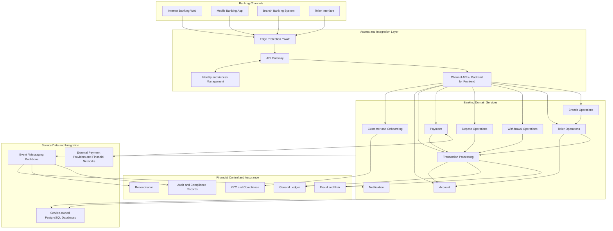

# Baraza Banking Platform — Platform Overview

## 1. Platform Purpose

Baraza is an enterprise banking modernization platform designed to evolve an established monolithic banking system into a cloud-native, service-oriented banking ecosystem.

The platform is intended to support the operational and digital requirements of microfinance institutions and other financial-service providers. Its architecture brings together core banking capabilities, customer-facing digital channels, branch operations, payment integrations, and the engineering platform required to operate these workloads securely and reliably.

Baraza is designed around a complete banking operating model rather than a single web application. The target ecosystem includes internet and mobile banking, branch and teller operations, core account and transaction processing, payment services, financial accounting, customer lifecycle management, and operational control functions.

The platform architecture is documented as a cohesive target system. Individual services and capabilities are delivered incrementally as the modernization programme progresses.

## 2. Modernization Objectives

The modernization programme has the following objectives:

- Decompose the responsibilities of the legacy monolithic banking system into well-defined domain services.
- Provide consistent banking capabilities across internet, mobile, branch, and teller channels.
- Establish secure customer onboarding, identity, authentication, and authorization workflows.
- Provide reliable account, transaction, payment, deposit, and withdrawal processing.
- Maintain accurate financial records through controlled, auditable ledger postings.
- Integrate external payment providers and other financial institutions through managed interfaces.
- Support independent service deployment, scaling, maintenance, and evolution.
- Apply infrastructure automation, container orchestration, GitOps, and continuous delivery.
- Design for security, resilience, observability, recoverability, and operational governance.

The modernization is not simply a migration of application code. It is a redesign of service boundaries, integration patterns, data ownership, deployment practices, and operational controls.

## 3. Target Platform at a Glance

Baraza is organized into five architectural areas:

1. **Banking channels** — internet banking, mobile banking, branch banking, and teller interfaces.
2. **Access and integration** — API gateway, identity and access management, channel APIs, and external integration interfaces.
3. **Banking domain services** — customer, account, transaction, payment, deposit, withdrawal, teller, branch, and notification capabilities.
4. **Financial control and data** — general ledger, audit, reconciliation, risk controls, and service-owned data stores.
5. **Cloud and platform engineering** — Kubernetes orchestration, Amazon EKS as the AWS production deployment target, infrastructure as code, CI/CD, GitOps, security, and observability.

## 4. Enterprise Target Architecture

The following diagram describes the intended end-to-end platform architecture. It is a logical architecture: it defines the capabilities and relationships that the implementation is being built toward, without requiring every capability to be deployed as a separate microservice.

The diagram is a target-state view. Detailed service contracts, synchronous APIs, asynchronous events, data ownership, and deployment topology are defined in the dedicated architecture and service documentation.

## 5. Banking Channels

Baraza provides multiple channels over which customers and bank staff interact with the same governed banking capabilities.

### 5.1 Internet Banking

The Internet Banking Web application provides the customer-facing web channel. Its intended capabilities include:

- Customer registration and secure sign-in.
- Customer dashboard and account overview.
- Account information and balances.
- Transaction history.
- Transfers and payment initiation.
- Access to customer profile and service requests.
- Clear transaction status and reference information.

The web channel consumes backend APIs. It does not own core banking rules or directly update financial balances.

### 5.2 Mobile Banking

The Mobile Banking application provides equivalent customer banking capabilities through mobile devices. It is a channel application, not automatically a separate core banking service.

It uses the platform's identity, customer, account, transaction, and payment APIs. Mobile-specific capabilities may be provided through channel APIs or a backend-for-frontend where this is justified by security, performance, or user-experience requirements.

### 5.3 Branch Banking

The Branch Banking System supports staff workflows performed within a physical branch. It provides controlled access to customer servicing and branch operations.

The architecture allows branch deployments to operate through centrally governed APIs and integration services. Where branch connectivity constraints require it, an edge component can support approved local functions, secure data synchronization, and controlled recovery after connectivity is restored. Offline financial posting must be explicitly governed to prevent duplicate or conflicting transactions.

### 5.4 Teller Interface

The Teller Interface is the staff-facing channel for cash and counter operations. It supports teller workflows such as customer identification, account lookup, deposit and withdrawal initiation, transaction confirmation, and supervisor approval where required.

The interface relies on Teller Operations and the core transaction and ledger capabilities. It does not independently maintain account balances.

## 6. Banking Domain Capabilities

The target domain model separates business responsibilities while keeping financial consistency under central control.

### 6.1 Customer and Onboarding

Manages customer records and the customer lifecycle, including registration, application review, approval, rejection, activation, profile maintenance, and customer status.

Customer onboarding integrates with identity verification and KYC controls. Access to banking functions is granted only after the relevant approval and activation rules have been satisfied.

### 6.2 Account

Manages bank account records and account lifecycle operations, including account creation, ownership, account status, product association, and account inquiries.

Account operations enforce ownership and status rules. Balance information is derived from or reconciled with authoritative financial postings rather than being changed arbitrarily by channel applications.

### 6.3 Transaction Processing

Coordinates the lifecycle of financial transactions. Responsibilities include request validation, authorization checks, transaction state management, idempotency, posting coordination, status tracking, and transaction history.

The transaction capability coordinates financial operations with the account and ledger domains. It must support traceable transaction references and safe handling of retries, timeouts, and duplicate requests.

### 6.4 Payment

Manages payment initiation and the integration lifecycle for internal and external payment methods. This includes payment validation, provider communication, callback handling, status transitions, reference management, and idempotent processing.

External payment integrations are isolated behind provider adapters so that provider-specific protocols do not leak into the core banking domain.

### 6.5 Deposit Operations

Coordinates deposit use cases across the supported channels. A deposit request is validated, authorized, assigned a unique reference, processed through the transaction workflow, and recorded through the financial ledger.

Deposit operations may originate from internet or mobile banking where applicable, branch staff, teller counters, or integrated payment channels. Cash deposits require appropriate teller and branch controls.

### 6.6 Withdrawal Operations

Coordinates withdrawal use cases, including available-funds checks, account restrictions, transaction limits, authorization, posting, and confirmation.

Cash withdrawals initiated at a branch or teller counter require staff identity, teller-session, cash-control, and approval checks. Digital withdrawals and transfers follow their applicable channel and payment rules.

### 6.7 Teller Operations

Manages teller-specific operational controls, including teller identity and sessions, assigned tills or cash drawers, transaction limits, cash positions, supervisor approvals, and end-of-day balancing.

Teller operations coordinate with account, transaction, ledger, and branch capabilities. They do not bypass the core posting workflow.

### 6.8 Branch Operations

Manages branch identity, branch configuration, operating controls, staff assignments, branch-level limits, and operational reporting.

Branch context is applied to transactions where required for authorization, audit, cash management, and reporting.

### 6.9 Notification

Delivers customer and staff notifications triggered by platform events. Delivery channels may include email, SMS, and mobile push notifications.

Notification processing is decoupled from the critical financial posting path. Delivery attempts, provider responses, retries, and failures should be traceable without changing the outcome of an already committed financial transaction.

## 7. Financial Control and Assurance Capabilities

A banking platform requires more than transaction APIs. The following capabilities provide the financial integrity and operational controls expected of an enterprise system.

### 7.1 General Ledger

The General Ledger is the authoritative accounting record for financial postings. It maintains a balanced journal of debits and credits and provides the accounting foundation for customer balances, internal accounts, fees, settlement, and financial reporting.

Financial operations must produce controlled ledger entries. The ledger must enforce balanced postings, immutable journal history, unique posting references, and traceability to the originating business transaction.

### 7.2 Reconciliation

Reconciliation compares internal transaction and ledger records with external provider, settlement, bank, and operational records. It identifies missing, duplicated, delayed, or mismatched entries and supports investigation and resolution.

### 7.3 Fraud and Risk

Fraud and Risk capabilities evaluate transactions and customer activity against configurable controls. These may include velocity limits, unusual activity indicators, transaction thresholds, risk scoring, and review or hold workflows.

Risk decisions must be explainable and auditable. The design should allow synchronous controls for high-risk actions and asynchronous analysis for broader monitoring.

### 7.4 KYC and Compliance

KYC and Compliance capabilities manage customer due diligence, identity verification, required documentation, risk classification, screening outcomes, and review history.

The platform should support configurable policy requirements appropriate to the institution and jurisdiction in which it operates.

### 7.5 Audit and Compliance Records

Audit records provide traceability for security-sensitive and financially significant actions. Records should capture the actor, action, affected resource, timestamp, originating channel, correlation or transaction reference, and relevant outcome.

Audit history must be protected from unauthorized modification and retained according to applicable institutional and regulatory policies.

### 7.6 Additional Banking Capabilities

The platform can extend to include:

- **Standing Orders and Scheduled Payments:** recurring or future-dated payment instructions, execution scheduling, retry policy, and customer authorization.
- **Cash and Vault Management:** branch cash positions, teller cash movements, vault balances, cash limits, and cash replenishment controls.
- **Fees and Charges:** configurable service fees, transaction charges, waivers, and accounting treatment.
- **Interest and Accruals:** calculation and posting of account interest and applicable accruals.
- **Customer Service and Case Management:** complaints, disputes, service requests, and investigation workflows.
- **Regulatory and Management Reporting:** controlled operational, financial, and compliance reporting.

These capabilities are part of the broader target domain landscape. Their final service boundaries should be determined by domain ownership, consistency requirements, operational scale, and integration needs rather than creating a separate microservice for every business operation.

## 8. Financial Processing Principles

Financial integrity is a central architectural concern.

- **Ledger-controlled posting:** financial transactions must result in controlled accounting entries; channel applications must never update balances directly.
- **Double-entry accounting:** each posted journal must balance debits and credits.
- **Idempotency:** retries and repeated requests must not create duplicate financial effects.
- **Explicit transaction states:** initiated, validated, pending, posted, failed, reversed, and other states must have defined transition rules.
- **Reversals instead of destructive edits:** posted financial records should be corrected through traceable reversal or adjustment entries.
- **Authorization and limits:** customer, staff, teller, branch, and transaction limits must be enforced server-side.
- **Auditability:** each financial action must be traceable from channel request through transaction processing and ledger posting.
- **Reconciliation:** internal records must be reconcilable with external providers and settlement records.

The exact posting model, account types, journal structure, and transaction state machine are specified in the detailed architecture and database documentation.

## 9. Service Architecture and Data Ownership

Baraza uses domain-oriented service boundaries. Each service owns its business rules and the data for which it is authoritative.

The target data architecture follows these principles:

- Services own their schemas and control changes to their data.
- Other services access domain data through documented APIs or events, not by writing directly into another service's tables.
- Cross-service workflows use explicit orchestration or event-driven coordination.
- Events carry stable identifiers, event types, timestamps, schema versions, and correlation references.
- Consumers are designed for duplicate delivery and safe retries.
- Financial records preserve the relationship between customer-facing transactions and ledger postings.

PostgreSQL is the relational data platform. The physical database and schema deployment model may use separate databases or isolated schemas according to service boundaries and operational requirements. The detailed database document records the actual implementation model.

## 10. Integration Architecture

Baraza integrates internal services and external systems through controlled interfaces.

### Internal integration

- Synchronous REST APIs are used where an immediate response or validation is required.
- Asynchronous events are used for decoupled notifications, audit processing, reconciliation, and other workflows that do not need to block the initiating request.
- API contracts are versioned and documented.
- Correlation identifiers support end-to-end tracing.
- Timeouts, retries, circuit breaking, and idempotency protect service interactions.

### External integration

External integration adapters isolate provider-specific protocols and credentials from core banking services. Examples include mobile money providers, payment processors, SMS and email gateways, identity verification providers, and financial networks.

Provider callbacks must be authenticated, validated, correlated to the original request, and processed idempotently.

## 11. Cloud and Platform Engineering Architecture

The target cloud deployment uses Kubernetes as the workload orchestration platform, with Amazon Elastic Kubernetes Service (Amazon EKS) as the intended AWS production Kubernetes environment.

The platform engineering foundation includes:

- **AWS infrastructure:** network segmentation, compute, managed data services, security boundaries, and environment foundations.
- **Amazon EKS:** managed Kubernetes control plane and application workload orchestration.
- **PostgreSQL:** persistent relational data storage, with managed database deployment as the production target where appropriate.
- **Docker:** repeatable application container packaging.
- **Helm:** reusable Kubernetes application packaging and environment configuration.
- **Terraform:** declarative infrastructure provisioning and change review.
- **GitHub Actions:** source-driven build, test, validation, and image delivery workflows.
- **Container registry:** versioned application images and controlled image promotion.
- **Argo CD:** GitOps reconciliation of declared Kubernetes application state.
- **Observability:** metrics, logs, traces, dashboards, alerts, and operational diagnostics.

The intended AWS deployment is organized into separate network and workload boundaries for public entry points, private application workloads, and protected data services. Production topology, availability zones, network routes, database access, secrets handling, and disaster recovery are detailed in the infrastructure and architecture documentation.

Local Kubernetes environments are development and verification tools. They are not the definition of the production platform architecture.

## 12. Deployment and Environment Model

The platform is designed to support controlled promotion across environments such as development, testing, staging, and production.

A typical delivery path is:

Environment-specific configuration is separated from application binaries. Secrets are managed through approved secret-management mechanisms and are not committed as plaintext credentials.

Deployments should be traceable to source revisions, image digests, configuration revisions, and approval records.

## 13. Security Architecture

Security is applied across customer access, staff access, APIs, services, containers, Kubernetes, cloud infrastructure, and operational processes.

Key security concerns include:

- Strong customer and workforce authentication.
- Role-based and, where necessary, attribute-based authorization.
- Least-privilege service identities and cloud IAM roles.
- Secure session and token lifecycle management.
- Encryption in transit and at rest.
- Centralized secrets management and credential rotation.
- Network segmentation and restricted service communication.
- Container image provenance, vulnerability scanning, and non-root execution.
- Kubernetes RBAC, workload security controls, and policy enforcement.
- Input validation, API protection, rate limiting, and abuse prevention.
- Tamper-resistant audit trails and controlled administrative access.
- Secure software supply-chain and dependency management.

Security controls must be enforced by backend services and infrastructure policies; hiding a user-interface function is not an authorization control.

## 14. Reliability, Availability, and Recovery

The platform is designed around explicit reliability objectives and controlled failure handling.

The architecture should incorporate:

- Multiple application replicas where availability requirements justify them.
- Health checks and readiness-based traffic management.
- Resource requests, limits, and workload scaling policies.
- Graceful shutdown and safe startup behavior.
- Timeouts, bounded retries, circuit breakers, and bulkheads for service dependencies.
- Idempotent processing and durable handling of asynchronous events.
- Database backup, point-in-time recovery where supported, and tested restoration procedures.
- Defined recovery time and recovery point objectives.
- Deployment rollback and configuration recovery procedures.
- Disaster recovery planning across the required failure domains.

High availability is not achieved by replicas alone. Database availability, dependency behavior, network paths, deployment practices, and operational response must be designed and tested together.

## 15. Observability and Operations

The operational model combines metrics, logs, traces, events, and business-level signals.

### Metrics

Examples include request rate, latency, error rate, saturation, JVM and process health, database connection usage, queue depth, pod restarts, and resource utilization.

### Logs

Structured logs support troubleshooting, security investigation, and operational analysis. Sensitive customer and payment data must be excluded or appropriately masked.

### Distributed tracing

Trace and correlation identifiers connect requests across gateways, services, payment providers, and asynchronous consumers.

### Banking and operational signals

Operational dashboards should also expose relevant business indicators, such as payment outcomes, transaction failures, pending items, reconciliation exceptions, teller cash differences, and notification delivery failures.

Alerts should be actionable, linked to operational runbooks, and tuned to reduce noise.

## 16. Engineering and Governance Principles

The platform follows these engineering principles:

| Principle | Application in Baraza |
|---|---|
| Domain ownership | Services own defined banking responsibilities and authoritative data |
| Financial integrity | Ledger-controlled, balanced, traceable financial postings |
| Secure by design | Identity, authorization, encryption, and audit controls across layers |
| API and event contracts | Explicit, versioned service integration |
| Automation | Repeatable builds, tests, infrastructure, and deployments |
| Declarative operations | Infrastructure and deployment state maintained as code |
| Observability | Technical and business-level visibility |
| Resilience | Bounded failure handling, recovery, and tested operational procedures |
| Controlled change | Reviewable changes, environment promotion, and rollback |
| Evolvability | Services and channels can grow without destabilizing the entire platform |

## 17. Documentation Map

The following documents provide deeper implementation and operational detail:

- [Architecture](architecture.md) — service boundaries, interactions, and end-to-end architecture.
- [Database](database.md) — data ownership, database design, migrations, and financial data integrity.
- [Workstation Setup](workstation-setup.md) — developer workstation prerequisites and setup.
- [Docker](docker.md) — container build and runtime conventions.
- [Kubernetes](kubernetes.md) — workload orchestration and cluster configuration.
- [Helm](helm.md) — chart structure and environment values.
- [Terraform](terraform.md) — cloud infrastructure as code.
- [CI/CD](ci-cd.md) — build, test, image, and delivery workflows.
- [GitOps and Argo CD](gitops-argocd.md) — declarative deployment and reconciliation.
- [Security](security.md) — application, container, Kubernetes, and cloud security.
- [Monitoring](monitoring.md) — metrics, logs, traces, dashboards, and alerting.
- [Operations](operations.md) — operational model and service management.
- [Troubleshooting](troubleshooting.md) — diagnostic procedures.
- [Deployment Runbook](runbooks/deployment.md) — controlled application deployment.
- [Rollback Runbook](runbooks/rollback.md) — recovery from unsuccessful releases.
- [Image Management Runbook](runbooks/image-management.md) — image build, tagging, and registry operations.
- [Kubernetes Debugging Runbook](runbooks/kubernetes-debugging.md) — workload and cluster diagnostics.

## 18. Platform Evolution

Baraza is being delivered incrementally against the target architecture described in this documentation. The architecture provides the destination and the implementation sequence will progressively establish the services, integrations, controls, and operational capabilities required to realize it.

The platform is intended to evolve through disciplined domain implementation, integration testing, security validation, infrastructure automation, deployment automation, resilience testing, and operational readiness. Detailed implementation status and release evidence belong in the project roadmap and service-specific documentation, while this overview remains the stable description of the platform's purpose and target capabilities.
