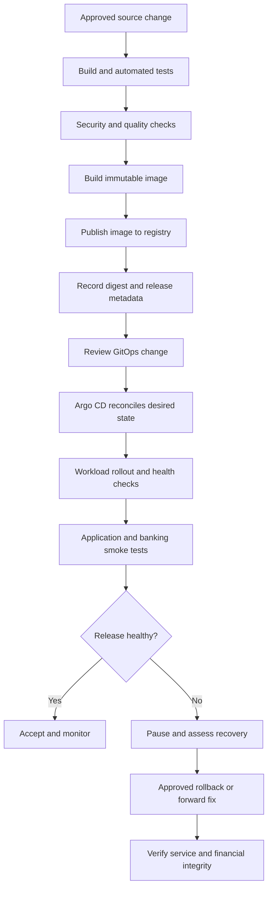
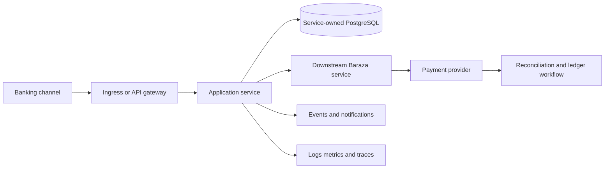

# Deployment Runbook

## 1. Purpose and scope

This runbook describes the controlled release of Baraza services from source code through container images and Kubernetes workloads, followed by application and banking validation. It covers local development, Minikube, Helm, GitHub Actions, GHCR, Argo CD GitOps, and the intended AWS EKS production environment.

Baraza modernizes an established microfinance banking system into a cloud-native platform. Minikube is the current local Kubernetes environment. EKS and managed AWS services are the production target; do not interpret this runbook as evidence that EKS has already been provisioned.

Use this runbook with [Troubleshooting](../troubleshooting.md), [Rollback](rollback.md), [Image management](image-management.md), and [Kubernetes debugging](kubernetes-debugging.md).

## 2. Deployment principles

1. Protect customer funds, records, and in-flight transactions.
2. Build and test an artifact once, then promote the same immutable image digest through environments.
3. Keep Kubernetes desired state in the GitOps repository when Argo CD manages the environment.
4. Review application, database, Helm, GitOps, and infrastructure changes before deployment.
5. Treat schema changes separately from application releases. Rolling back an image does not reverse a database migration.
6. Verify business workflows, not only pod health.
7. Prefer reversible, narrowly scoped changes.
8. Use least privilege and approved secret-management mechanisms.

## 3. Environments and deployment types

| Type | Purpose | Mechanism |
|---|---|---|
| Local service | Fast application development | Maven / Spring Boot |
| Local container | Validate image and dependencies | Docker |
| Local Kubernetes | Integration testing | Minikube, Helm |
| Development | Integrated service validation | CI/CD and GitOps |
| Staging | Production-like release validation | Approved pipeline and GitOps |
| Production target | Customer-facing workloads | Approved EKS release process |

Production deployments require formal change approval, security controls, monitoring, operational coverage, and a tested recovery plan.

## 4. Roles and release ownership

| Role | Responsibility |
|---|---|
| Service owner | Application readiness, dependencies, health checks and business validation |
| Platform/DevOps | Build, artifact promotion, deployment configuration and platform health |
| Database owner | Migration review, backup/restore readiness and database health |
| Security owner | Access, secrets, image and dependency security |
| Banking operations | Customer impact, business readiness and operational acceptance |
| Release owner | Change approval, deployment window, go/no-go and communications |

Follow the organisation's separation-of-duties policy for shared and production environments.

## 5. Pre-deployment checklist

### Change and source readiness

- [ ] Change record, release scope and target environment are identified.
- [ ] Code review and required approvals are complete.
- [ ] Source commit and release notes are recorded.
- [ ] Deployment window, communications and support coverage are agreed.
- [ ] Rollback or forward-recovery plan is documented.
- [ ] No unreviewed local changes are included.

### Build and artifact readiness

- [ ] Unit and integration tests pass.
- [ ] Static analysis and security checks meet release policy.
- [ ] Container image builds successfully.
- [ ] Image is tagged with a traceable immutable identifier.
- [ ] Registry publication and image digest are recorded.
- [ ] Helm chart and rendered manifests are validated.
- [ ] Target configuration and secret references are available.

### Database and banking readiness

- [ ] Migration scripts and compatibility are reviewed.
- [ ] Backup and recovery requirements are verified.
- [ ] Connection capacity and expected workload are understood.
- [ ] In-flight transactions, payment callbacks and scheduled jobs are considered.
- [ ] Ledger, reconciliation and audit requirements are understood.
- [ ] No deployment action depends on manually changing balances or transaction states.

### Platform readiness

- [ ] Cluster, namespace and deployment target are confirmed.
- [ ] Nodes have sufficient capacity.
- [ ] Registry access, networking, ingress and storage are ready.
- [ ] Database and required downstream services are reachable.
- [ ] Monitoring, logging and alert routing are available.
- [ ] Baseline availability, latency and error rates are recorded.

## 6. Confirm the deployment target

Run these commands from the application repository:

```powershell
git status --short
git branch --show-current
git rev-parse HEAD
git log -1 --oneline
java -version
mvn -version
```

Resolve a dirty working tree or unexpected branch before producing a release artifact. Baraza Java services target Java 21; use the Maven wrapper when present.

Confirm the Kubernetes context before any cluster operation:

```powershell
kubectl config current-context
kubectl get nodes -o wide
kubectl get namespaces
kubectl get pods -A
```

For local work, confirm the context is the intended Minikube cluster. For shared or production work, verify cluster identity using the approved access process. Never assume the active context is correct.

Confirm the exact service directory, Dockerfile, chart path, release name, namespace, values file, and GitOps application entry. Do not infer one service's deployment paths from another service.

## 7. Build and test the application

Run from the relevant service directory.

```powershell
.mvnw.cmd clean verify
```

If the service does not contain a Maven wrapper, use the repository's documented Maven installation:

```powershell
mvn clean verify
```

Review test reports and verify the expected artifact exists. Do not proceed with failing tests or skipped tests without an approved reason.

Validate target configuration, including:

- Spring profile and application properties.
- Database URL, database name, credential reference and TLS settings.
- Service-to-service URLs and timeouts.
- JWT issuer, validation settings and key references.
- External payment-provider endpoint and secret references, where applicable.
- Health endpoint exposure, resource settings and graceful shutdown.

Never commit credentials or copy production secrets into local configuration.

## 8. Build and publish the container image

Use an immutable or traceable tag derived from the source commit or release version. Record the image digest. Do not use `latest` as the only release identifier.

Example PowerShell variable (replace placeholders with the approved registry path and commit):

```powershell
$Image = "ghcr.io/<OWNER>/<SERVICE>:<COMMIT_SHA>"
docker build -t $Image .
docker image inspect $Image
```

For shared environments, prefer the approved GitHub Actions workflow:

1. Push reviewed source changes to the approved branch.
2. Review automated build and test results.
3. Review required security and dependency scan results.
4. Confirm the image was published to GHCR.
5. Record the image tag and digest.
6. Update the environment deployment declaration to reference that exact artifact.

Verify registry access and artifact availability:

```powershell
docker pull $Image
docker image inspect $Image
```

Never place registry tokens in scripts, shell history, repository files, or workflow output. For private images, verify the image pull secret in the target namespace without displaying its value.

## 9. Database migration deployment

Migrations are release dependencies and must be reviewed separately from the application rollout.

Classify the change:

- **Additive:** compatible new table, nullable column, index or structure.
- **Expand-and-contract:** add a new structure, deploy code compatible with both versions, migrate data, then remove the old structure in a later release.
- **Destructive:** drops, rewrites, incompatible type changes or constraint changes.

Preferred sequence:

1. Review SQL and expected execution time.
2. Test against a representative non-production database.
3. Confirm backup and recovery requirements.
4. Confirm migration ownership and execution mechanism.
5. Apply using the approved process.
6. Verify Flyway history and resulting schema.
7. Deploy compatible application code.
8. Validate reads, writes and data integrity.

The account and transaction services use Flyway in the current implementation. Confirm the migration mechanism for other services rather than assuming all services share one database or migration lifecycle.

Never edit an already-applied migration, delete Flyway history to bypass validation, or run a destructive migration without an approved recovery plan. Application rollback does not automatically reverse a schema migration. Never use a migration to make unexplained financial adjustments.

## 10. Local Minikube deployment with Helm

This section is for local validation, not production.

```powershell
minikube status
kubectl config current-context
kubectl get nodes
kubectl get pods -A
```

Start the local cluster only when intentionally stopped and local capacity is sufficient:

```powershell
minikube start
```

Validate the actual chart and environment values:

```powershell
helm lint <CHART_PATH>
helm template <RELEASE_NAME> <CHART_PATH> --namespace <NAMESPACE> -f <VALUES_FILE>
```

Inspect the rendered manifests for image and tag, namespace, selectors, ports, configuration, secret references, probes, resource requests/limits, service account, security context, storage and ingress.

For a new release:

```powershell
helm install <RELEASE_NAME> <CHART_PATH> --namespace <NAMESPACE> --create-namespace -f <VALUES_FILE>
```

For an existing release:

```powershell
helm upgrade <RELEASE_NAME> <CHART_PATH> --namespace <NAMESPACE> -f <VALUES_FILE>
```

Choose install or upgrade based on the actual release state; do not run both blindly.

Verify:

```powershell
kubectl rollout status deployment/<DEPLOYMENT_NAME> -n <NAMESPACE>
kubectl get deployments,pods,services -n <NAMESPACE> -o wide
kubectl get events -n <NAMESPACE> --sort-by=.lastTimestamp
helm status <RELEASE_NAME> -n <NAMESPACE>
```

If a pod is not ready, stop and investigate events, logs, image, probes, configuration and dependencies. See [Kubernetes debugging](kubernetes-debugging.md) and [Troubleshooting](../troubleshooting.md).

## 11. Deploy through Argo CD GitOps

For an Argo CD-managed environment, the GitOps repository is the source of desired Kubernetes state.

1. Identify the application entry, environment values/manifests and target revision.
2. Update the image reference to the artifact already built and tested.
3. Review configuration and secret references.
4. Confirm destination cluster, namespace and chart/manifests path.
5. Commit and push the reviewed GitOps change.
6. Obtain required review and approval.
7. Observe Argo CD synchronization and resource health.

Review the diff before sync. If automated sync is enabled, the Git commit may trigger deployment without a manual sync. Confirm the configured policy instead of issuing a redundant sync.

Verify the application is Synced and Healthy, the expected replicas are available, pods use the intended image, Services have ready endpoints, and no unexpected drift or repeated reconciliation failure exists. A successful sync is not a substitute for business smoke tests.

Avoid persistent imperative changes to Argo-managed resources. If an emergency live change is approved, record it and reconcile the Git source promptly.

## 12. AWS EKS production target

Use this section only after the AWS account, EKS cluster, access controls, network, database, secrets and release pipeline are provisioned and approved.

### Pre-flight checks

- Confirm AWS account and region.
- Confirm EKS cluster identity and Kubernetes context.
- Confirm private endpoint access and approved network path.
- Confirm node capacity and autoscaling.
- Confirm private database connectivity and security groups.
- Confirm registry access and image provenance.
- Confirm ingress/load balancer, DNS, TLS and WAF controls as applicable.
- Confirm secrets and encryption keys are available through approved secret management.
- Confirm backups, monitoring, alerting and incident coverage.

```powershell
aws sts get-caller-identity
aws configure get region
kubectl config current-context
kubectl get nodes -o wide
```

Do not proceed if account, region, cluster or namespace is ambiguous.

### Rollout strategy

Select a strategy appropriate to service state and traffic controls:

- Rolling update for backward-compatible stateless service changes.
- Canary/progressive delivery where traffic control and metrics support it.
- Blue/green where separate environments and safe traffic switching exist.
- Approved maintenance window where versions cannot safely coexist.

Account for long-running requests, payment callbacks, scheduled jobs, message consumers and in-flight transactions. Do not terminate or duplicate processing merely to accelerate a rollout.

Production deployments must use approved change records and deployment identities, least privilege, protected secrets, reviewed infrastructure changes, retained audit logs, and named rollback decision-makers.

## 13. Post-deployment verification

### Infrastructure and workload

- [ ] Cluster and nodes are healthy.
- [ ] Expected replicas are available.
- [ ] Pods are Ready and stable.
- [ ] Services have ready endpoints.
- [ ] Ingress/gateway routes to the intended backend.
- [ ] No new critical events, restarts or resource pressure.

### Application and dependencies

- [ ] Health endpoint returns the expected status.
- [ ] Logs contain no unresolved startup/dependency errors.
- [ ] Database connectivity is healthy.
- [ ] Authentication and authorization behave correctly.
- [ ] Service-to-service calls succeed.
- [ ] Metrics and traces are visible where instrumentation is configured.

### Banking business validation

Use approved non-production customers and accounts in development/staging. Production smoke tests must be approved and must not create unintended financial activity.

- [ ] Customer and staff sign-in follow expected access rules.
- [ ] Onboarding and staff approval controls remain correct.
- [ ] Account information and transaction history are available and consistent.
- [ ] An authorized controlled transaction follows the expected lifecycle.
- [ ] Payment status is confirmed with the provider where relevant.
- [ ] Ledger postings and reconciliation show no unexplained differences.
- [ ] Audit evidence is retained.
- [ ] Notifications and asynchronous processing work where enabled.

Compare request rate, error rate, latency, restarts, resource use, database connections and banking indicators with the pre-deployment baseline. Investigate material regressions even if Kubernetes reports Healthy.

## 14. Go/no-go criteria

Pause progression and involve the release owner if any of the following occurs:

- Unexpected customer access or authorization failures.
- Database migration failure or schema incompatibility.
- Repeated pod restarts, unavailable replicas or failed readiness.
- Sustained error-rate or latency regression beyond release thresholds.
- Payment outcome cannot be established for affected transactions.
- Duplicate, missing or inconsistent ledger postings.
- Monitoring or audit evidence is unavailable for a high-risk change.
- Deployment affects an unrelated service or environment.

The release owner and relevant service/business owners decide whether to pause, continue, roll back or use forward recovery. Do not downgrade an incident because infrastructure health checks are green.

## 15. Rollback and forward recovery

Rollback is not always the safest response. Application rollback may be suitable for a defective stateless release, but a schema migration, ledger posting or external payment is not reversed by redeploying an older image.

Before rollback:

1. Identify the previous known-good release and artifact.
2. Check schema compatibility with the previous application version.
3. Check in-flight requests, callbacks, scheduled jobs and consumers.
4. Determine whether financial postings occurred under the new release.
5. Obtain required approval.
6. Execute [Rollback runbook](rollback.md).
7. Verify technical health and business integrity.

Use a forward fix when reverting is unsafe or incompatible. Financial correction must use approved ledger, reversal and reconciliation processes.

## 16. Deployment workflow



## 17. Service request and deployment dependencies

A deployment can succeed technically while a downstream dependency is unavailable. Validate dependencies relevant to the released service.



When a request fails, identify the last confirmed successful hop. Do not infer that a downstream operation failed simply because an upstream caller timed out.

## 18. Release evidence and handover

Record the following in the release/change record:

- Source repository, branch, commit SHA and review reference.
- Build workflow, test and security results.
- Image name, immutable tag and digest.
- Helm chart/version, values revision and manifest review.
- GitOps commit and Argo CD application/revision.
- Database migration versions and validation result.
- Deployment start/end time and operator identity.
- Pre/post-deployment health and business checks.
- Incidents, deviations, approvals and recovery actions.
- Outstanding risks and monitoring owner.

Do not attach secrets, tokens, raw customer data or unredacted payment payloads.

## 19. Common deployment failures

| Failure | First investigation |
|---|---|
| Maven build fails | First compilation/test error and toolchain |
| Image build fails | Dockerfile, build context and dependency access |
| Registry push denied | Workflow permissions and package access |
| ImagePullBackOff | Exact image reference and pull credentials |
| CrashLoopBackOff | Previous logs and startup dependencies |
| Pod Pending | Resource requests, scheduling and storage |
| Helm render fails | Chart lint and values/template errors |
| Helm upgrade fails | Release history and Kubernetes events |
| Argo CD OutOfSync | Git revision and desired/live diff |
| Service has no endpoints | Selectors, pod labels and readiness |
| Migration fails | Stop rollout; inspect migration/schema state |
| Health endpoint fails | Startup logs, probe path and dependencies |
| API smoke test fails | Channel, gateway, service and database path |
| Payment outcome unknown | Preserve idempotency reference and query provider |
| Ledger validation fails | Stop release progression and escalate |

For detailed diagnosis, use [Troubleshooting](../troubleshooting.md).

## 20. Deployment completion checklist

- [ ] Correct environment and artifact were deployed.
- [ ] Source revision, image digest and release metadata are recorded.
- [ ] Desired and live workload state agree.
- [ ] Application and dependency health checks pass.
- [ ] Business smoke tests pass.
- [ ] Financial integrity and reconciliation checks are satisfactory.
- [ ] Monitoring and alerting are active.
- [ ] Approvals and release evidence are recorded.
- [ ] Known issues have owners.
- [ ] Operations and stakeholders have been informed.

## 21. Related documentation

- [Platform overview](../platform-overview.md)
- [Architecture](../architecture.md)
- [Database](../database.md)
- [Docker](../docker.md)
- [Kubernetes](../kubernetes.md)
- [Helm](../helm.md)
- [Monitoring](../monitoring.md)
- [Troubleshooting](../troubleshooting.md)
- [Rollback runbook](rollback.md)
- [Image management runbook](image-management.md)
- [Kubernetes debugging runbook](kubernetes-debugging.md)
