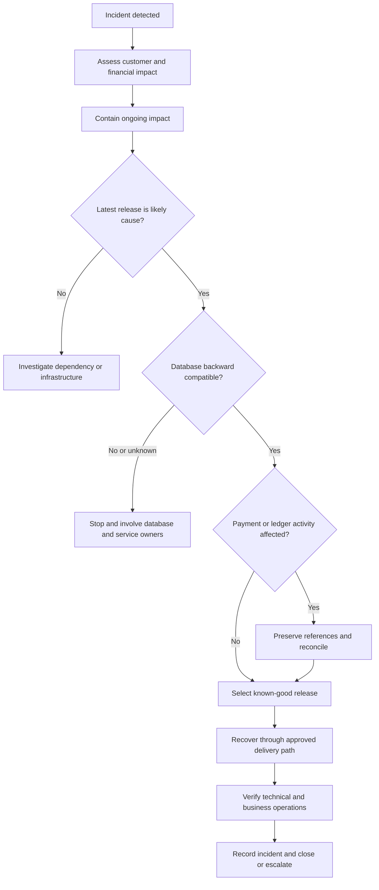

# Rollback and Recovery Runbook

## 1. Purpose and scope

This runbook defines how to recover Baraza services after a faulty application release, container image, configuration change, or platform change. It covers the current local Kubernetes environment and the intended AWS EKS production environment.

Rollback restores a known-good application state. It does not automatically reverse database migrations, external payment activity, or financial postings. Those require separate compatibility and reconciliation decisions.

## 2. Recovery principles

1. Protect customers and the integrity of financial records.
2. Contain ongoing impact before changing the platform.
3. Identify the affected service, release, dependency, and change.
4. Prefer a known-good immutable image digest and reviewed configuration.
5. Confirm database compatibility before reverting application code.
6. Preserve payment idempotency and provider references.
7. Never repair a financial balance by directly editing an account balance or ledger row.
8. Record actions, timestamps, approvals, evidence, and outcomes.

## 3. Environment scope

| Environment | Recovery mechanism | Status |
|---|---|---|
| Local development | Minikube, Helm, Kubernetes | Current development environment |
| GitOps delivery | Argo CD and the Baraza GitOps repository | Used where configured |
| Production target | AWS EKS, Helm, Argo CD, managed PostgreSQL | Target architecture; provision and validate before use |

Do not assume a production EKS cluster exists merely because Terraform configuration is present.

## 4. When to roll back

Consider rollback when a release causes critical API or customer-journey failures, elevated errors or latency, authentication failures, database connectivity failures, inconsistent transaction processing, a security regression, or material service degradation.

Do not treat every alert as a reason to roll back. Establish whether the cause is the latest release, a dependency outage, capacity, networking, credentials, or an external provider.

## 5. Decision flow



## 6. Roles and approval

The incident lead coordinates recovery and communication. The service owner validates application behaviour. The platform engineer performs deployment recovery. The database owner reviews schema and migration compatibility. The payments or finance operations owner validates provider outcomes and ledger integrity.

Production recovery must follow the organisation's incident and change approval process. The person executing a rollback must not independently approve a financial correction.

## 7. Pre-rollback assessment

Capture the incident identifier, start time, severity, affected environment, services and namespaces, deployment and Helm history, image tags and digests, recent commits, configuration changes, database migration state, relevant logs and metrics, and customer-impact examples.

For payment-related incidents, preserve transaction identifiers, provider references, idempotency keys, and known transaction states. Never copy secret values into incident notes.

Containment may include pausing a rollout, disabling a faulty feature flag, stopping new work from entering an affected flow, or routing traffic away from an unhealthy instance. Choose the least disruptive reversible action.

## 8. Kubernetes deployment recovery

Inspect the rollout and cluster state:

```powershell
kubectl get deployments -n <namespace>
kubectl get pods -n <namespace> -o wide
kubectl get events -n <namespace> --sort-by=.lastTimestamp
kubectl rollout history deployment/<deployment-name> -n <namespace>
kubectl describe deployment/<deployment-name> -n <namespace>
```

Identify the last known-good revision. Confirm its image, configuration, service dependencies, and database compatibility. Execute recovery only through the approved release mechanism for that environment.

After recovery, verify rollout completion, pod readiness, restart counts, events, and application health endpoints. A successful Kubernetes rollout alone does not prove banking operations are correct.

## 9. Helm release recovery

Inspect the release before selecting a known-good revision:

```powershell
helm list -n <namespace>
helm history <release-name> -n <namespace>
helm get values <release-name> -n <namespace> --all
helm status <release-name> -n <namespace>
```

Check the selected revision's chart version, image digest, configuration, and compatibility with the current database schema. Follow the team's approved Helm recovery procedure and record the selected revision and operator.

Do not restore an old values file blindly; it may reintroduce obsolete endpoints, resource limits, security settings, or secret references.

## 10. Argo CD and GitOps recovery

For Argo CD-managed applications, Git is the durable source of desired state.

1. Identify the commit that introduced the failing state.
2. Identify and verify the last known-good Git commit and its image/configuration references.
3. Prepare a reviewed revert or corrective commit in the GitOps repository.
4. Confirm database compatibility and external side effects before merging.
5. Merge through the normal review process.
6. Allow Argo CD to reconcile, or use the approved sync procedure.
7. Verify that live resources match the intended Git revision.

Do not rely on an untracked live-cluster change. Argo CD may reconcile the cluster back to Git. Record emergency live changes and represent the approved final state in Git.

## 11. Container image recovery

Use the exact previously validated image, preferably pinned by digest. Do not rely on mutable tags such as `latest`.

Record the registry and repository, tag and digest, build workflow run, source commit, available test and vulnerability scan results, and the environment where the artifact was last validated. Confirm that the image is trusted, available to the cluster, and compatible with current configuration and schema. Rebuilding old source does not guarantee an identical artifact.

## 12. Database and migration safety

Application rollback and database rollback are separate operations.

Use an expand-and-contract migration approach where practical: add backward-compatible schema elements, deploy versions that support old and new structures, migrate and validate data, and remove obsolete structures only after dependent versions are retired.

Before reverting application code, inspect Flyway migration history and determine whether the previous application version supports the current schema. A committed migration may not be safely reversible. Do not manually edit Flyway history or drop tables, columns, or data to make an old release start.

If compatibility is uncertain, stop and involve the database and service owners. Prefer a forward fix when reverting code could corrupt or misinterpret persisted data.

## 13. Payment and external-provider safety

A timeout does not prove that a payment failed. The provider may have accepted the request even if Baraza did not receive the response.

- Preserve the original transaction identifier, provider reference, and idempotency key.
- Resolve provider status using the original reference and the provider's supported process.
- Do not submit a second payment with a new idempotency key merely to obtain a response.
- Keep uncertain transactions in an explicit pending or review state until their outcome is established.
- Reconcile provider records with Baraza transaction records and ledger postings.
- Escalate discrepancies to authorised payments and finance operations owners.

A rollback must not erase evidence of a payment request or create a second financial effect.

## 14. Ledger and balance integrity

After recovery, verify the transaction lifecycle and corresponding financial postings. Confirm completed operations have the expected ledger entries, debit and credit postings balance, failed operations have no unintended postings, and pending operations remain distinguishable from completed ones.

Never resolve a discrepancy by directly updating an account balance. Use the authorised reversal, adjustment, and reconciliation workflow with the required approval and audit trail.

## 15. Configuration and feature mitigation

A targeted configuration correction or feature-flag disablement may be safer than reverting an entire service. Restore known-good non-secret values through the approved process. Do not print credentials, tokens, connection strings, or secret values during diagnostics. Verify that workloads can consume the intended secret references.

## 16. Local Minikube recovery

Confirm that the active context is the intended local cluster:

```powershell
kubectl config current-context
kubectl get namespaces
kubectl get pods -A
helm list -A
kubectl get events -A --sort-by=.lastTimestamp
```

Identify the affected namespace, release, deployment, and image. Follow the Kubernetes or Helm recovery process above, then validate the service health endpoint and database connectivity. Keep local recovery separate from production change records.

## 17. Production EKS recovery target

Once AWS is provisioned, apply the same controls using the approved EKS access path and production change process. Confirm cluster identity and namespace before acting. Verify private cluster access, workload identity, registry access, secrets, network policies, database connectivity, and observability.

Production actions must be performed only by authorised operators using the correct account, role, and cluster context. Do not copy local Minikube assumptions or credentials into production.

## 18. Post-recovery verification

Technical verification:
- Deployment completed and desired replicas are ready.
- Pods are stable without repeated restarts or failing probes.
- Service endpoints, ingress, DNS, and network policies work.
- Application health and readiness endpoints pass.
- Database connections and required migrations are healthy.
- Logs, metrics, and traces indicate recovery.

Banking and customer verification:
- Customer login and account retrieval work.
- Account and transaction history are consistent.
- Transfers and payment workflows follow their expected state model.
- No duplicate payment or ledger posting has been introduced.
- Pending and failed transactions are handled correctly.
- Reconciliation confirms financial integrity.

Resume traffic or re-enable a feature only after the service owner and relevant business owner confirm the required checks.

## 19. Communication and incident record

Record the timeline, customer impact, triggering change, evidence, approvals, recovery action, selected artifact or revision, database assessment, payment and ledger checks, verification results, and remaining risks.

Communicate status through established operational channels. If customer transactions remain under investigation, state that clearly rather than reporting full recovery.

## 20. Common recovery mistakes

| Mistake | Risk | Safer approach |
|---|---|---|
| Rolling back without checking schema compatibility | Application failure or data corruption | Review migration state first |
| Reusing a mutable image tag | Unreproducible recovery | Pin a validated image digest |
| Changing only live resources | GitOps may reverse the change | Commit approved desired state to Git |
| Treating payment timeout as failure | Duplicate payment | Resolve provider status using original references |
| Editing balances manually | Ledger inconsistency and audit gaps | Use authorised reversal or adjustment workflows |
| Declaring recovery when pods are ready | Customer journeys may still fail | Verify APIs and financial operations |
| Exposing secrets during diagnostics | Credential compromise | Inspect references without printing values |

## 21. Recovery completion checklist

- [ ] Incident impact and affected services are documented.
- [ ] Known-good artifact and configuration were selected.
- [ ] Database compatibility was reviewed and recorded.
- [ ] Payment provider outcomes were checked where applicable.
- [ ] Ledger integrity and reconciliation were verified where applicable.
- [ ] Technical health and customer journeys passed.
- [ ] GitOps desired state reflects the approved release.
- [ ] Stakeholders were informed and residual risks assigned.
- [ ] Follow-up actions and a post-incident review were created.

## 22. Related documentation

- [Platform architecture](../architecture.md)
- [Database architecture and migration practices](../database.md)
- [Docker and container image practices](../docker.md)
- [Kubernetes operations](../kubernetes.md)
- [Helm deployment practices](../helm.md)
- [Monitoring and observability](../monitoring.md)
- [Deployment runbook](deployment.md)
