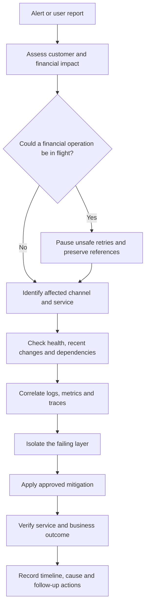
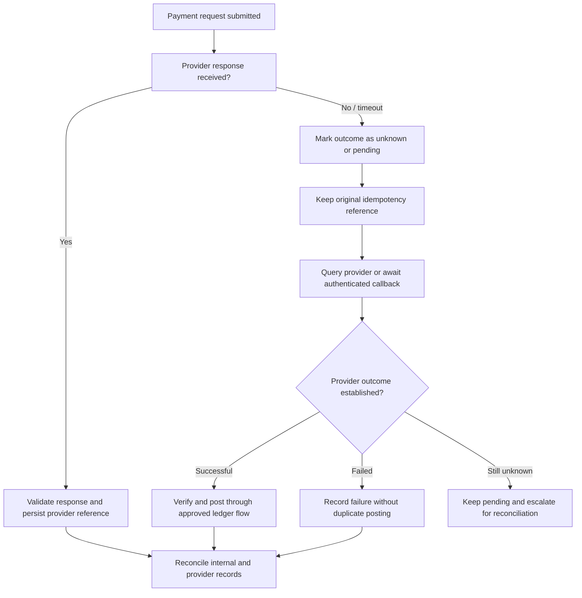
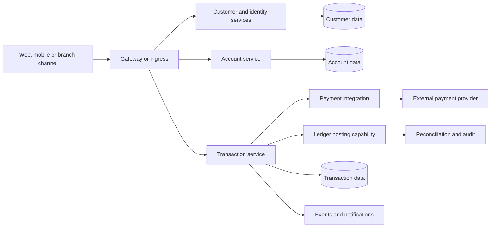

# Troubleshooting Guide

## 1. Purpose

This guide provides a repeatable method for diagnosing and resolving failures across the Baraza Banking Platform. It covers the application services, PostgreSQL, containers, Kubernetes, Helm, GitOps, CI/CD, cloud infrastructure, web channel, payment integrations, and banking operations.

Baraza is a modernization programme for an established microfinance banking system. The target platform is a cloud-native, service-oriented banking platform. The current engineering environment uses local development tools and Minikube; Amazon EKS and managed AWS services are the intended production deployment target. A troubleshooting instruction for EKS or a future banking domain is an operational design guide, not proof that the component is already deployed.

Use this document alongside the operational runbooks:

- [Deployment](runbooks/deployment.md)
- [Rollback](runbooks/rollback.md)
- [Image management](runbooks/image-management.md)
- [Kubernetes debugging](runbooks/kubernetes-debugging.md)

## 2. Operating principles

### 2.1 Protect customer funds and records first

Banking incidents require more care than ordinary application incidents.

1. Establish whether customer access, transaction processing, payment posting, or financial reporting is affected.
2. Stop unsafe retries when an operation may already have reached a payment provider or the ledger.
3. Treat a timeout as an unknown outcome, not proof that a transaction failed.
4. Do not manually update account balances to make a screen or report appear correct.
5. Preserve transaction references, provider references, timestamps, request identifiers, logs, and audit evidence.
6. Use the approved transaction, ledger, reversal, and reconciliation workflows to correct financial state.
7. Escalate suspected data corruption, duplicate posting, unauthorized access, or unexplained ledger differences immediately.

The ledger is the financial record of truth. Account balances shown to channels must be derived from, or reconciled against, the authoritative posting records according to the platform's ledger design.

### 2.2 Diagnose before changing

- Identify the affected users, channels, services, regions, and transaction types.
- Determine when the issue began and whether it correlates with a deployment, configuration change, migration, certificate change, or provider outage.
- Check health and dependencies before restarting workloads.
- Capture relevant evidence before deleting pods, containers, jobs, or persistent resources.
- Change one variable at a time where practical.
- Verify the recovery from the customer or business workflow, not only from a process status.

### 2.3 Use the right environment

| Environment | Purpose | Troubleshooting boundary |
|---|---|---|
| Local development | Build and test individual services | PowerShell, Maven, Docker, local PostgreSQL |
| Local Kubernetes | Integration and deployment testing | Minikube, kubectl, Helm, Argo CD |
| Staging | Pre-production validation | Environment-specific configuration and test data |
| Production target | Customer-facing banking workloads | EKS, managed database, controlled change and incident procedures |

Never copy production credentials, customer data, or payment-provider secrets into a local troubleshooting session.

## 3. Incident triage workflow

Start with the business impact, then follow the request path from the channel through the service and its dependencies.

### 3.1 Initial questions

- What customer or staff action failed?
- Is the failure isolated to one customer, account, branch, channel, service, or all users?
- Does it affect reads, writes, authentication, or a particular transaction type?
- Is the failure intermittent or continuous?
- What is the first known failure time?
- What changed shortly before the failure?
- Are requests failing before reaching the service, inside the service, or at a downstream dependency?
- Could a financial operation have completed despite the error shown to the caller?

### 3.2 Triage sequence



### 3.3 Severity and escalation

Use the organisation's incident classification where one exists. As a practical guide:

| Severity | Example | Response |
|---|---|---|
| Critical | Suspected ledger corruption, unauthorized transactions, widespread inability to transact, duplicate financial posting | Declare an incident, engage banking operations and security immediately, protect evidence and prevent further harm |
| High | Major channel unavailable, payment processing broadly failing, database unavailable | Engage service owners and operations, assess safe failover or rollback |
| Medium | One service degraded, elevated errors or latency with a workaround | Assign an owner, investigate dependencies and monitor impact |
| Low | Non-customer-facing defect or isolated development issue | Track and resolve through normal engineering workflow |

Do not downgrade an incident solely because infrastructure health checks are green. Business transaction outcomes and data integrity determine the real impact.

## 4. Fast local checks

The following commands are intended for Windows PowerShell. Run them from the repository root unless a command says otherwise.

### 4.1 Confirm repository and tool versions

```powershell
Get-Location
git status --short
git log -5 --oneline
java -version
mvn -version
docker version
kubectl version --client
helm version
```

A missing executable or daemon is an environment problem, not necessarily an application defect.

### 4.2 Check known local service ports

The current local service ports are:

| Component | Typical local port |
|---|---:|
| Customer service | 8080 |
| Account service | 8081 |
| Transaction service | 8082 |
| Customer/core database mapping | 5433 |
| Transaction database mapping | 5434 |
| Payment database mapping, where configured | 5435 |

Port mappings can differ by Compose file, profile, or local environment. Inspect the active configuration before assuming a port is in use.

```powershell
$ports = 8080,8081,8082,5433,5434,5435
Get-NetTCPConnection -State Listen -ErrorAction SilentlyContinue |
  Where-Object { $ports -contains $_.LocalPort } |
  Sort-Object LocalPort |
  Format-Table LocalAddress,LocalPort,OwningProcess
```

Identify a process by PID:

```powershell
Get-Process -Id <PID>
```

### 4.3 Test HTTP health endpoints

Where Actuator health is enabled and exposed:

```powershell
Invoke-RestMethod http://localhost:8080/actuator/health
Invoke-RestMethod http://localhost:8081/actuator/health
Invoke-RestMethod http://localhost:8082/actuator/health
```

A 404 may mean the endpoint is not exposed; a connection refusal usually means no process is listening on that address and port. A health response does not prove that every business operation is healthy.

## 5. Application and Spring Boot problems

### 5.1 Service does not start

**Symptoms:** Maven exits with an error, the Spring Boot process terminates, or a container repeatedly restarts.

Check in this order:

1. Read the first meaningful exception and the deepest relevant `Caused by` section.
2. Confirm Java version and Maven wrapper/tool version.
3. Confirm the active Spring profile.
4. Check required environment variables and configuration files.
5. Check database reachability and schema compatibility.
6. Check whether the configured port is already occupied.
7. Confirm the service artifact was built from the expected source revision.

Build from the relevant service directory:

```powershell
mvn clean test
mvn spring-boot:run
```

If the repository uses the Maven wrapper, prefer it for a reproducible project-specific Maven version:

```powershell
.mvnw.cmd clean test
```

**Common causes**

| Log or symptom | Likely cause | Investigation |
|---|---|---|
| Address already in use | Another process owns the port | Use `Get-NetTCPConnection` and identify the PID |
| Could not resolve placeholder | Missing property or environment variable | Check profile, environment and configuration binding |
| Failed to configure a DataSource | Missing or invalid JDBC settings | Verify URL, username, password and driver |
| Connection refused | Database or dependency is unavailable | Test the host and mapped port |
| Bean creation failure | Invalid configuration, missing bean or incompatible dependency | Read the complete startup exception |
| Unsupported class version | Runtime JDK is older than build target | Align Java runtime with Java 21 requirement |

Do not solve a startup problem by disabling security, schema validation, or dependency checks without understanding the consequence.

### 5.2 Maven dependency or build failures

```powershell
mvn -U clean verify
mvn dependency:tree
mvn help:effective-pom
```

- Check Maven Central or the configured artifact repository availability.
- Inspect the first dependency resolution error; later errors may be consequences.
- Confirm that dependency versions are compatible with the project's Spring Boot and Java versions.
- Clear a specific corrupt local artifact only when evidence points to a damaged cache. Avoid deleting the entire Maven repository as a first response.

### 5.3 Configuration and profile errors

- Confirm which profile is active, for example local, development, staging, or production.
- Compare the effective configuration with the intended environment values.
- Check property names, indentation in YAML, quoting, and environment-variable binding.
- Do not print secrets into terminal transcripts, build logs, tickets, or screenshots.
- Do not commit credentials to `application.yml`, Helm values, Dockerfiles, or GitHub Actions workflows.

### 5.4 Service-to-service calls fail

Check the caller's configured base URL, DNS name, port, protocol, network policy, and target service health.

A container should generally call another container using its service/network DNS name, not `localhost`. Inside a container, `localhost` refers to that same container. From a local process, a published host port may be correct. From Kubernetes, use the Kubernetes Service DNS name and service port.

## 6. Authentication, authorization and customer onboarding

### 6.1 HTTP 401 Unauthorized

A 401 normally means authentication was not accepted.

Check:

- The request is sent to the intended service and route.
- The login request uses the expected JSON field names and content type.
- The account exists and the stored password hash matches the configured encoder.
- The user is enabled and eligible to authenticate.
- The JWT signing key and token configuration are consistent between issuer and validator.
- The token has not expired and is sent as `Authorization: Bearer <token>`.
- The server clock is sufficiently accurate for token validity checks.

For a local login test, avoid putting real passwords in shell history or shared logs. Use a disposable development account.

### 6.2 HTTP 403 Forbidden

A 403 normally means the request was authenticated but lacks permission.

Check:

- The authenticated principal's role and authorities.
- The endpoint's method-level and request-level security rules.
- Whether the caller is using a staff-only route as a customer, or vice versa.
- Whether the JWT contains the expected role/authority claim and the application maps it correctly.
- Whether a gateway or ingress policy is denying the request.

Do not make all routes public as a quick fix. Restrict any temporary test configuration to an isolated local environment and remove it before merging.

### 6.3 Customer application remains pending

A pending application is not necessarily an error. The onboarding workflow requires the configured staff review and approval process before the customer can use services that require an activated banking relationship.

Verify:

1. The application was persisted and has a reference number.
2. Its status is the expected pending state.
3. The staff reviewer is authenticated and authorized.
4. The approval or rejection action was recorded with an audit trail.
5. The resulting customer and user records are consistent.
6. Authentication is enabled only at the correct lifecycle stage.

Do not manually set an applicant to approved or enable a user directly in the database to bypass the workflow.

### 6.4 JWT or password configuration changed

A signing-key change can invalidate previously issued tokens. Coordinate key rotation, token lifetime, deployment order, and rollback behavior. Password hashes must be verified with the same supported password-encoding algorithm; never store or log plaintext passwords.

## 7. PostgreSQL and database issues

### 7.1 Cannot connect to PostgreSQL

Check that the database process/container is running and that the configured host port is published.

```powershell
Test-NetConnection localhost -Port 5433
Test-NetConnection localhost -Port 5434
Test-NetConnection localhost -Port 5435
docker ps
docker logs <CONTAINER_NAME> --tail 100
```

Verify the JDBC URL from the perspective of the process making the connection:

| Caller | Typical host reference |
|---|---|
| Application running directly on Windows | `localhost:<published-port>` |
| Application in Docker Desktop | Docker network service name, or `host.docker.internal` when intentionally reaching a host-published service |
| Application in Kubernetes | Kubernetes Service DNS name and target port |

A port being open does not prove that credentials, database name, TLS settings, or permissions are correct.

### 7.2 Authentication failed or database does not exist

- Verify the configured database name, role, password source, and grants.
- Confirm that the application is connecting to the expected database rather than another local instance.
- Check PostgreSQL logs for the exact rejected user/database.
- Avoid sharing passwords in diagnostic output.
- Do not create a production database or grant superuser privileges as a shortcut.

### 7.3 Flyway migration failure

**Symptoms:** service startup fails during migration, Flyway reports a failed version, or Hibernate validation reports missing objects.

1. Identify the service and database affected.
2. Read the migration version and exact SQL error.
3. Inspect the migration history table and database schema.
4. Determine whether the migration partially executed or was rolled back by the database.
5. Compare the deployed application version with the migration set.
6. Follow the approved forward-fix or recovery procedure.

Do not delete Flyway history rows or edit an already-applied migration to force startup. A corrected migration should normally be a new versioned migration. Production recovery must account for backup state and data preservation.

### 7.4 Connection pool exhaustion

Symptoms include connection acquisition timeouts, slow requests, and database connections at the configured limit.

- Check active sessions and long-running queries.
- Look for connections not returned after exceptions.
- Check transaction boundaries and whether remote calls are being made while holding database transactions open.
- Review pool maximum size, database connection limits, and service replica count together.
- Do not increase pool size without checking total connections across all replicas and database capacity.

### 7.5 Locks and slow queries

Use approved read-only database diagnostics first. Identify blocking sessions, query duration, execution plans, and recent changes. Coordinate cancellation or termination of a database session with the database owner; terminating a session can roll back work and affect customers.

### 7.6 Data mismatch

Never repair a financial mismatch by directly editing a balance. Identify the authoritative ledger entries, transaction state, posting reference, and reconciliation result. Use an approved adjustment or reversal workflow with authorization and audit evidence.

## 8. Docker and container troubleshooting

### 8.1 Container exits immediately

```powershell
docker ps -a
docker logs <CONTAINER_NAME> --tail 200
docker inspect <CONTAINER_NAME>
```

Check the container exit code, startup command, environment, mounted files, port bindings, and dependency readiness. A container can start successfully while the application inside it is not ready.

### 8.2 Image build fails

```powershell
docker build --no-cache -t baraza-service:debug .
```

Check:

- Build context and Dockerfile path.
- Maven build output and Java version.
- Files excluded by `.dockerignore`.
- Registry or dependency repository availability.
- Multi-stage build copy paths and final image entrypoint.
- Whether the image contains only runtime artifacts and required certificates/configuration.

Use `--no-cache` as a diagnostic, not as a routine substitute for understanding stale build inputs.

### 8.3 Image pull fails

For GHCR images, confirm the image name, owner/repository path, tag, package visibility, and registry credentials.

```powershell
docker pull ghcr.io/<OWNER>/<IMAGE>:<TAG>
docker image ls
```

A missing tag is different from an authorization failure. Never put a personal access token in a command that may be saved in shell history. Use the approved credential mechanism.

### 8.4 Container networking fails

- Confirm both containers are attached to the intended Docker network.
- Check the destination port inside the container, not only the host-published port.
- Use service/container DNS names for container-to-container traffic.
- Check whether the application binds to `0.0.0.0` rather than only loopback.
- Check host firewall and port conflicts.

### 8.5 Persistent data and volumes

Do not remove volumes as a routine cleanup step. A volume may contain database data. Before any destructive command, identify the volume, its owner, backup status, and environment. Prefer targeted container replacement while preserving the data volume.

## 9. Kubernetes and Minikube troubleshooting

The commands below assume the intended local Minikube context. Confirm the active context before making changes.

```powershell
kubectl config current-context
kubectl get nodes -o wide
kubectl get namespaces
kubectl get pods -A
kubectl get events -A --sort-by=.lastTimestamp
```

### 9.1 Pod is Pending

```powershell
kubectl describe pod <POD_NAME> -n <NAMESPACE>
kubectl get events -n <NAMESPACE> --sort-by=.lastTimestamp
kubectl describe nodes
```

Typical causes:

- Insufficient CPU or memory.
- Node selector, affinity, or taint prevents scheduling.
- Persistent volume claim is not bound.
- Namespace quota or limit range is exceeded.

Check resource requests against actual node capacity. On a resource-constrained local machine, reduce unnecessary concurrent workloads rather than removing production-appropriate resource controls from the application.

### 9.2 CrashLoopBackOff

```powershell
kubectl logs <POD_NAME> -n <NAMESPACE> --previous
kubectl logs <POD_NAME> -n <NAMESPACE>
kubectl describe pod <POD_NAME> -n <NAMESPACE>
```

Inspect the previous container logs first, then startup configuration, secrets, dependency availability, probes, exit code, and resource limits. A restart is a symptom; find the original failure before changing the workload.

### 9.3 ImagePullBackOff or ErrImagePull

- Verify the image repository and tag in the rendered manifest.
- Confirm the tag exists in GHCR.
- Check image pull secret name, namespace, and registry permissions.
- Confirm the cluster can reach the registry.
- Check whether the tag is immutable or was overwritten unexpectedly.

```powershell
kubectl describe pod <POD_NAME> -n <NAMESPACE>
kubectl get secrets -n <NAMESPACE>
```

Never print registry credentials while debugging.

### 9.4 Readiness or liveness probe failures

Check the probe path, port, scheme, initial delay, timeout, period, and failure threshold. Confirm the application actually exposes the configured endpoint. Readiness failure removes a pod from Service endpoints; liveness failure can restart it. Do not simply disable probes to make a rollout green.

### 9.5 Service has no endpoints or DNS fails

```powershell
kubectl get svc,endpoints -n <NAMESPACE>
kubectl get pods -n <NAMESPACE> --show-labels
kubectl describe svc <SERVICE_NAME> -n <NAMESPACE>
```

Compare Service selectors with pod labels and verify target ports. Check NetworkPolicies and DNS only after confirming the Service and endpoints are correct.

### 9.6 Rollout is stuck or unavailable

```powershell
kubectl rollout status deployment/<DEPLOYMENT_NAME> -n <NAMESPACE>
kubectl rollout history deployment/<DEPLOYMENT_NAME> -n <NAMESPACE>
kubectl describe deployment <DEPLOYMENT_NAME> -n <NAMESPACE>
```

Inspect unavailable replicas, scheduling, readiness, image changes, and events. Use the rollback runbook when rollback is the approved mitigation. Before reverting a release, consider database migration compatibility and in-flight banking transactions.

### 9.7 PVC or storage failure

Inspect PVC and PV status, storage class, access mode, capacity, node attachment, and events. Do not delete a claim or volume to clear a Pending state without confirming the data-retention and recovery implications.

### 9.8 Local cluster resource pressure

```powershell
minikube status
kubectl top nodes
kubectl top pods -A
docker stats
```

If metrics are unavailable, the metrics-server may not be installed or ready. Check Minikube capacity and concurrent containers before attributing slow startup to application code.

## 10. Helm troubleshooting

### 10.1 Chart lint or rendering failure

Run commands from the repository root, adjusting the chart path to the actual chart being used:

```powershell
helm lint infrastructure/helm/customer-service
helm template customer-service infrastructure/helm/customer-service --namespace baraza-dev
```

Check YAML indentation, template expressions, required values, chart dependencies, and Kubernetes API compatibility. Review rendered manifests before applying changes.

### 10.2 Upgrade fails

```powershell
helm list -A
helm status <RELEASE_NAME> -n <NAMESPACE>
helm history <RELEASE_NAME> -n <NAMESPACE>
```

Read the Helm error and Kubernetes events. Check immutable fields, missing secrets, unavailable images, failed hooks, and resource ownership conflicts. Do not force replacement of stateful resources without a reviewed recovery plan.

### 10.3 Release rollback

Use the deployment rollback runbook and verify the target revision. A Helm rollback changes Kubernetes resources; it does not automatically reverse database migrations or financial transactions. Validate schema compatibility and business processing after rollback.

## 11. Argo CD and GitOps troubleshooting

### 11.1 Application is OutOfSync

Compare the live state with the desired manifests in the GitOps repository.

- Confirm the application points to the intended repository, path, revision, and destination namespace.
- Check whether the Git commit contains the expected change.
- Review the diff and identify whether the difference is expected runtime state or configuration drift.
- Check ignored fields and controller-managed fields.
- Do not repeatedly sync an unexplained diff.

### 11.2 Application is Degraded or SyncFailed

Inspect application conditions, resource health, sync operation details, and the affected Kubernetes resource. Then use the relevant pod, deployment, Service, PVC, or event troubleshooting section in this guide.

### 11.3 Automated sync does not apply a change

Check auto-sync settings, branch/revision, repository authentication, manifest generation, health gates, and whether the change is actually committed to the GitOps source. Argo CD deploys declared desired state; changing a local file alone does not change the cluster.

### 11.4 Manual drift

Avoid making persistent production changes with `kubectl edit` or imperative patches. If an emergency change is necessary, record it, obtain the required approval, and reconcile the Git source promptly so that the desired state is explicit and repeatable.

## 12. CI/CD and GitHub Actions

### 12.1 Workflow fails before build

- Read the first failed step and its exit code.
- Check workflow triggers, branch filters, permissions, and required secrets.
- Confirm action versions and runner availability.
- Check whether the workflow is using the expected Java and Maven versions.

### 12.2 Tests pass locally but fail in CI

Compare JDK, Maven, environment variables, timezone, database version, test profiles, and external dependencies. Identify tests that rely on local state, execution order, or unavailable services. Do not skip a failing test without understanding the risk.

### 12.3 GHCR push or authentication fails

Check the workflow's package permissions, token scope, image name, tag, and registry login step. Use the GitHub-provided workflow token with the minimum required permissions where supported. Never print tokens or secrets in workflow output.

### 12.4 Cluster runs an old image

Check the commit SHA and image tag built by the workflow, the image reference in the Helm/GitOps repository, and the pod's actual image ID. Reusing mutable tags can make deployments ambiguous. Prefer traceable immutable tags, such as a commit SHA, and promote the same tested artifact through environments.

## 13. Terraform and AWS/EKS target environment

AWS/EKS is the intended production target; the local Minikube environment is not an EKS deployment. Apply these checks only in an authorized AWS environment.

### 13.1 Terraform plan or apply fails

- Confirm the selected workspace and backend/state configuration.
- Confirm AWS identity, account, and region before planning.
- Inspect provider and module versions.
- Review the full plan for destructive or unexpected changes.
- Check quotas, IAM permissions, and resource dependencies.
- Do not delete or manually edit Terraform state to clear an error.

```powershell
aws sts get-caller-identity
aws configure get region
terraform fmt -check -recursive
terraform validate
terraform plan
```

Run Terraform from the intended `infrastructure/terraform-aws` directory and use the repository's documented backend and variable conventions. Do not paste credentials or sensitive plan values into tickets.

### 13.2 EKS access or node problems

Check AWS account and region, cluster status, IAM authentication mapping, kubeconfig context, node group health, subnet routing, security groups, and cluster endpoint access. Confirm the active Kubernetes context before issuing any command.

### 13.3 RDS connectivity

Check database status, subnet group, security group source rules, route tables, DNS resolution, TLS requirements, credentials, and connection limits. The database should not be made publicly accessible as a troubleshooting shortcut. Prefer private connectivity from approved application networks.

### 13.4 AWS networking

For unreachable workloads, trace the path across DNS, route tables, security groups, network ACLs, load balancer listeners/target groups, ingress, and Kubernetes Services. Change only the layer supported by evidence.

## 14. Internet Banking Web troubleshooting

### 14.1 Frontend cannot reach an API

Check the configured API base URL, local development proxy, environment variables, backend availability, and browser network request. Ensure the frontend is not using a container-only hostname or Kubernetes DNS name from the user's browser.

### 14.2 CORS error

A browser CORS message means the browser rejected a cross-origin response; it does not necessarily mean the API is down.

- Confirm the exact frontend origin, including scheme and port.
- Check the backend's allowed origins, methods, and headers.
- Ensure preflight OPTIONS requests are handled.
- Check whether authentication headers trigger a preflight.
- Avoid wildcard origins with credentialed requests in production.

### 14.3 UI displays stale or incorrect information

Check the API response, caching behavior, request lifecycle, error handling, and whether the frontend is displaying an old response after a failed refresh. For balances and transactions, compare the displayed data with the authoritative backend and ledger records; do not treat the browser as a source of financial truth.

### 14.4 Client-side routing or deployment errors

Confirm the static host is configured to serve the application entry point for supported client-side routes. Check build output, asset paths, environment-specific API configuration, and browser console errors. A successful static-site deployment does not prove backend APIs are reachable.

## 15. Payments and external provider failures

### 15.1 Payment request times out

A timeout creates an uncertain outcome. The provider may have accepted the request even if Baraza did not receive the response.

1. Preserve the Baraza transaction reference, idempotency key, provider reference if available, amount, currency, and timestamps.
2. Do not submit a new payment with a new idempotency key merely because the first request timed out.
3. Query the provider using the supported status or transaction-query mechanism.
4. Process callbacks using authenticated, validated provider messages.
5. Reconcile the provider result with the internal transaction and ledger.
6. Escalate unresolved outcomes to payment operations.



### 15.2 Duplicate callback or repeated request

- Verify the idempotency key and provider transaction reference.
- Confirm that callback processing is safe to repeat.
- Check the persisted event/processing state and unique constraints.
- Ensure a repeated notification cannot create a second financial posting.
- Preserve the original event and processing evidence.

### 15.3 Callback is not received

Check callback URL, DNS/TLS, ingress, provider allowlists, authentication/signature validation, response status, and provider retry policy. A missing callback does not prove the payment failed. Use the provider's query/reconciliation mechanism.

### 15.4 Provider reports success but Baraza does not

Treat this as a reconciliation incident. Preserve both references and compare provider status, internal transaction state, ledger posting, and callback logs. Use the approved recovery workflow; never create a second payment to compensate for a missing local response.

## 16. Transaction, ledger and balance integrity

### 16.1 Transaction is pending for too long

Check the transaction state transition history, service logs, downstream dependency status, event delivery, provider status, and reconciliation queue. Determine whether the transaction is awaiting authorization, provider confirmation, posting, or settlement.

### 16.2 Debit appears without a corresponding credit

Treat this as a high-severity financial integrity issue. Stop further automated retries for the affected operation where safe, preserve records, identify the transaction and ledger entries, and engage the ledger/service owner. Determine whether the workflow is intentionally multi-stage or genuinely incomplete. Correct through a controlled compensating or reversal process.

### 16.3 Duplicate debit, credit or posting

Identify all records by business transaction reference, idempotency key, ledger entry ID, and provider reference. Check retry behavior, unique constraints, message redelivery, and transaction boundaries. Do not delete duplicate rows directly; use the approved reversal and audit process.

### 16.4 Account balance differs between channels

Compare the channel response with the account service and ledger-derived balance at the same effective time. Check pending holds, uncleared deposits, transaction status, cache age, and eventual-consistency rules. Record the exact account and transaction references in a restricted incident record; do not expose customer data in general logs.

### 16.5 Transaction state does not advance

Check the state machine transition rules, event publication and consumption, outbox/inbox records where implemented, retry/dead-letter handling, and service ownership. A manual state update can bypass business controls and audit history; use an approved repair mechanism.

## 17. Notifications and asynchronous messaging

For missing, duplicated, delayed, or out-of-order notifications:

- Confirm the originating business event was committed.
- Check the message broker/topic/queue and consumer health, where messaging is configured.
- Inspect retry count, dead-letter queue, consumer lag, and message identifiers.
- Verify consumer idempotency and event ordering assumptions.
- Separate delivery failure from business transaction failure. A failed SMS or email must not silently reverse a successful financial transaction.
- Avoid putting account numbers, credentials, tokens, or full sensitive payloads in notification logs.

Some messaging and notification capabilities are part of the target platform and may not yet be deployed in every environment.

## 18. DNS, TLS, ingress and network failures

Work from the outside inward:

1. Resolve the public or internal hostname.
2. Confirm the destination IP and expected load balancer.
3. Check TCP connectivity to the listener.
4. Validate certificate chain, hostname, expiry, and TLS policy.
5. Inspect ingress/gateway routing and backend Service endpoints.
6. Check network policy, security groups, firewall, and route tables.
7. Test the application endpoint directly from an authorized network location.

Useful local commands:

```powershell
Resolve-DnsName <HOSTNAME>
Test-NetConnection <HOSTNAME> -Port 443
curl.exe -Iv https://<HOSTNAME>
```

Do not disable TLS verification as a permanent fix. A certificate bypass can conceal a real interception or trust problem.

## 19. Monitoring, logs and traces

### 19.1 Start with a time window and correlation identifiers

Use a narrow time window around the first failure. Correlate request ID, trace ID, transaction reference, service name, pod, deployment revision, and provider reference where available. Restrict access to sensitive identifiers.

### 19.2 Metrics

Check:

- Request rate, error rate, and latency by service and endpoint.
- Pod restarts, unavailable replicas, CPU and memory pressure.
- Database connections, query latency, locks, and storage.
- Queue depth and consumer lag where messaging exists.
- Payment success, pending, timeout, and reconciliation counts.
- Ledger posting failures and reconciliation differences.

### 19.3 Logs

Look for the first failure, not only repeated downstream symptoms. Check structured fields, exception causes, deployment version, and timestamps. Redact credentials, tokens, personal data, and payment secrets.

### 19.4 Traces

Follow the request across the channel, gateway, service, database, and provider integration where tracing is instrumented. A missing span may indicate instrumentation or propagation gaps rather than a successful dependency call.

Prometheus, Grafana, and OpenTelemetry are the platform observability direction. Verify which components are installed and collecting data in the environment being investigated; do not assume a dashboard or collector exists merely because it is described in the target architecture.

## 20. Backup, restore and disaster recovery

A backup is useful only if it can be restored and the restored data is consistent.

- Confirm the backup timestamp, retention, encryption, and database identity.
- Confirm backup jobs completed and alerting is active.
- Follow the approved restore procedure in an isolated recovery environment first.
- Validate schema version, referential integrity, ledger totals, transaction references, and reconciliation state.
- Establish the recovery point and recovery time achieved.
- Obtain the required approval before replacing or restoring production data.
- Preserve evidence and document any transactions that occurred after the selected recovery point.

Never run a restore against a live production database as an exploratory test.

## 21. Recovery verification

Do not close an incident because a pod is Ready or an endpoint returns HTTP 200.

Verify the relevant business path:

- Customers and staff can authenticate with the correct authorization.
- Customer onboarding and approval states remain valid.
- Account information is available and consistent.
- A controlled test transaction follows the expected lifecycle.
- Payment outcomes are confirmed with the provider where applicable.
- Ledger entries and balances reconcile.
- Notifications and downstream events behave as expected.
- Error rates and latency return to acceptable levels.
- No duplicate or orphaned processing remains.

Use approved test accounts and non-production payment credentials for synthetic checks.

## 22. Incident record and root-cause review

For every material incident, record:

- Incident identifier, severity, owner, and affected business capabilities.
- Start, detection, mitigation, recovery, and resolution timestamps.
- Customer, branch, channel, service, and transaction impact.
- Relevant deployment, configuration, infrastructure, and schema changes.
- Evidence references: logs, traces, metrics, events, provider references, and audit records.
- Actions taken, approvals, and why each action was safe.
- Confirmed root cause, contributing conditions, and detection gaps.
- Corrective and preventive actions with owners and due dates.

A useful review explains how the system allowed the failure and how recurrence will be prevented. Avoid blame-focused summaries.

## 23. Quick symptom-to-investigation reference

| Symptom | First investigation |
|---|---|
| Service will not start | Application logs, active profile, Java version, configuration and database |
| HTTP 401 | Credentials, enabled state, password encoder, JWT and authentication route |
| HTTP 403 | Role/authority mapping and endpoint authorization |
| Customer application pending | Staff review workflow and application status |
| Database connection refused | Database process, host mapping, port and network path |
| Flyway migration fails | Migration version, database state and SQL error |
| Container exits | Container logs, exit code and runtime configuration |
| Pod Pending | Scheduling events, resources, affinity and PVC |
| CrashLoopBackOff | Previous container logs, probes and dependency startup |
| ImagePullBackOff | Image path/tag, registry availability and pull credentials |
| Service has no endpoints | Service selectors, pod labels and readiness |
| Helm upgrade fails | Rendered manifest, Kubernetes events and release history |
| Argo CD OutOfSync | Git revision, desired/live diff and sync conditions |
| GitHub Actions fails | First failed step, runner environment and workflow permissions |
| Frontend CORS error | Exact origin, preflight and backend CORS policy |
| Payment timeout | Unknown outcome, original idempotency key and provider query |
| Ledger mismatch | Authoritative postings, transaction history and reconciliation |
| Missing notification | Event publication, queue/consumer and delivery provider |
| TLS error | Certificate chain, hostname, expiry and trust |
| Slow database | Query latency, locks, pool saturation and connection count |

## 24. Service request and dependency path

Use this model to decide where to investigate. Actual routing and deployment topology depend on the environment.



When a request fails, establish the last confirmed successful hop. Do not infer that a downstream operation failed simply because the upstream caller timed out.

## 25. Operational safety checklist

Before a corrective action:

- [ ] Confirm the environment, account, cluster, namespace, and service.
- [ ] Understand customer and financial impact.
- [ ] Determine whether a transaction or payment outcome is uncertain.
- [ ] Preserve relevant logs, identifiers, and audit evidence.
- [ ] Confirm the action is authorized and has an owner.
- [ ] Check database, storage, and migration implications.
- [ ] Prefer a reversible, narrowly scoped mitigation.
- [ ] Verify the business outcome after the change.
- [ ] Record the action and follow-up work.

## 26. Related documentation

- [Platform overview](platform-overview.md)
- [Architecture](architecture.md)
- [Database design](database.md)
- [Docker](docker.md)
- [Kubernetes](kubernetes.md)
- [Helm](helm.md)
- [Monitoring and observability](monitoring.md)
- [Deployment runbook](runbooks/deployment.md)
- [Rollback runbook](runbooks/rollback.md)
- [Image management runbook](runbooks/image-management.md)
- [Kubernetes debugging runbook](runbooks/kubernetes-debugging.md)
